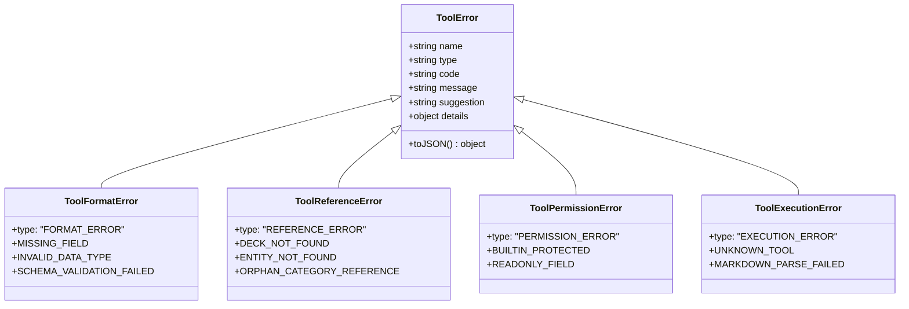

# 31. 页面 Agent 工具方法调用异常反馈与自主修复闭环规约 (Agent Tool Calling Exception Feedback & Self-Healing Spec)

> **对应架构**：Enterprise Frontend Architecture Core 2.1  
> **设计规范参考**：`12_DESIGN_SYSTEM_AND_UI_OPTIMIZATION_SPEC.md`、`13_AI_AGENT_ARCHITECTURE_AND_TOOL_CALLING_SPEC.md`、`30_LONG_CONVERSATION_PERFORMANCE_POSTMORTEM_AND_GATES.md`  
> **状态**：APPROVED & IMPLEMENTED  
> **版本**：v2.4-Agent-SelfHealing  

---

## 一、 建设背景与问题诊断 (Background & Root Cause Analysis)

在现有的 AI Agent 智囊体系（`features/ai-agent/`）中，大模型通过 Function Calling / Tool Calling 机制自主调用前端本地知识库工具（如 `tool_list_decks`、`tool_get_deck`、`tool_create_deck`、`tool_delete_deck` 等）。

然而，在生产实践与深度交互中暴露出严重的**异常处理断层**：

### 1. 痛点一：方法调用失败直接粗暴熔断终止，破坏 Agentic 对话流
在 `features/ai-agent/agent-loop.js` 的原实现中：
```javascript
// 原始有缺陷代码
async executeAndFeedBack(assistantMsgId, toolCall) {
  try {
    const execResult = await this.executor.execute(toolCall.name, toolCall.arguments);
    // ... 回传 role: 'tool' 消息
  } catch (err) {
    // 💥 缺陷点：一旦工具执行抛出任何异常，直接终结整个循环！
    this.finishLoop(`\n\n❌ 工具执行失败: ${err.message}`);
  }
}
```
**严重后果**：
- 当工具方法执行失败（如模型传入不存在的 `deckId`、缺少某个必填参数、或触发内置保护），对话循环被强制终止；
- 大模型**完全收不到**任何 `role: 'tool'` 消息，无法感知失败原因；
- 在 OpenAI/Claude 标准协议中，Assistant 消息生成了 `tool_calls` 但上下文中缺失对应的 `tool` 回传，会导致后续多轮对话上下文格式非法或上下文断裂。

### 2. 痛点二：缺乏结构化的领域异常分类体系 (Untyped Raw Errors)
在 `tool-executor.js` 中，所有错误均通过原生 `throw new Error(...)` 抛出纯字符串，缺少：
- 错误类型标识（`error.type`）：无法区分是参数格式错误还是引用不存在；
- 错误错误码（`error.code`）：无法做精细化程序判断；
- 纠错行动建议（`error.suggestion`）：无法为具备推理能力的大模型提供明确的下一步自愈行动指引。

### 3. 痛点三：前端 UI 状态脱节与用户误导
在 `agent-templates.js` 的 `renderToolCard` 中：
- 仅处理了 `isDone` (success)、`isPending`、`isExecuting`、`isRejected` 四种状态；
- 完全缺失 `isError` (error) 状态分支；
- 工具执行报错后，卡片要么退化为显示错误的“待确认”，要么停留在旧状态，用户无法看清错误本质，无法判断系统为何停滞。

---

## 二、 业内横向调研与可行性论证 (Feasibility Research)

### 1. 国际主流大模型工具调用标准规范对比

| 平台 / 规范 | 官方建议的工具错误处理方式 | 是否支持模型自主读取错误与自愈 | 对本项目的适用性 |
| :--- | :--- | :---: | :--- |
| **OpenAI Function Calling** | 官方文档明确说明：当工具执行出错时，应将错误序列化为 JSON 字符串，作为 `role: 'tool'` 消息回传。大模型会在下一轮根据错误信息重试或解释。 | ✅ 支持 | ⭐⭐⭐⭐⭐ 100% 契合。系统现有接口完全遵循 OpenAI `tool_calls` 规范。 |
| **Anthropic Claude 3/3.7 Tool Use** | `tool_result` 块内包含 `is_error: true` 与 `content: "..."` 字段，模型会针对性进行策略回退。 | ✅ 支持 | ⭐⭐⭐⭐⭐ 逻辑结构一致。 |
| **Google Gemini Function Calling** | `functionResponse` 对象支持回传执行状态及详细错误载荷。 | ✅ 支持 | ⭐⭐⭐⭐⭐ 逻辑结构一致。 |
| **ReAct / Reflexion 架构模式** | Agent 核心循环：`Thought -> Action -> Observation (含 Error) -> Reflection -> Adjusted Action`。 | ✅ 支持 | ⭐⭐⭐⭐⭐ 自主智能体标准的自愈机制。 |

### 2. 可行性调研结论
1. **理论完全可行**：现代大语言模型（如 DeepSeek-V3/R1、Qwen 2.5、GPT-4o、Claude 3.7 等）均具备强大的**根据工具执行报错进行自我反思与参数重构（Self-Correction & Reflection）**的能力；
2. **工程零依赖落地**：该机制完全运行在前端纯客户端状态机内，**不需要引入任何外部 npm 包**，符合零依赖独立单文件（Zero-Dep Standalone）工程哲学；
3. **安全防死循环可控**：通过引入“最大自主步数（`maxSteps = 5`）+ 连续同类错误预算控制（`consecutiveErrorCounts < 2`）”，能够彻底杜绝 Agent 陷入无限重试死循环。

---

## 三、 结构化异常分类学与数据协议 (Error Taxonomy & Schema)

我们建立清晰分层的四大领域异常类，全部继承自标准 `ToolError`：



### 1. 异常类型详细定义

#### A. 格式异常 (`FORMAT_ERROR`)
- **适用场景**：
  - 缺少必填参数（如 `tool_create_deck` 缺少 `title`、`categories` 或 `entities`）；
  - 数据类型违背 Schema（如 `categories` 传入了对象而非数组，`layer` 传入了无效等级）；
  - 考点业务完整性校验失败（如某 entity 缺少标准答案 `answer` 或题干 `prompt`）。
- **给 Agent 的自愈引导**：明确指出缺失的字段名及预期的 JSON Schema，Agent 读取后可立即补齐参数并重新调用。

#### B. 参考/引用异常 (`REFERENCE_ERROR`)
- **适用场景**：
  - 目标题库 ID 不存在（如模型臆造了一个 `deck_math`，但在当前系统 `getAllDecks()` 中并未检索到）；
  - 目标考点 ID 不存在（如修改 `v_unknown`，但在目标题库实体列表中不存在）；
  - 孤岛分类引用（Entity 中声明的 `categoryId` 在题库 `categories` 中未声明）。
- **给 Agent 的自愈引导**：
  - 若题库不存在：提示 Agent 先行调用 `tool_list_decks()` 检索全部现有可用题库 ID；
  - 若考点不存在：提示 Agent 先行调用 `tool_get_deck(deckId)` 查看题库内所有实体的确切 ID 列表。

#### C. 权限/保护异常 (`PERMISSION_ERROR`)
- **适用场景**：
  - 试图调用 `tool_delete_deck` 删除内置预设题库（`deck_verbs`、`deck_http`、`deck_python`）；
  - 试图修改受系统核心架构保护的元数据。
- **给 Agent 的自愈引导**：
  - 告知内置题库受只读保护，禁止删除；
  - 指引 Agent 不要重试删除，而是转为在最终回复中向用户委婉解释系统规则，并建议使用 `tool_create_deck` 新建独立副本。

#### D. 运行时执行异常 (`EXECUTION_ERROR`)
- **适用场景**：
  - 调用了不存在的工具名称（`UNKNOWN_TOOL`）；
  - Markdown AST 文本解析严重语法错误（`MARKDOWN_PARSE_FAILED`）。

### 2. 回传给模型的工具错误 JSON 载荷标准 (Wire Format)
当工具执行异常时，统一生成以下标准格式对象并回传至 `role: 'tool'` 的 `content` 字段：

```json
{
  "success": false,
  "error": {
    "type": "REFERENCE_ERROR",
    "code": "DECK_NOT_FOUND",
    "message": "未找到 ID 为 \"deck_kubernetes\" 的题库",
    "suggestion": "请先调用 tool_list_decks 查询当前系统内所有可用题库清单，核对准确的 deckId 后再重试。",
    "details": {
      "requestedDeckId": "deck_kubernetes"
    }
  }
}
```

---

## 四、 自主修复状态机与防死循环策略 (Self-Healing Loop & Circuit Breaker)

```mermaid
sequenceDiagram
    autonumber
    actor User as 用户
    participant Loop as Agent 循环状态机 (AgentLoopEngine)
    participant Exec as 工具执行器 (ToolExecutor)
    participant LLM as 大语言模型 (API / 仿真)

    User->>Loop: "帮我修改 Docker 题库里的 run 考点解析"
    Loop->>LLM: Step 1 发送提示词
    LLM-->>Loop: tool_call: tool_update_entity(deckId: 'deck_docker', entityId: 'e_run_999')
    Loop->>Exec: execute('tool_update_entity', args)
    Exec-->>Loop: 抛出 ToolReferenceError('考点 e_run_999 不存在')
    Note over Loop: 异常拦截与结构化封装 (toToolErrorPayload)
    Loop->>Loop: 记录工具卡片状态 status = 'error'<br>更新连续错误计数 consecutiveErrorCounts
    Loop->>LLM: Step 2 回传 role: 'tool' 消息 (含 REFERENCE_ERROR & 纠错 suggestion)
    Note over LLM: 模型自反思 (Reflection):<br>"目标 ID 不存在，我需要先查阅题库实体列表"
    LLM-->>Loop: tool_call: tool_get_deck(deckId: 'deck_docker')
    Loop->>Exec: execute('tool_get_deck', args)
    Exec-->>Loop: 返回题库完整考点列表 (发现实际 ID 为 'e_run')
    Loop->>LLM: Step 3 回传 role: 'tool' 题库数据
    LLM-->>Loop: tool_call: tool_update_entity(deckId: 'deck_docker', entityId: 'e_run', updates: {...})
    Loop->>Exec: execute('tool_update_entity', args)
    Exec-->>Loop: 执行成功！
    Loop->>LLM: Step 4 回传 role: 'tool' 成功结果
    LLM-->>Loop: 终态文本总结："已成功定位并为您更新考点解析！"
    Loop->>User: 呈现闭环结果与已自愈成功的各步卡片
```

### 1. 连续错误预算控制 (Consecutive Error Budget)
为了防止大模型在无法纠正的死胡同中无限消耗步数，状态机维护 `consecutiveErrorCounts`：
- **定义**：针对 `toolName:errorCode` 维度的连续失败计数器；
- **熔断阈值**：如果同一个工具因相同的错误代码连续失败 $\ge 2$ 次，判定为自愈阻断，立即中断循环并向用户明确报告：
  `"⚠️ 检测到工具 tool_xxx 连续异常 (xxx)，自愈熔断生效已暂停，请核对参数或手工配置。"`；
- **重置机制**：任一工具调用成功，或更换了工具/错误代码，连续计数器自动清零。

### 2. 状态卡片 UI 规范 (UI/UX Feedback)
在 `agent-templates.js` 中新增 `status === 'error'` 渲染分支：
- **徽章**：`<span class="text-[10px] px-2 py-0.5 rounded-full font-mono bg-rose-950 text-rose-300 border border-rose-800">❌ 异常 (已转交 Agent 自愈)</span>`
- **卡片提示区域**：
  - 红色警示背景区块，展示 `[错误分类]` 与人类可读的失败信息；
  - 醒目高亮展示 `💡 纠错建议 (Suggestion)`，让用户也能一目了然看清当前 Agent 正在尝试如何解决；
- **默认展开性**：发生错误的工具卡片默认保持 `<details open>` 展开，确保关键上下文透明可见。

---

## 五、 工程落地与代码对照表 (Implementation Blueprint)

| 模块路径 | 职责与变更 | 门禁规范符合度 |
| :--- | :--- | :--- |
| `features/ai-agent/tool-errors.js` *(新增)* | 定义结构化异常类、错误代码常量与统一打包工厂函数 `toToolErrorPayload` | 严格控制在 90 行以内，符合 `<=300` 门禁 |
| `features/ai-agent/tool-executor.js` | 参数入参契约校验，精准抛出 `ToolFormatError`、`ToolReferenceError`、`ToolPermissionError` | 控制在 240 行以内，符合 `<=300` 门禁 |
| `features/ai-agent/agent-loop.js` | 捕获工具异常并将其转换为 `role: 'tool'` 消息推进下一步自愈循环，实现连续同类错误熔断 | 控制在 285 行以内，符合 `<=300` 门禁 |
| `features/ai-agent/agent-templates.js` | 增加 `tc.status === 'error'` 卡片渲染分支，展示分类、原因与自愈建议 | 控制在 295 行以内，符合 `<=300` 门禁 |
| `features/ai-agent/client.js` | 仿真引擎增加异常自愈推演分支，支持离线模式完整验证自愈全流程 | 符合 Core 2.1 仿真测试标准 |
| `features/ai-agent/index.js` | 导出 `ToolError` 相关工具类 | 统一门面导出 |
| `scripts/bundler.mjs` | 将 `tool-errors.js` 纳入单文件拓扑打包序列 | 保证 `index.html` 独立可用 |
| `tests/unit/agent-loop.test.mjs` | 编写异常反馈与 Agent 自愈闭环单元测试用例 | 自动化回归验证 |

---

## 六、 验收结果与验证基准 (Verification & Gates)

1. **单元测试回归**：运行 `npm test`，所有架构与领域门禁 100% 通过（PASS）；
2. **场景自动化验证**：
   - 验证格式异常被拦截为标准 JSON 并推进至下一步；
   - 验证引用异常被模型读取后触发 `tool_list_decks` 检索自愈；
   - 验证内置题库保护异常阻断破坏性操作并生成用户友好解释；
   - 验证连续异常 $\ge 2$ 熔断保护正常生效；
3. **独立预览工作台**：提供 `docs/31_agent_tool_exception_preview.html` 供直观交互演示。
