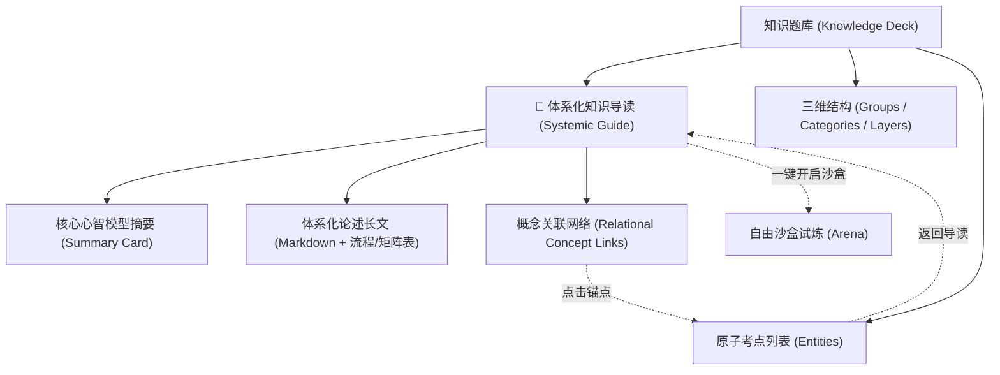

# 32. 题库体系化知识导读与关系学习引擎规约 (Deck Systemic Knowledge Guide & Relational Learning Spec)

> **对应架构**：Enterprise Frontend Architecture Core 2.1  
> **设计规范参考**：`03_DATA_SCHEMA_AND_KNOWLEDGE_BASE.md`、`08_GROUP_CATEGORY_LAYER_HIERARCHY_SPEC.md`、`12_DESIGN_SYSTEM_AND_UI_OPTIMIZATION_SPEC.md`、`31_AGENT_TOOL_CALL_EXCEPTION_FEEDBACK_AND_SELF_HEALING_SPEC.md`  
> **状态**：APPROVED & IMPLEMENTED  
> **版本**：v2.5-SystemicGuide  

---

## 一、 建设背景与认知痛点 (Background & Cognitive Problem Statement)

在 Knowledge Master 记忆引擎既有设计中，知识库被原子化切分为**卡片考点（Entities）**，并依托自由沙盒（Arena）与聚焦精读（Study Hub）实现了高效的**检索练习（Retrieval Practice）与遗忘曲线复习（SM-2）**。

然而，在深层知识掌握与跨领域认知建构中，单纯的点状考点暴露出显著的**认知碎片化局限**：

### 1. 痛点一：点状考点无法建立全局图式（Schema Deficit）
- **现象**：用户在刷《HTTP 协议》时，能够机械记住 401 是未认证、403 是禁止访问、304 是协商缓存，但缺乏对“HTTP 请求-响应报文生命周期”、“安全鉴权分层”与“浏览器缓存协商决策树”的整体认知；
- **后果**：学习者“只见树木、不见森林”，无法形成高位心智模型，面对跨概念综合题或实际业务排障时无法举一反三。

### 2. 痛点二：特例与规律割裂，无法进行关系学习（Relational Learning Gap）
- **现象**：在《动词变位》中，用户死记硬背 `picnic → picnicked`、`panic → panicking` 为独立特例，容易因记忆负荷过载而混淆；
- **认知规律**：英语中借自希腊语/古法语的词汇，为避免字母 c 在 e/i 前软化发 /s/ 音，必须插入 k 强制锁定 /k/ 音。若缺乏体系化论述，原本一通百通的“底层语音规律”沦为了死板的“零散特例”。

### 3. 认知科学指导原则
依据 **奥苏贝尔（David Ausubel）的有意义言语学习理论** 与 **先行组织者（Advance Organizer）模型**：
> “在学习细节性、低阶知识点前，若先呈现包容性更高、具系统性的上位概念框架，学习者的长时记忆保留率可提升 40%~70%，并能有效降低工作记忆的认知负荷（Cognitive Load）。”

---

## 二、 架构方案与技术设计 (Architecture & Technical Design)



### 1. 数据模型协议扩展 (Data Schema Expansion)

在保持 Core 2.1 零破坏向下兼容的前提下，在 `Deck` 数据契约中扩充**可选字段（Optional）** `guide`：

```typescript
interface KnowledgeDeck {
  id: string;
  title: string;
  icon: string;
  description: string;
  categories: Category[];
  layers: Layer[];
  entities: Entity[];

  // 🌟 SPEC 32: 题库体系化导读与认知框架 (可选扩展)
  guide?: {
    summary: string;              // 1~2 句话提炼的核心心智模型 (Cognitive Hook)
    markdown: string;             // 包含背景渊源、规律总览、易混淆全景矩阵的富文本
    relations?: Array<{           // 考点间的关系映射 (对比/因果/层级)
      source: string;             // 源实体 ID (如 "http_401")
      target: string;             // 目标实体 ID (如 "http_403")
      type: 'contrast' | 'prerequisite' | 'family';
      label: string;              // 关系说明 (如 "401身份认证 vs 403权限鉴权")
    }>;
  };
}
```

### 2. 学习大厅视图模式升级 (Study Hub 3-Mode Layout)

在 `features/study-hub/tree-renderer.js` 中，将既有的双模式拓展为**三维一体的立体研读矩阵**：

| 视图模式 | 标识 (`mode`) | 定位与核心价值 | 适用学习阶段 |
| :--- | :--- | :--- | :--- |
| **🎯 聚焦精读模式** | `'focus'` | 单考点 3 阶段视线聚焦（释义遮罩/同胞辨析/陷阱呼出） | 微观深读、逐词击破 |
| **📖 体系知识导读** ⭐ | `'guide'` | 题库全局框架、规律原理总论、全景横向对比矩阵 | **宏观建构、课前预习、查漏补缺** |
| **🌲 全景大纲模式** | `'overview'` | 分类/分层多卡片矩阵平铺，全局掌握度透视 | 宏观统计、词条检索 |

### 3. Markdown AST 双向序列化契约 (`shared/markdown-ast.js`)

为满足 `FE-KNOW-003` 架构门禁（Markdown AST 双向序列化 100% 幂等），在导出 Markdown 时采用专用分界标记：

```markdown
# 英语动词形态与变异法则
> 涵盖 -ic 加 k 黄金特例、-ing/-ed 规则变化...

<!-- GUIDE_START -->
## 📖 题库体系化导读与认知框架
这里是完整的体系化 Markdown 说明长文...
<!-- GUIDE_END -->

---

## 规则变形与读音规律
### ⭐ -ic 结尾加 k 必考特例
... 考点条目 ...
```

- **解析逻辑**：若检测到 `<!-- GUIDE_START -->` 与 `<!-- GUIDE_END -->`，将其中的文本精准提取为 `deck.guide.markdown`，在提取实体与分类时跳过该区块，杜绝误解析；
- **序列化逻辑**：若 `deck.guide?.markdown` 存在，在题库描述下方无缝输出导读区块。

---

## 三、 三大内置题库体系化导读内容落地 (Built-in Decks Content)

系统为 3 大官方内置预设题库编写深度权威导读：

### 1. 《英语动词形态与变异法则》(`deck_verbs`)
- **核心心智摘要**：英语动词变位的底层逻辑是由**语音同化与历史借词演变**决定的。掌握 -ic 锁 k 音铁律、闭音节辅元辅双写规律，以及 AAA~ABC 五大不规则阵营，建立网状发音与形态心智模型。
- **体系化长文核心板块**：
  1. *底层语音学渊源*：为什么借自希腊/法语的 `-ic` 动词必须补 k（阻止字母 c 在 e/i 前软化发 /s/ 音）；
  2. *-ing / -ed 四大规则全景映射*（不发音 e、重读闭音节辅元辅、ie 变 y）；
  3. *不规则动词五大矩阵*（AAA 绝对不变族、AAB/ABA 韵律同形族、ABB 核心大军、ABC 强变化大分裂）；
  4. *语法概念辨析*：分词（形容词性） vs 动名词（名词性）的本质语法功能。

### 2. 《HTTP 状态码与网络协议》(`deck_http`)
- **核心心智摘要**：HTTP 状态码是客户端与服务端在分布式无状态协议下的契约语言。从 1xx 到 5xx 构成了完整的请求生命周期诊断体系，重点攻坚 401（未认证）与 403（未授权）、502（坏网关）与 504（网关超时）等易混淆关系。
- **体系化长文核心板块**：
  1. *报文请求-响应生命周期全景*；
  2. *五大状态码族分类学哲学*（1xx 协商中 / 2xx 成功交付 / 3xx 资源寻址 / 4xx 客户端过失 / 5xx 服务端故障）；
  3. *核心混淆双璧深度对照表*（401 vs 403 鉴权双璧；301 vs 302 搜索引擎权重新旧论；502 vs 504 链路节点异常定位）；
  4. *现代前端协商缓存决策模型*（304 + ETag / Last-Modified 决策链）。

### 3. 《Python 核心数据类型与内存模型》(`deck_python`)
- **核心心智摘要**：Python 的核心机制建立在“一切皆对象”、PyObject 内存模型以及引用传递基础之上。透彻理解可变对象与不可变对象在堆内存中的本质差异，掌握默认参数跨调用共享、深浅拷贝和 is vs == 判据。
- **体系化长文核心板块**：
  1. *PyObject 底层结构图示*（引用计数 ob_refcnt + 类型指针 ob_type）；
  2. *可变 (Mutable) vs 不可变 (Immutable) 内存表现与哈希性 (Hashable)*；
  3. *语言级高频隐形陷阱总览*（默认参数在函数定义时绑定的陷阱；浅拷贝外壳隔离但内层共享；is 比较内存地址 vs == 比较对象值）。

---

## 四、 AI Agent 智囊工具链扩展 (AI Agent Integration)

为实现“自然语言对话即生成导读”的全自动闭环，扩展 2 项原子工具：

### 1. `tool_get_deck_guide`
- **功能**：查询指定题库的体系化知识导读与心智模型。
- **参数**：`{ deckId: string }`。

### 2. `tool_update_deck_guide`
- **功能**：为自定义题库自动生成或更新体系化导读文本。
- **参数**：
  ```json
  {
    "type": "object",
    "properties": {
      "deckId": { "type": "string" },
      "summary": { "type": "string", "description": "1~2 句话核心认知心智模型" },
      "markdown": { "type": "string", "description": "完整的系统化知识导读 Markdown 文本" }
    },
    "required": ["deckId", "markdown"]
  }
  ```

---

## 五、 质量门禁与工程文件约束 (Quality Gates & Compliance)

| 门禁代码 | 规约内容 | 本次落地策略 |
| :--- | :--- | :--- |
| **FE-QUALITY-001** | 单文件代码行数严格 `<= 300` 行 | 抽离专用 [`features/study-hub/guide-renderer.js`](file:///d:/D/Notes/资料/知识巩固/Game/features/study-hub/guide-renderer.js)（约 120 行），保持 `tree-renderer.js` 严格在 240 行以内。 |
| **FE-KNOW-003** | Markdown AST 双向序列化 100% 幂等 | 精确隔离 `<!-- GUIDE_START -->` 区块，通过单元测试回归保障 100% 幂等。 |
| **FE-RES-001** | 单文件独立分发产物 `index.html` 完备 | 更新 `scripts/bundler.mjs`，打包后大小稳健控制在 520KB 左右。 |
| **FE-TEST-001** | 自动化单元测试全绿 | 新增 `tests/unit/guide-renderer.test.mjs` 验证导读渲染、AST 导出与工具交互。 |
