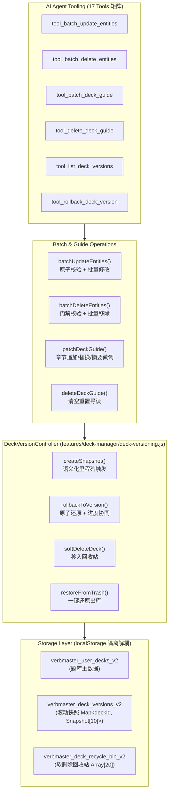

# SPEC 33: 题库版本管理（快照/回滚/回收站）、Agent 批量操作与体系化导学 CRUD 规范

> **状态**: PROPOSED & ACTIVE  
> **版本**: 1.0.0 (Core 2.1)  
> **负责人**: Architecture Team  
> **关联规范**: [SPEC 13: AI Agent 架构与工具链规范](file:///d:/D/Notes/资料/知识巩固/Game/docs/13_AI_AGENT_ARCHITECTURE_AND_TOOL_CALLING_SPEC.md), [SPEC 31: Agent 工具异常回馈与自愈规范](file:///d:/D/Notes/资料/知识巩固/Game/docs/31_AGENT_TOOL_CALL_EXCEPTION_FEEDBACK_AND_SELF_HEALING_SPEC.md), [SPEC 32: 体系化知识导学规范](file:///d:/D/Notes/资料/知识巩固/Game/docs/32_DECK_SYSTEMIC_KNOWLEDGE_GUIDE_AND_RELATIONAL_LEARNING_SPEC.md)

---

## 1. 架构背景与业务痛点

在基于认知心理学（Ausubel 先行组织者理论）与 LLM 智能体自主协作的学习系统中，题库的规模与内容复杂度不断提升。系统面临三大关键演进需求：

1. **体系化导学（Deck Guide）的精细化治理缺失**：
   - 现存方案仅支持全量覆写（`tool_update_deck_guide`），无法执行局部增量追加（`patch`）或清空重置（`delete`），导致长篇幅导学大纲在 AI 交互中消耗大量无谓 Token 并面临截断风险。
2. **AI 工具单题串行修改的性能与一致性瓶颈**：
   - 当前考点修改与删除仅支持单题粒度（`tool_update_entity`、`tool_delete_entity`）。批量重构 15 道题需要触发 15 轮 Agent Loop，造成严重延迟、极易触碰 `MAX_STEPS` 阈值，且中途异常会导致题库处于半更新的不一致状态。
3. **缺乏版本控制导致的“毁灭性不可逆风险”**：
   - 本地 `localStorage` 缺乏历史快照、撤销与回收站机制。AI 幻觉过度删改或用户误操作删除题库时，无法回滚；
   - 纯前端必须在 **5MB 本地存储上限** 的严苛物理约束下，设计出轻量、自淘汰（Rolling FIFO）且防撑爆的快照管理机制。

---

## 2. 核心架构设计



---

## 3. 数据结构规范

### 3.1 版本快照契约（DeckVersionSnapshot）
```typescript
interface DeckVersionSnapshot {
  versionId: string;       // e.g. "ver_1729123456789_a1b2"
  deckId: string;          // 目标题库 ID
  versionName: string;     // 快照标题, e.g. "[AI] 批量修改前快照"
  timestamp: number;       // 时间戳
  trigger: 'user_manual' | 'ai_batch' | 'pre_delete' | 'guide_update' | 'pre_rollback';
  author: 'user' | 'agent';
  changeSummary: string;   // 变更摘要, e.g. "修改 5 个考点解析，调整 2 个层级"
  stats: {
    entitiesCount: number;
    categoriesCount: number;
    hasGuide: boolean;
  };
  snapshotDeck: Deck;      // 完整题库深拷贝数据
}
```

### 3.2 存储容量治理规则（Storage Budget Guard）
- **题库级滚动上限**：每个题库最多保留 **10 个历史版本**（FIFO 淘汰策略）；
- **回收站容量上限**：回收站最多暂存 **20 个被删除题库**；
- **存储键剥离**：版本库与回收站独立占用 `STORAGE_KEYS.DECK_VERSIONS` 与 `STORAGE_KEYS.RECYCLE_BIN`，主列表渲染无需反序列化历史巨树，彻底消除卡顿。

---

## 4. Agent 工具扩展矩阵（17 Tools）

| 工具名称 | 功能描述 | 关键参数 | 容错/自愈机制 |
| :--- | :--- | :--- | :--- |
| `tool_batch_update_entities` | 原子批量更新考点词条 | `deckId`, `updates: Array<{ id, ... }>`, `mode` | `atomic_strict` 模式下一处报错全量回滚，自动预建快照 |
| `tool_batch_delete_entities` | 批量移除考点词条 | `deckId`, `entityIds: string[]` | 触发 `FE-KNOW-001` 干扰项不足门禁检查并在返回值中预警 |
| `tool_patch_deck_guide` | 导学大纲增量局部修补 | `deckId`, `operation`, `heading`, `content`, `summary` | 支持章节追加 (`append_section`) 与局部覆盖 (`replace_section`) |
| `tool_delete_deck_guide` | 清空重置题库导学页 | `deckId` | 受保护的预设题库拦截，仅限自定义题库 |
| `tool_list_deck_versions` | 查询题库历史版本快照 | `deckId` | 返回轻量版版本摘要数组（不携带庞大的 snapshotDeck） |
| `tool_rollback_deck_version` | 一键回滚题库至历史版本 | `deckId`, `versionId` | 回滚前自动创建当前状态快照，安全清理孤立 CardState 进度 |
| `tool_create_deck_snapshot` | 关键节点手动打桩快照 | `deckId`, `note` | 校验题库存在性并落地版本池 |

---

## 5. UI 交互体验规范

1. **题库管理面板版本抽屉**：
   - 题库卡片新增“版本”按钮，一键调出历史快照抽屉；
   - 支持直观查看版本时间、修改人（用户/AI）、考点总数变化及变更摘要；
   - 提供“回滚到此版本”与“删除此快照”操作。
2. **安全软删除（回收站）体验**：
   - 用户或 AI 删除题库时，系统不再直接执行不可逆硬删除，而是执行 `softDeleteDeck` 暂存至回收站；
   - 题库管理面板头部提供“回收站”切换入口，支持“一键还原”与“彻底粉碎”。

---

## 6. 架构质量门禁（Quality Gates）

1. **FE-VER-001: 滚动版本限额门禁**
   - 单一题库历史版本数严禁超过 10 个；超过时最旧版本必须自动剔除，保障存储安全。
2. **FE-VER-002: 软删除幂等与可恢复性门禁**
   - 移入回收站的题库在还原后，其分类、分层、考点与导学必须 100% 完好无损。
3. **FE-VER-003: SM-2 进度状态协同一致性门禁**
   - 题库回滚导致考点实体减少时，`deckStates` 中孤立卡片记录必须被安全回收，防止内存泄漏与空指针异常。
4. **FE-BATCH-001: 批量操作原子性门禁**
   - `atomic_strict` 模式下，若批量输入中存在不存在的 `entityId` 或非法 `categoryId`，题库数据严禁发生任何部分突变。
5. **FE-QUALITY-001: 单文件行数治理 (<= 300 行)**
   - 拆分为独立的 `deck-versioning.js`，保障 `deck-crud.js`、`tool-executor.js` 全部严格处于 300 行阈值内。
