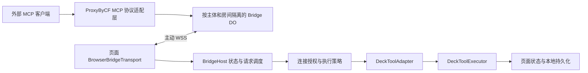

# MCP 桥接提供端可行性调研与设计

调研日期：2026-10-31。修订：按用户明确范围，覆盖全部 Agent 工具直接调用。

## 实施结果与后续决策（优先于下文原设计建议）

用户进一步明确采用现有桥接地址、房间和 Token；本轮只实现当前项目，不修改或部署 ProxyByCF。浏览器原生 WebSocket 使用现有 `aes-256-gcm` 子协议与 Token 鉴权，兼容网关 SHA-256→AES-GCM 信封，无长期 Token URL、无新增票据端点。全部 19 工具已由真实外部 SDK 经本地真实 Worker 调用，并在真实浏览器页面验证；使用与验证说明见 [35_MCP_BRIDGE_USAGE_AND_VALIDATION.md](./35_MCP_BRIDGE_USAGE_AND_VALIDATION.md)。

原设计中的网关短期票据、注册 ACK、跨客户端 ID/角色/租户隔离仍是建议改进，不是本轮已实现能力。现有网关无 ACK，UI 显示 REGISTERED 待调用验证；仅面向持有同一 Token 的可信客户端与独立房间，不声称多租户安全隔离。存储采用同步暂存写入与失败时尽力恢复，没有跨崩溃事务/恢复日志或 exactly-once 保证。单次业务同步执行不可交错，不引入异步共享写队列；排队截止预算从浏览器收到消息起算，网关不传绝对 deadline，因此不保证休眠后才收到的旧消息一定能判定过期。

默认全部工具直接执行，无逐次批准；桥接不是常驻后台服务。大写入成功后返回小型成功回执，不将已提交操作误报为结果过大失败。下面保留架构调研与长期建议以说明取舍。

2026-11-01 公网补验：使用现有 proxy.example.com 服务，外部官方 SDK 经真实公网 SSE/POST 调用本机浏览器页面全部 19 个工具成功；刷新持久化与 Host 离线反馈通过。详见 [公网验证记录](./36_MCP_BRIDGE_PUBLIC_VALIDATION.md)，不代表多租户隔离或性能压测通过。

## 1. 结论与范围

**可行，新增浏览器 Host，将全部 19 个现有 Agent 工具通过 ProxyByCF 对外提供，包含查询、创建、修改、删除、导入、批处理、快照和回滚。** 用户开启桥接并连接授权客户端后，合法调用直接执行，不依赖本地 AI 对话、不逐次弹窗批准。工具层原有业务保护仍有效；全部支持不意味着每个参数或内置题库修改都会成功。参考 Node 示例不能直接放进浏览器，网关隔离、鉴权和写入可靠性需作为全功能交付的一部分。

用户已明确范围：**仅外部 MCP 客户端操作当前页面中的题库，全部 Agent 工具直接支持调用**。不建设本项目调用外部 MCP 的 consumer，不再采用先只读、后写入的产品范围。分期仅用于内部验证，交付验收要求 19/19 工具可发现、可调用。

目标：保留纯前端、可独立打包运行；复用工具定义、业务执行与健康校验；不引入常驻本地进程。非目标：本轮实现代码、把浏览器变成后台服务、发布公网多租户网关、暴露任意 JavaScript 执行或文件系统。

## 2. 本地证据与可复用资产

以下是本轮源码读取确认的事实，路径相对各自仓库根目录。当前工作区存在用户未提交修改，调研以当前文件快照为准，未改动这些文件。

| 资产 | 已有能力 | 复用方式与边界 |
| --- | --- | --- |
| `features/ai-agent/tool-definitions.js` | `DECK_TOOL_DEFINITIONS`，实际 19 项，文件头的 10 CRUD Tools 已过时 | 映射 function.name/description/parameters 为 MCP name/description/inputSchema；现有全部 19 项注册，拒绝不在注册表中的任意方法 |
| `features/ai-agent/tool-executor.js` | `DeckToolExecutor.execute(name,args)` | 直接复用业务入口及题库健康校验；依赖 app 状态、保存和重绘，不能直接移到 Worker/Node 读取同一份浏览器数据 |
| `features/ai-agent/tool-errors.js` | 分类错误与模型反馈 | 复用业务错误信息；桥接另区分协议错误、权限错误和工具执行失败 |
| `features/ai-agent/agent-loop.js` | 工具审批、执行反馈、步数限制与错误熔断 | 可借鉴交互，不能把外部请求塞进正在运行的对话；当前 abort 只调用 AI client.abort，不能当作工具取消能力 |
| `features/ai-agent/session-store.js` | AI 配置、会话、autoApprove | 不复用其全局自动批准为远程授权；MCP 凭据独立管理，默认仅在内存保存 |
| `features/deck-manager/deck-versioning.js` | 快照、回滚、回收站等业务入口 | 复用恢复手段；单条增删改等并非全部经过版本入口，不保证所有写操作已有事务 |
| `platform/storage/local-storage-adapter.js` | 题库与学习数据 localStorage 持久化 | 保持当前页面为状态源；无后端共享存储、并发事务或远程审计保障 |
| `scripts/dev-server.mjs` | 静态服务与 `/api/proxy` HTTP 转发 | 不是 MCP 服务或 WSS Host；依赖它会破坏双击独立运行目标 |
| `package.json`、`scripts/build-vendor.mjs` | esbuild、fetch-event-source、partial-json 与浏览器 vendor 打包 | 有可复用打包通道；后两者不是 MCP 协议栈。直接依赖未见 MCP SDK、ws、XState、Ajv |
| `tests/unit/agent-loop.test.mjs` 等 | Agent 工具反馈与异常场景测试 | 可沿用假执行器测试方法，不能据此宣称桥接已通过互操作验证 |

参考仓库：`E:/WorkProject/Node/_CFWorkerProject/ProxyByCF`。

| 参考文件 | 本轮确认 |
| --- | --- |
| `examples/mcp-bridge-client/package.json` | Node >=24，SDK 1.32.2、ws 8.21.0，均为该示例固定版本，不能当作最新版本推荐 |
| `examples/mcp-bridge-client/lib/bridge-transport.mjs` | EventEmitter + ws Host；主动 WSS、tools/register、工具白名单、世代计数、随机指数退避、心跳、并发 8、队列 32、超时 25s、单帧 1MiB、发送缓冲保护 |
| `examples/mcp-bridge-client/lib/stdio-adapter.mjs` | 官方 SDK stdio client、工具分页、变更通知、AbortSignal；浏览器无子进程，不能复用 stdio 层 |
| `examples/mcp-bridge-client/README.md` | 外部接入为旧 HTTP+SSE `/mcp/sse?room=...`；READY 仅表示注册帧发出，无 ACK；文档承认 M2 隔离缺口 |
| `apps/worker/src/features/bridge/gateway.ts` | 按 room 路由 Durable Object，session 路由提示不能代替授权 |
| `apps/worker/src/features/bridge/application.ts` | 支持 token/key 查询参数、角色选择与 tools 注册；pendingRpc 使用 RPC ID 作键；已关联 SSE session 的 POST 存在信任路径，需专项审计 |

示例 README 记录过公网联调成功，这是已有文档的陈述，本轮没有重跑。DO 解决跨请求汇合，并不等于租户隔离、持久队列或请求恰好执行一次。未读取真实密钥或生产数据。

## 3. 业界方案与库对比

以下为官方文档/项目仓库核对结果；是代表性方案比较，不按星数或未经验证的市场份额定义“主流”。

| 路线 | 适用性 | 本项目判断 |
| --- | --- | --- |
| 官方 MCP SDK + Streamable HTTP [S1] | 标准远程服务接入，协议处理交给 SDK | 网关升级目标；必须明确支持的协议版本，不把旧 SSE 名称换一下就称为升级 |
| Cloudflare Agents MCP [S2] | Worker 上部署 MCP Server/Client、结合边缘基础设施 | 可借鉴网关实现；不负责读取用户页面 localStorage，不要求当前纯前端整体迁入 Agents |
| ProxyByCF 反向 WSS + 旧 SSE | 内网或页面主动出站，外部走兼容入口 | 与已有设施最接近，推荐受控试点；自定义 Host 通道需自己补可靠性与权限 |
| mcp-remote [S3] | 为只支持本地 stdio 的客户端连接远程服务 | 外部用户的兼容选项，不是浏览器 Host，也不解决 room 权限 |
| mcp-proxy [S4] | stdio 与 HTTP 类传输转换 | 有后端或本地守护进程时可借鉴；增加 Python/进程部署，首期不采用 |
| 本地 Node companion + stdio | 复用参考示例较多，可常驻 | 浏览器数据需额外安全通道和同步协议；适合未来后台运行需求，不满足当前零后台默认方向 |

库选择建议：

- 浏览器 Host 首期使用原生 WebSocket + 小型有限状态机。桥接私有协议只实现已明确支持的 `tools/list`、`tools/call`，避免声称完整 MCP Server。
- 官方 SDK 优先用于标准客户端互操作测试、网关标准协议实现；是否打包到浏览器，应先验证所选版本自定义 transport 与包体预算。不要引入 Node `ws` 或 node:events 的 polyfill 来照搬示例。
- XState [S5] 适合多连接、并行子状态、复杂恢复；初期显式 transition 表足够，达到复杂度阈值后再引入。
- Ajv [S6] 可校验现有 JSON Schema；优先评估构建期生成独立 validator，避免运行时动态编译与严格 CSP 冲突。手写必填检查不能替代整个 schema 校验。
- fetch-event-source 是当前 AI 响应流基础设施，不是本次浏览器 WSS Host 的依赖；partial-json 不用于解析完整的 MCP JSON-RPC 帧。

本轮仅确认库能力与适用性，没有安装、锁版、测包体、许可证兼容审计或漏洞扫描；实施时检查锁定版本及其传递依赖。

## 4. 协议版本：必须显式分层

参考网关使用旧 SSE 入口，不能直接给要求 Streamable HTTP 的客户端配置该地址。

2026-07-28 官方规范已改为无握手、无协议 session 的核心，使用每请求元数据，并更新 HTTP 路由字段 [S7]。因此不能将 2025 年 initialize、Mcp-Session-Id、长连接 GET SSE 的模型无条件套到最新版本。建议维护兼容矩阵：

| 通道 | 首期 | 后续 |
| --- | --- | --- |
| 浏览器至 ProxyByCF | 私有 WSS Host 协议，版本化 bridge-v1；首期交付必须具备 ACK、凭据票据与世代过滤 | 按实际扩展增加能力协商 |
| 外部至网关 | 只声明实际测试过的旧 SSE/协议组合 | 单独实现并测试最新 Streamable HTTP；旧版保留隔离适配层 |
| Host 工具能力 | list/call，全部 19 个 Agent 工具直接调用 | 完善写入幂等与恢复；resources、prompts、sampling 不在本次范围 |

实际兼容性以锁版 SDK 和客户端测试为准，不能根据服务 URL 或连接成功推断。

## 5. 推荐架构与设计模式

1. **适配器**：`DeckToolAdapter` 提供 `listTools(context)`、`callTool(name,args,context)`；内部复用原执行器。原成功对象转为 MCP `content: [{type:'text',text: JSON.stringify(result)}]`；业务失败返回合法 CallToolResult 且 `isError:true`；无效 JSON-RPC/method/params 用协议错误。结构化输出只在 schema 与版本支持时开放。
2. **策略模式**：`ExecutionPolicy` 区分读取和写入队列、业务保护与恢复方式；本次配置为已授权连接的全部注册工具直接执行。`RetryPolicy` 仅重试连接，不自动重放工具调用。无需为默认直接执行增加逐次审批状态或大型权限框架。
3. **状态机**：统一管理连接与注册；请求另有状态机，避免连接断开导致写操作被重放。
4. **门面/注册表**：schema 与 handler 以同一个 allowlist 注册，避免“列出一个工具却无法执行”；不复制题库 CRUD。

拟新增目录：`features/mcp-bridge/` 放 Host、策略、请求账本与工具适配器；`platform/network/browser-bridge-transport.js` 放原生 WSS 封装；`tests/unit/mcp-bridge*.test.mjs` 与浏览器行为测试。由 app 初始化入口显式注入执行器，禁止 transport 导入 app 单例。

连接状态：`DISABLED → AUTHENTICATING → CONNECTING → REGISTERING → READY`。临时断线进入 `BACKOFF`，只重连连接；401/403 或票据无效进入 `AUTH_REQUIRED`；同房间替换进入 `DISPLACED`，停止争抢；手动停用经 `STOPPING → DISABLED`。所有异步回调带 generation，旧连接消息丢弃。READY 必须有服务端注册 ACK；旧协议仅展示“已发送注册，待验证”，不冒充可用。

请求状态：`RECEIVED → VALIDATED → QUEUED → EXECUTING → SUCCEEDED/FAILED`；没有逐次审批等待。执行前超时可确定未执行，执行中断线/超时标记 `OUTCOME_UNKNOWN`；写入再区分状态已变更、持久化已确认、响应已发送三个事实。取消只表示尽力停止，不能撤销已完成副作用。停用立即拒绝新请求、清空未执行队列，运行中的同步写入不能强行中断。

浏览器 WebSocket 不暴露握手失败的 HTTP 状态码，不能照搬 Node ws 的 unexpected-response 分支。认证失败应由 HTTPS 票据接口明确返回，或通过已建立连接后的约定关闭码表达；普通 error/1006 只表示原因未知，采用有上限的重试并给出诊断提示。

## 6. 关键缺口及解决顺序

| 问题 | 影响 | 建议 |
| --- | --- | --- |
| 浏览器原生 WebSocket 不能设置 x-pyw-token 握手头 | 示例鉴权方式无法直接复制 | 网关新增 HTTPS 票据交换端点，以 Authorization 校验；返回短时、一次性、绑定主体/room/role/origin 的票据。WS 消费后失效；URL 不放长期 APIKey；票据和日志脱敏 |
| room 不是授权边界、scope 不等于角色 | 其他持钥者抢占 Host、串读写 | DO key 采用主体/租户+room；每次 HTTP/WS 请求校验身份和 room/role；禁止凭 sessionId 单独授权；分离 Host 与 consumer 凭据 |
| 跨客户端复用 RPC ID | pending 响应串线 | 网关生成内部唯一 ID，映射 principal/session/originalId/hostGeneration；回包和断线清理均核验世代 |
| 无注册 ACK、可能旧工具缓存 | UI 假成功或工具过期 | 注册版本、ACK、缓存失效与 Host 离线状态；工具列表版本随注册刷新 |
| 页面关闭、休眠、移动端后台冻结 | 无法承诺持续在线 | UI 明示“保持页面运行”；恢复后重新鉴权注册；Service Worker 不作为常驻 WSS 保证 |
| 多标签页与同源 localStorage | Host 争抢和状态覆盖 | 首期单 Host、单页面写入提示；同源协调可评估 BroadcastChannel/Web Locks，不能代替网关授权 |
| 写工具执行后网络超时 | 自动重试造成重复创建/删除 | 全部写工具支持 operationId、参数哈希、结果缓存和版本前置条件；不自动重放；跨重启恰好一次需要持久事务设施 |
| 现有执行器同步保存/重绘 | 大题库阻塞主线程 | 限流、分页投影、结果上限；先测量再考虑批量提交；不得将带 DOM/app 依赖的执行器直接丢进 Web Worker |

票据端点、ACK、角色约束等是**ProxyByCF 待实现能力**，不是当前已具备设施。若不改网关，浏览器可以技术性地使用现有 query token，但长期密钥 URL 泄漏风险明显，只能作为隔离环境一次性验证，不作为交付路径。

HTTPS 页面优先，WSS 必需；`file://` 可能带 null Origin，首期远程桥接默认不支持此来源，离线题库仍可正常使用。不能为支持双击连接而放开所有 null Origin。Origin 校验是浏览器防护，不代替身份验证。

## 7. 工具暴露与写入治理

### 7.1 全量工具矩阵

动态导入 DECK_TOOL_DEFINITIONS 确认 19 项，并与执行器 case 对照；5 项读取、14 项写入。保留现有工具名称与参数接口，不新增一个绕过类型约束的万能 execute 工具。

| 工具 | 类型 | 必须覆盖的行为 |
| --- | --- | --- |
| tool_list_decks | 读 | 所有可用题库摘要与健康度 |
| tool_get_deck | 读 | 完整题库；名称解析规则保持一致 |
| tool_search_entities | 读 | 现有逻辑最多返回 15 项，不能宣称检索返回全集 |
| tool_get_deck_guide | 读 | 有/无导学的合法结果 |
| tool_list_deck_versions | 读 | 版本列表可能包含完整快照，需测量大小 |
| tool_create_deck | 写 | 新题库、健康校验、稳定唯一 ID |
| tool_import_markdown_deck | 写 | Markdown 解析入库；与创建统一校验和 ID 策略 |
| tool_update_deck_meta | 写 | 自定义题库元信息；保持内置保护 |
| tool_delete_deck | 写 | 优先走已有软删除；关联学习状态一致 |
| tool_add_entities | 写 | 追加前校验、重复实体 ID 与引用检查 |
| tool_update_entity | 写 | 当前支持复制内置题库到自定义再修改；失败不能遗留半完成副本 |
| tool_delete_entity | 写 | 删除后题库健康与相关学习状态一致 |
| tool_update_deck_guide | 写 | 导学替换、内置只读保护 |
| tool_delete_deck_guide | 写 | 清空导学并保留恢复能力 |
| tool_patch_deck_guide | 写 | 三类 operation 与必要参数、章节定位 |
| tool_batch_update_entities | 写 | atomic_strict 与 best_effort 分别返回真实结果 |
| tool_batch_delete_entities | 写 | 删除后的同胞池健康校验 |
| tool_rollback_deck_version | 写 | 回滚前备份、卡片状态清理、持久化 |
| tool_create_deck_snapshot | 写 | 快照落盘；不能因为不改变题面就当作只读 |

### 7.2 直接调用流程与契约

页面启用桥接 → 完成 Host 身份验证 → 注册全部工具 → 外部客户端完成 consumer 鉴权 → tools/call → schema 校验 → 注册表分派 → 排队 → 调用同一个执行器 → 持久化确认 → 返回 MCP 结果。桥接本身不调用 LLM，也不消耗本地 Agent 的五步循环额度。

连接设置提示具备创建、删除、回滚能力，显示连接状态与最近调用；逐次调用不弹批准窗口。本地 Agent autoApprove 配置不影响外部调用。新增未登记工具需通过注册表完整性检查后才能随版本发布，不暴露任意 app 方法。

schema 原样映射作为初始兼容契约，但当前部分 schema 较宽：entities 数组缺少 items、updates 对象缺少字段约束、部分工具 deckId/title 缺少条件必填。Ajv 无法凭空补全业务约束；应在共享工具层补齐校验，再供本地 Agent 和 MCP 共用，不创建两套含义不同的 CRUD。内置题库限制按各工具现有语义执行，不一刀切禁止本来支持的复制编辑。

### 7.3 写入可靠性与并发

- 当前 tool_add_entities、tool_update_entity、tool_delete_entity 直接修改页面对象后保存；未统一经过候选副本健康检查。tool_update_entity 在确认实体存在前可能先创建自定义副本；updates 使用 Object.assign，应补字段白名单与危险键拒绝。
- StorageAdapter 的 saveCustomDecks/saveDeckVersions 等捕获错误后仅 console.warn，上层可能返回成功。交付前需提供可确认失败的存储结果，使“成功”至少表示相关持久化已确认；多 localStorage key 仍非事务。采用候选副本校验→提交→保存确认→发布状态/重绘；跨题库/版本/回收站的提交需恢复日志，或评估 IndexedDB 事务，不能仅在 adapter 外 catch 假装原子性成立。
- 创建与 Markdown 导入使用 deck_+Date.now()，同毫秒调用可能冲突；共享创建入口改用唯一 ID。此为待实施修复，本轮未修改。
- 首版采用页面级 FIFO 写队列（含创建、导入、快照），先保证全局 customDecks 与版本图一致；同一页面本地 AI 和 UI 写入也须接入同一个 mutation coordinator。仅锁远程请求不能避免本地覆盖。跨标签页先阻止重复 Host，并明确其他标签页编辑的冲突；需要自动协同时采用 Web Locks+版本核验，BroadcastChannel 仅负责通知。
- 读取不得观察半提交状态；获取稳定快照后再序列化。后续测量证明必要再拆成每题库写锁，避免过早增加锁顺序复杂度。
- 请求账本键为主体+页面实例+operationId，附工具名与规范化参数哈希；同键同参返回缓存结果，同键异参报冲突。JSON-RPC ID 仅用于关联，不是业务幂等键。普通客户端重试若换 ID 且不带 operationId，无法可靠判定是否同一次意图；不得按“相同参数”永久去重，否则会吞掉用户主动重复创建/追加。
- operationId 可通过约定 _meta 扩展传递，普通调用不强制要求；没有它的调用仍直接执行，但超时后只能报告结果未知、查询题库或版本确认。网关必须保留并安全传递该扩展；这是新增契约，不是现有示例能力。
- 重连只恢复连接和工具目录，绝不重放未确认的写请求。刷新页面后内存账本消失，localStorage 多键提交也不能提供跨崩溃恰好一次保证；需要更强保证再引入事务存储，不承诺虚假的 exactly-once。

外部参数和内容按不可信数据校验、转义，不作为指令或原始 HTML 执行。网关对当前页面数据是中转可信方，WSS 链路加密不等于端到端加密。

## 8. 性能、容量与可观测性

以下为拟议预算，**没有压测结果**：浏览器读取并发 2、共享等待队列 8；页面级写入并发 1；返回体软限 256KiB、硬限不超过参考 Host 的 1MiB 帧约束，网关实际限制还需核对。全量注册 19 工具；list/get 的健康计算、快照返回体和同步存储是主要热点。

全量支持须明确数据规模边界：get_deck 保留完整返回语义，超上限返回 RESULT_TOO_LARGE，不能悄悄截断；若要求大题库也完整读取，则需增加可选分页/资源下载契约并验证客户端支持，单纯增加 WebSocket 帧上限不能消除模型上下文和主线程成本。写操作的成功回包尽量小，快照/版本数量沿用已有上限（每库 10 个版本、回收站 20 项），备份空间不足时在修改前拒绝。

耗时模型：总耗时约为客户端↔边缘 RTT + 边缘↔页面 RTT + 排队 + 本地执行 + 序列化，无人工审批延迟。握手只在连接建立发生；每次调用不重连。参考实现 25s deadline 含排队，浏览器与网关需确定一致的端到端 deadline，保留回包余量；写操作超时不重试。主线程同步任务不能靠 setTimeout 精确中止，截止前检查剩余预算，执行中超时只标记结果不确定。

主要成本不是状态机本身，而是大题库序列化、localStorage 同步写入、页面全量 render、工具清单占用模型上下文，以及 SSE/WSS 长连接和 DO 请求成本。缓存工具目录按版本失效，业务结果不能跨主体缓存；分页需要工具 schema 与业务入口配合，不能截断 JSON 伪装成功。

实施压测：小/中/大题库（100/1000/10000 条作为合成规模，不表示当前支持上限）、1/2/8 客户端、延迟/丢线/休眠/拥塞。记录 p50/p95/p99、队列等待、执行与序列化耗时、主线程长任务、帧字节、重连数、重复调用与错误率。以相同数据比较本地直接执行和桥接执行，单独报告网关额外耗时。初始目标：适配器处理不产生 >50ms 长任务；超预算先分页与减载，不承诺公网固定延迟或 QPS。

日志只记随机追踪 ID、工具名、耗时、状态与字节量；不记录 token、完整题库或学习资料。账单估算须基于实测连接量、请求频率和所用 Cloudflare 套餐，不给未经核验的费用数字。

## 9. 分期与验收

| 阶段 | 工作与退出条件 |
| --- | --- |
| P0 契约验证 | 隔离网关+合成题库；验证浏览器 WSS、Origin/票据、旧 SSE list/call；19 项 schema 与 handler 全量对照；不是只读产品交付 |
| P1 全功能实现 | 服务端票据、主体/room/role 隔离、内部 ID/世代、ACK；浏览器状态机、全量工具适配、直接执行；共享写队列、校验和持久化失败反馈 |
| P2 全功能验收 | 19 项逐工具成功与失败用例、真实页面状态与刷新后数据核对；operationId、防重复、恢复、断网无重放；此阶段通过才称全量方案可交付 |
| P3 标准化 | Streamable HTTP 新旧协议适配、更多客户端互操作；需要后台运行时再评估 companion 或后端数据服务 |

必要测试：19/19 工具发现与调用；未知工具拒绝；内置保护与复制编辑兼容；相同原始 RPC ID 的两客户端不串线；旧 Host 回包被丢弃；认证失败不循环重连；注册失败不 READY；队列满及时拒绝；超时不自动重放；停用清理 timer/socket/pending；存储配额失败不报成功；同 operationId 重复与冲突；本地 AI/UI 与远程写入并发；创建 ID 不冲突；单条编辑失败不遗留副本。批处理验证 strict 全成全败与 best_effort 真实部分结果。刷新后核对题库、版本、回收站和学习卡片。

浏览器验证直接调用不要求本地对话/批准、UI 忙碌和错误反馈、休眠恢复与多标签页；外部 SDK 验证 MCP 结果结构。所有 19 个工具的最小成功路径必须在支持的数据范围内实际执行，不能只断言名称和 mock 分派。

本轮为文档工作，只做资料与方案核对，不运行全量业务测试，不将已有参考测试视为本项目桥接测试。实施前需重新检查当前有修改的 Agent 文件与接口，避免按旧快照接入。

初稿与本修订均已做独立审阅；本修订动态读取全部 19 个工具定义并检查执行入口，新增全量写入链路风险分析。浏览器握手错误不可直接读取 HTTP 状态码，以及 ACK/票据/世代应作为首期交付前提的阶段一致性问题已纳入设计。

## 10. 当前范围的实现边界

本项目只作 Host/工具提供方；不新增远程工具发现面板、不修改模型工具目录为外部 MCP 聚合目录、不建设 MCP consumer。外部 MCP 端负责自己的 LLM 和工具循环；页面只执行被调用的工具。AgentLoopEngine 无需参与远程调用，必要改造集中在共享写入入口，不扩大到 AI 会话重构。

## 11. 取舍与待定产品项

用户已决定：仅提供端、当前页面题库、全部 Agent 工具支持外部直接调用。作者建议：浏览器主动 WSS、连接级授权、HTTPS 页面、先面向单一可信使用者；不实现后台常驻、不先引入大型状态库。页面关闭即停止服务；如未来要求关闭后继续运行，需另设后台状态源。

实施默认所有现有可用题库按原工具语义访问，不额外缩成只读或三个工具；不代表绕过内置保护。后续可配置 endpoint、room 与凭据；多租户、后台运行与超大题库分页属于扩展。本轮不要求用户重复决定已明确的调用方向和全量工具范围。

## 12. 一手参考来源

- [S1 官方 TypeScript SDK](https://github.com/modelcontextprotocol/typescript-sdk)：标准协议实现与版本选择入口。
- [S2 Cloudflare MCP transport](https://developers.cloudflare.com/agents/model-context-protocol/protocol/transport/)：远程传输与旧 SSE 兼容背景。
- [S3 mcp-remote](https://github.com/punkpeye/mcp-remote)：stdio 客户端连接远程 MCP。
- [S4 mcp-proxy](https://github.com/sparfenyuk/mcp-proxy)：stdio/HTTP 传输转换。
- [S5 XState](https://github.com/statelyai/xstate)：状态机、状态图和 actor 建模。
- [S6 Ajv](https://github.com/ajv-validator/ajv)：JSON Schema 校验。
- [S6a Ajv standalone](https://ajv.js.org/standalone.html)：构建期生成独立校验代码，适用于减少浏览器运行时编译。
- [S7 MCP 2026-07-28 官方发布说明](https://blog.modelcontextprotocol.io/posts/2026-07-28/)：无状态核心与版本变化。

外部资料检索时未发送私有源码、真实密钥、客户信息或本地路径。以上链接于调研日访问；项目后续变化须以锁版与实测为准。
