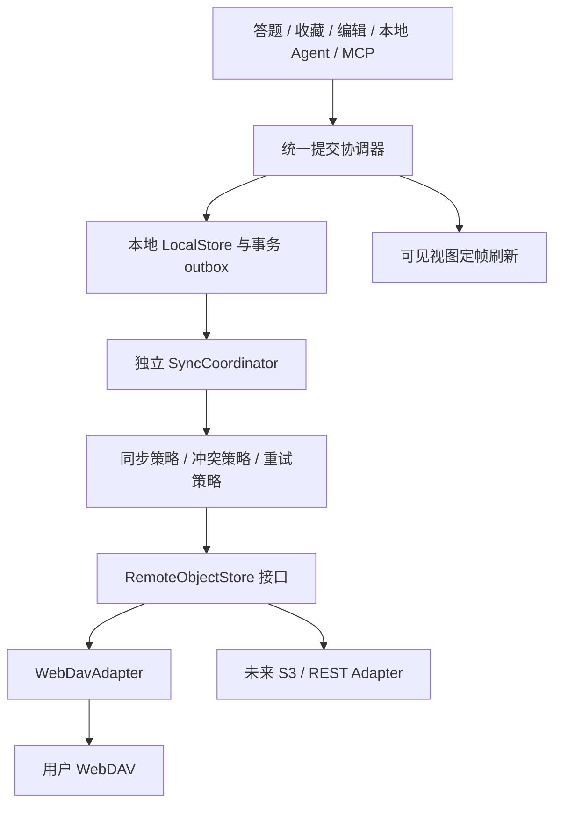

# 学习数据与题库外部持久化：WebDAV、多后端与操作抖动调研

日期：2026-11-01。状态：调研与设计，未实现、未安装依赖、未访问或写入真实 WebDAV。本轮仅新增本文档，保留工作区已有 MCP 配置与子导航改动。

## 1. 结论与建议范围

**可以支持外部持久化，推荐“本地优先 + 可插拔远端存储 + 独立同步协调器”，首个远端实现为 WebDAV。** 不应把同步 localStorage 方法直接换成 HTTP 请求，也不应每答一题上传整个题库。

用户已明确：覆盖学习数据/存档与题库，多后端扩展，WebDAV 优先，改善频繁操作的抖动。本报告建议的默认行为是：本地保存成功即可继续学习，外部同步状态单独展示；首期先提供 WebDAV 上传备份、浏览恢复和安全覆盖检测，再提供自动上传检查点。自动双向合并和多人协作不是接上 WebDAV 就自然具备的能力。

“抖动”目前没有用户复现录像或浏览器性能记录。下文区分已确认的重复写入机制、可疑重绘因素与待验证的视觉症状，不把所有卡顿归结为一个原因。具体定时参数是建议初值，实施时以测量调整。

## 2. 当前系统基础设施与数据边界

| 文件/入口 | 本轮读取确认的事实 | 可复用与缺口 |
| --- | --- | --- |
| `platform/storage/local-storage-adapter.js` | 档案、自定义题库、激活题库、遮挡偏好、版本与回收站共 6 类 key；load 同步、save 同步 | 已有适配器外形，但没有异步持久化接口、变更版本或远端同步队列 |
| 同文件 `runTransaction` | 暂存多 key 后同步提交，异常时尽力恢复；非事务模式 save 错误仅日志 | 可复用迁移桥梁；不是跨崩溃原子事务，不能安全包裹任意异步回调 |
| `app/main.js: saveUserData` | 每次写 profile + 全部 customDecks + activeDeckId + maskState；lastActiveAt 每次变化 | 必须拆分学习数据变更与题库变更，按领域 dirty revision 写入 |
| `features/arena/quiz-runner.js` | 作答路径调用 app.saveUserData | 高频学习事件不应触发题库全量序列化或网络上传 |
| `features/deck-manager/favorites-manager.js` | 收藏切换也调用 app.saveUserData | 保留即时视觉响应，合并视图刷新及远端检查点 |
| `features/deck-manager/deck-versioning.js` | 每库最多 10 个完整快照、回收站最多 20 项；版本和回收站分别存储 | 可复用快照/恢复业务；完整快照会放大体积，远端保留策略要独立设计。getVersions 返回元信息，不是完整快照 |
| `features/ai-agent/tool-executor.js` | 19 工具共享执行器，写入执行同步，依赖 app 状态、保存与重绘 | MCP 和本地 Agent 必须共享本地提交路径；成功代表本地持久化，不默认承诺已上传远端 |
| `app/main.js: exportBackupJSON/importBackupJSON` | v2 备份包含 profile、自定义题库、界面偏好及完整 aiConfig；没有版本/回收站；导入验证较弱后写多 key 再刷新 | 可复用文件选择与下载入口，不能直接把现有备份对象当远端同步格式；aiConfig 可含密钥 |
| `app/main.js: resetAllProgress` | 当前直接 localStorage.clear | 会清除同源其他配置；加入同步后必须区分本机重置、恢复与远端删除，防止空档覆盖远端 |
| `features/deck-studio/markdown-editor.js` | 输入后 180ms 合并 AST 解析和预览渲染 | 有防抖样例，但不是持久化 outbox，也没有长时间连续输入 maxWait 保障 |
| `features/ai-agent/session-store.js` 与 UI | AI 会话已有 1s 保存检查点，页面隐藏/离开尝试 flush；流式 UI 已合并刷新 | 可借鉴调度与终态强制保存；会话与凭据不默认进入学习同步包 |
| `platform/exporter/file-exporter.js` | JSON 下载、FileReader 导入 | 保留离线备份/恢复，外部存储故障时仍能导出 |
| MCP 配置子导航及 Web Locks | 新增的配置偏好白名单、状态提示、同源 Host 锁已有实现 | 可复用配置与状态交互思路；Host 锁不等于存储写锁或跨设备同步锁 |
| package.json / package-lock.json | 直接依赖只有 esbuild、fetch-event-source、partial-json；检索未发现 webdav/idb/Dexie/localForage/PouchDB/Lodash | 无现成远端存储或 IndexedDB 框架可直接启用；现有 esbuild vendor 流水线可打包所选库 |

题库当前每库健康上限为 500 实体，不代表所有题库加起来只有 500。内置题库随应用发布，不必原样反复上传；同步学习进度要记录内置题库版本/来源标识，升级后按稳定实体 ID 核对。

## 3. 重复写入证据与性能推断

本轮运行只读合成探针：直接调用当前 `KnowledgeMasterApp.prototype.saveUserData`，每组连续更新 100 次 totalAttempts；使用真实 StorageAdapter，但以内存计数器替代浏览器 setItem。每库 500 个合成实体，不读取真实学习数据。

| 场景 | 保存操作 | setItem 次数 | 累计序列化内容 | 探针耗时 |
| --- | --- | --- | --- | --- |
| 1 个题库 | 100 | 400 | 约 12.30MiB | 总 16.15ms，最大单次 0.67ms |
| 10 个题库 | 100 | 400 | 约 122.91MiB | 总 181.77ms，最大单次 4.60ms |

**这些不是浏览器磁盘写入耗时或 UI 帧率数据。** 替身只累计字节、没有真实存储 I/O；计时包含序列化及计数成本。它证明同一次学习状态更新会重复编码未改变的题库，成本随题库总量增加；不能据此声称已复现用户视觉抖动或给出优化百分比。

建议按以下顺序验证并优化：

1. **高证据：无差别全量保存。** 答题只写对应 deck 的学习状态/事件，题库内容 revision 未变时不序列化；activeDeck/mask 单独保存，禁止 lastActiveAt 使所有领域永远 dirty。
2. **中证据：完整快照与全量重绘。** 批量/导学操作创建完整快照并保存，再调用 renderAllViews；测量 JSON.stringify、克隆和 render 的占比，按当前可见视图增量刷新。
3. **待复现：DOM 重建导致焦点、选择、滚动跳动。** 浏览器 Performance/长任务与 DOM 节点身份对照，保留键控节点、滚动和输入焦点；不能靠保存防抖修复 DOM 结构问题。
4. **新增风险：远端写入顺序与重复重试。** 单飞、版本戳、持久 outbox 与冲突停止，避免旧响应覆盖新状态或状态提示来回闪烁。

## 4. 业界路线与库选型

以下比较代表性实现及其原理，不以未经核实的市场份额排序。

| 路线/项目 | 借鉴点 | 与本项目适配性 |
| --- | --- | --- |
| Joplin [S1] | 同步引擎与目标驱动分离、同步项状态、支持 WebDAV 等目标 | 最贴近多目标扩展思想；不整体移植其桌面运行时与成熟同步协议 |
| Remotely Save [S2] | 多云/对象存储/WebDAV 后端适配、冲突处理 | 借鉴能力边界与服务差异；Obsidian 插件 API 及请求环境不能直接当浏览器可用方案 |
| PouchDB + CouchDB [S3] | 文档修订与复制、离线多副本 | 若改用 CouchDB 可减少自研复制，但 WebDAV 不是 CouchDB replication endpoint，不会直接兼容 |
| 远端 REST/SQL 服务 | 事务、事件与权限可由服务端实现 | 后续可实现另一个 adapter；当前无自有后端，增加账号与维护成本 |
| S3/R2 等对象存储 | 对象接口、版本与条件操作 | 第二种目标候选；鉴权、CORS、条件写能力按供应商检测，不能默认与 DAV 完全相同 |
| Git/代码仓库存储 | 历史可追溯 | 高频作答频繁产生提交、限流与冲突成本高，适合人工归档，不作为实时持久化首选 |

| 库 | 能力与选择 |
| --- | --- |
| `webdav` / perry-mitchell/webdav-client [S4] | 支持 Node 与浏览器，文件读写、目录与自定义请求头；推荐做 DAV adapter 内部候选。先验证 ETag 读取、If-Match 透传、浏览器构建、取消与包体，不能只凭“支持浏览器”推断能绕过 CORS |
| `idb` [S5] | 小型 Promise IndexedDB 包装，适合少量对象仓库与事务；推荐本地异步事务层首选，具体版本与包体实施时锁定验证 |
| Dexie [S6] | 对象仓库、事务和查询更完整 | 数据域、索引与迁移变多时可选；Dexie Cloud 是另一套后端能力，不等同普通 Dexie 自带 DAV 同步 |
| localForage [S7] | 异步 KV 接口与驱动封装 | 迁移简单，但多个领域与 outbox 的跨仓库提交需要明确事务能力，不能仅用 KV 包装假装原子 |
| Lodash debounce [S8] | maxWait、cancel、flush 等成熟调度语义 | 借鉴契约；无需为一个调度器引入整库，可选独立入口或小型已测试实现 |
| 原生 fetch / IndexedDB | 小范围无框架依赖 | 固定 GET/PUT 的 DAV 子集可直接 fetch；增加 PROPFIND/XML/各服务兼容后优先复用库，避免手写整套 DAV |

本轮未安装、测 bundle 或审计许可证/漏洞，不能指定“最新安全版本”；实施前锁版、检查传递依赖与实际 browser bundle。现有 ESM/单文件生成器需要将库经 esbuild 打包为 vendor，不在浏览器运行时依赖远程 CDN。

## 5. 推荐分层与设计模式



**适配器**负责协议、鉴权、资源读写；**策略**负责上传时机、恢复/冲突决定、重试和保留期限；**状态机**负责同步阶段及互斥。适配器内不包含 UI 或学习算法，不把后端差异散落到答题、收藏和 MCP 代码里。

不要让本地事务存储与远端对象服务实现同一个虚假的全能力接口。建议两个端口：

```text
LocalStore
  loadWorkspace() -> Promise<Workspace>
  commit(changeSet, expectedLocalRevision) -> Promise<{revision}>
  readOutbox() / acknowledgeOutbox(generation)
  // commit 同时写领域数据和 outbox；事务完整提交才算本地已保存

RemoteObjectStore
  probe(signal) -> {read, write, conditionalCreate, conditionalReplace, list, quota?}
  get(path, signal) -> {bytes, etag?}
  put(path, bytes, {ifMatch?, ifNoneMatch?, signal}) -> {etag?}
  list(prefix, signal) -> metadata[]        // 可选能力
  remove(path, condition, signal)          // 显式清理用，不默认调用
```

工厂按 providerId 创建 adapter，能力检测决定可启用功能。不可用能力必须报明确原因；没有条件替换能力时降级为不可变备份，不静默覆盖共享存档。首期仅一个活动远端，切换目标时暂停旧队列并保留其 outbox/基线；不同时向所有目标自动扇出。

拟新增：`features/data-management/` 管配置、快照构造与恢复预览，`platform/storage/local-store.js`、`indexeddb-store.js` 与 `remote/webdav-adapter.js` 管端口及 I/O；调度器放共享或平台相应层。后续在现有“学习数据与存档管理”入口内提供“本地备份 / 外部存储”子标签，不挪进 MCP 设置。

## 6. 数据格式、备份边界与恢复

首期远端包 v3 建议包含：schemaVersion、workspaceId、snapshotId、deviceId、localRevision、parentSnapshotHash、contentHash、exportedAt、appVersion、内置题库来源版本、payload。payload 为 profile/deckStates、自定义题库、完整 deckVersions 与 recycleBin；activeDeck/mask 可选。

默认排除 aiConfig、模型/网关/WebDAV 凭据、AI 会话与机器专属连接设置。**不能直接远传现有 v2 备份中的 aiConfig。** 本地导出也应新增“包含凭据”的独立显式选择，并默认关闭；本轮仅报告该现有边界，不改导出代码。

快照从一个已提交的本地 revision 读取，不从正在变动的 app.state 拼装多次读取。hash 用确定性 JSON 编码或明确 canonicalization 后计算；revision/时间仅作诊断，不能用设备时钟判断谁可以覆盖。hash 用于完整性和去重，不是身份验证或加密。

保留 v2 文件导入兼容；导入 v3 要限制总字节、实体与版本数量，验证结构/关联引用，拒绝危险键、未知未来 schema，不执行远端内容中的 HTML/脚本。先暂存、校验、展示差异、创建本地恢复点，再原子提交。当前 file-exporter 的“能 JSON.parse”不是足够的安全或业务验证。

恢复过程中暂停自动同步，并检查当前 revision 未变化；冲突则重新预览。覆盖/恢复是显式操作，不能把“同步成功”自动变为清空当前题库。学习 SM-2 状态含算法顺序，不能把两设备统计简单取 max 或相加。首版采用整个快照冲突选择/保留双方；精细双向合并需要稳定学习事件 ID、题库版本引用、去重与确定的重放规则，另期设计。

## 7. WebDAV 第一后端的具体协议

### 7.1 浏览器可达性是首个门槛

使用 HTTPS、独立应用目录与应用专用凭据。推荐直连用户 DAV；GitHub Pages 可以运行请求代码，但不能替远端生成 CORS 响应。Basic/授权头及 PUT 等操作会涉及预检；需要服务允许应用 Origin、所用方法和 Authorization/If-Match/If-None-Match/Content-Type 等头，向脚本暴露 ETag。若启用目录功能，再检测 PROPFIND/Depth/MKCOL 与 207 XML，不能用 OPTIONS 宣称完整兼容。[S9][S10]

先允许填写已存在的应用目录；不要求首期递归创建整个路径。正常方式为应用专用密码或可用 Bearer；Cookie/Digest/厂商 SSO 不一开始全支持。凭据默认内存，未配置可信代理时不能将 WebDAV 密码发送到任意公共 CORS 代理。

已有 `/api/proxy` 是本地开发 HTTP 代理，不是生产 DAV 设施；它缺乏完整 DAV/CORS、安全与条件请求验证，GitHub Pages 上也不存在该路由。ProxyByCF MCP 桥接不是 WebDAV 存储服务，不能因都走 HTTP 就复用其房间/Token 协议。若服务不允许浏览器直连，再单独设计用户可控的代理适配层并验证方法、响应头与跨域重定向，不把改网关设为当前默认前置条件。

### 7.2 分开提供两种能力

**A. 不可变远端备份（首先交付）**

路径形如 `knowledge-arena/<workspaceId>/backups/<deviceId>/<UUID>.json`，每次上传一个完整一致快照；支持时带 If-None-Match: * 防止同名覆盖。断网不阻断本地操作。服务无法列目录时，保留已知备份索引与可手动输入对象路径的恢复方式；配置中明确标注不能跨设备浏览历史。

每次快照编号唯一，不因改后端重用同一路径。超时结果未知时 GET 原 snapshotId 路径并核对 hash，匹配即记成功，否则保留待确认；不自动换新名字反复产生重复备份。不在首期自动删除远端历史；本地最多 10 个版本不是远端只保留 10 个对象的理由。

**B. 共享当前存档/自动检查点（能力检测后启用）**

共享对象 `knowledge-arena/<workspaceId>/state.json`。初次创建使用 If-None-Match: *；更新先 GET 取得对象与**强 ETag**，使用 If-Match 条件替换；412 转冲突状态，不自动重复覆盖。弱 ETag 不能作为强比较的乐观并发保障，缺少可用 ETag 的目标只开放备份模式。[S11]

**GET 最新 ETag 不代表可以上传本地旧快照。** 本地记录每个目标的最后共同基线 snapshotId/contentHash；GET 后先比较远端内容与该基线。只有远端仍等于共同基线，才能用此次 ETag 条件提交本地新 revision；远端已偏离基线且本地也有改动时，即使 CAS 本可成功也必须先进入冲突。远端变化而本地未变时只能经明确的恢复/拉取策略应用；内容已等于本次待上传快照时可确认为已同步。这样同时防住“读完后别人又写了”的竞争与“别人已写完，但自己仍拿旧状态覆盖”的逻辑丢失。

首次绑定不能把“没有本地同步记录”当作远端为空。先选择创建新 workspace 或连接已有 workspaceId/应用目录；新设备连接已有目录时读取远端身份和版本，若双方都有内容则展示差异选择，不能自动用本地默认空档覆盖。端点、目录、账号或 workspace 改变都要重新建立该目标的基线。404 仅在确认应用目录可达且该对象不存在时允许创建，认证/跨域/目录错误不能解释为新空存档。

探针必须在专用临时文件上实际验证：创建、读回 ETag、正确 If-Match 成功、旧 ETag 写入确实被拒绝、内容未被覆盖，再清理自己的探针文件。目录可写、HEAD 成功或服务宣传兼容 DAV 都不能替代条件写验证。

上传 revision N 期间继续产生 N+1，完成 N 只能确认到 N，不能清空整个 dirty 标记。下一轮从最新已提交 revision 构造快照；同时最多一个上传。网络超时 GET 核对本次 snapshotId/hash，未确定前不推进远端基线；401/403 停止请求凭据，429 遵守 Retry-After，5xx/临时网络故障有限指数退避加抖动，409/412 不盲目重试。

首版不要求 LOCK/UNLOCK，也不假设 PUT 到临时文件再 MOVE 在所有服务器上都具备跨文件原子提交。条件请求和实际服务能力负责覆盖边界；需要原子多文件 manifest/分块协议时另外验证设计，不能偷偷升级为自研分布式文件系统。

### 7.3 路径、凭据与清理边界

只允许授权 baseUrl 下的应用目录；每段单独编码，拒绝 `..`、绝对路径、外部 href、URL 内用户名密码和跨 origin 重定向。PROPFIND 返回 href 不直接作为带凭据请求目标，必须归一化后重新验证 origin 与前缀。

配置可记住 endpoint/path/用户名，密码默认不存；浏览器中用同源固定密钥“加密后记住”不等于安全密钥管理。可另期做口令解锁的加密存档，算法参数和恢复流程另行设计，不自创密码协议。日志仅状态、字节、匿名 jobId，不记录密码或完整学习内容。

删除远端历史、改远端目标、恢复覆盖和“重置全部数据”分别确认范围。普通本机重置不删除远端，也不自动把空库上传覆盖旧存档；保留暂停/重新绑定步骤。同步目标不明确时不发网络请求。

## 8. 调度、防抖与持久化语义

| 层 | 拟议策略 | 不可牺牲的保证 |
| --- | --- | --- |
| 答题/收藏状态 | 即时更新 UI；关键学习事件本地逐条事务提交，按事务批次合并领域快照 | 不能对学习事件丢弃中间值；不要拿 1s debounce 的内存队列冒充已保存 |
| 题库编辑草稿 | 180–300ms trailing debounce + maxWait 2s，可见视图一帧一次重绘 | 保存/关闭/导出前 flush 草稿；显式保存确认后才称已提交 |
| 本地派生数据 | dirty domain + revision，合并同一批次状态计算 | 题库没变不重写题库；lastActiveAt 与内容 hash 分开 |
| 远端检查点 | trailing debounce 2s、maxWait 15s、单飞，上传中只标记最新待办 | 定时器是调度，不是持久队列；outbox 与本地修改同事务提交 |
| UI 状态提示 | 固定位置、低频文本更新；长传输只更新必要进度 | 不每次键入重建表单/聊天/题库视图，避免焦点和滚动跳动 |
| 导出/备份/手动同步 | await 本地 flush 后执行一次；导出从已提交版本生成 | 重复点击共用进行中任务或明确拒绝，不发多份并行上传 |

上述 ms 是目标初值，不是实测最佳参数。远端短时间跳过中间检查点可以，本地答题记录不能因此丢失。显式“本地已保存”和“远端待同步/已同步”分开，远端失败不回滚用户已成功学习的进度。

visibilitychange/pagehide 可以触发尽力 flush，但浏览器关闭时不能保证异步 IDB 或网络完成；sendBeacon 也不是带 DAV 条件头 PUT 的通用替代。依靠提前本地提交与持久 outbox，下次启动继续，不承诺关页后后台同步。Web Locks 负责同源单同步 leader，BroadcastChannel 只广播 revision；跨设备竞争由远端 CAS 处理。

建议本地状态与同步状态两个独立状态机：

```text
本地：CLEAN -> DIRTY -> COMMITTING -> CLEAN / LOCAL_ERROR
远端：DISABLED -> PROBING -> IDLE -> SCHEDULED -> READING -> UPLOADING -> IDLE
                                      |             |
                                  OFFLINE      CONFLICT / AUTH_REQUIRED / RETRY_WAIT / ERROR
```

同步用 generation、目标身份和 revision 绑定 job；断开/切目标后旧回包不可更新新目标状态。存在本地新写入时，IDLE 表示本轮结束，不意味着本地所有 revision 都已同步。CONFLICT 必须保留本地/远端/base 三份候选，不用最后写入时间自动覆盖。

## 9. 同步接口迁移：不能只加 async

当前 executor.runTransaction 和各 controller 依赖同步 app.state/storage；若把 saveProfile 改为返回 Promise 却不更新调用方，MCP 会提前报成功，随后失败还可能用旧快照覆盖较新的 UI 修改。

建议分层推进：先把当前同步存储的领域写入拆开，保持成功语义；WebDAV 的手工备份读取一致快照，不侵入每题流程。自动可靠同步阶段迁移到 IndexedDB + outbox：启动先 await LocalStore.loadWorkspace 再启用写入；所有题库/学习命令通过同一提交协调器，以 expectedLocalRevision 校验候选，await 提交后发布状态。MCP、本地 Agent、UI、备份导入、回滚都必须接入，不能只迁移 MCP。

IndexedDB 事务仅执行数据库工作，不在活跃事务内 await WebDAV/哈希/计时器；序列化和 hash 在事务外，提交时再核验 revision。遇到跨 revision 的本地更新必须重算或返回冲突，不恢复覆盖别人的新状态。[S5][S6]

迁移 legacy 数据时：读取六类 key→校验和生成迁移快照→一次 IDB 事务导入数据/元信息→标记完成→复核数量与 hash；旧 key 先保留，成功后停止双写。迁移失败继续使用原存储并明确提示。回退时从最新 IDB 导出/回灌，不直接读取迁移前的旧 key 假装无损回退。

上述读取开始前需进入跨标签页写入静默期：取得迁移锁，通知所有已升级标签页暂停命令并确认，再读取 legacy 快照；提交前复核源 key/revision 未变化，变化则终止重做，完成后广播存储版本切换再恢复命令。Web Locks 只能约束参与协议的新代码，旧版本标签页可能继续写入，单靠锁或读后 hash 复核不能关闭这一竞态。检测到不配合的旧标签页时，要求关闭旧页面后再迁移；无法建立静默前提则不自动迁移，保持原存储而不是宣称无损升级。

## 10. 分期、测试与验收

| 阶段 | 交付与退出条件 |
| --- | --- |
| P0 定位抖动 | 真实浏览器复现答题/收藏/编辑，记录保存次数、序列化字节、长任务、render 与焦点/滚动；先拆 dirty domains 和重复刷新，确认没有保存语义退化 |
| P1 WebDAV 备份/恢复 | 适配器端口、凭据配置、CORS/读写探测、v3 备份包、人工上传/恢复；失败不损坏当前数据，先不承诺实时双向同步 |
| P2 本地异步事务 | idb 或 Dexie 二选一；领域提交和 durable outbox 同事务；升级所有关键调用方、迁移与回退、刷新恢复；MCP 19 工具回归 |
| P3 条件自动检查点 | 真实服务 CAS 能力验证通过；单飞合并、最大等待、断网续传、冲突停止、目标切换隔离 |
| P4 第二后端 | 用相同 adapter contract tests 接入 S3/REST；若主要需求是自动双向合并，则独立设计学习事件与冲突 UI，不借此无界扩大首期 |

必要用例：

- 100 次答题不序列化未变题库；100 次编辑合并远端检查点，但记录与本地已提交结果不丢；连续活动达到 maxWait 仍调度。
- 上传 N 时本地变 N+1，N 的成功不清掉 N+1；双设备基于同一 ETag 写，只有一方成功，另一方显示冲突。
- 设备 A 已写入新版本，设备 B 随后 GET 到其最新 ETag，但 B 的共同基线已落后，仍须冲突而非直接 CAS 覆盖；初次连接已有远端不上传默认空档。
- 无/弱 ETag、错误 CORS、207 单项失败、401/403、404、409/412、429、5xx、满配额、断线和写成功响应丢失；不把这些统一成“已同步”。
- 远端存档损坏/过大/新 schema/含凭据/危险路径，导入不落半份；恢复预览期间本地 revision 改变不能悄悄覆盖。
- 模拟 IDB quota/abort、迁移失败、关页重启、多个标签页、旧 job 回包、切换目标、导出前 flush、本地重置不清远端。
- 迁移读取期间另一标签页答题、旧版本不响应暂停、迁移后旧 key 又变化：迁移必须中止或阻止继续写入，不能丢失迁入前最后一笔记录。
- 用户可见反馈、键盘和窄屏、存储授权、复制/日志无密钥；HTTP mock 单测之外，至少用真实 CORS 可达的 WebDAV 服务完成读写/CAS 验证，服务矩阵分别记录，不宣称通用兼容。

目标数据集：1/10/50 个题库、每库 500 条，版本和回收站包含大快照，学习 cards 数量独立变化；这是测试规模，不保证所有设备都可流畅承载。记录 p50/p95、字节、local commit/outbox/上传数量、长任务与丢帧。目标是高频路径不因未变题库产生全量写入，UI 不新增 >50ms 长任务；达不到先减载/分片，再考虑 Worker，不能把带 DOM 的业务控制器直接搬入 Worker。

## 11. 本轮结果及剩余决定

完成源码链路核对、依赖核对、一手资料对比、合成重复序列化探针及具体分期设计。未更改业务代码、未创建远端文件、未验证某个用户 WebDAV 服务的 CORS/ETag 行为，也未运行无关全量测试。

独立方案审阅已完成，补齐“条件写前比较共同基线”和“迁移时旧标签页写入静默期”两项关键约束；文档差异检查通过。

作者默认建议：本地优先；WebDAV 首期做可靠外部备份与恢复；能力满足后启用自动检查点；冲突保留双方并由用户选择；不自动同步凭据/AI 会话。未来实施前影响范围较大的决定包括：希望“备份恢复”还是“多设备自动双向合并”、服务提供方与应用目录、允许保存凭据的方式、远端历史保留期限。它们不影响可行性结论，未将作者建议冒充用户已选定的产品行为。

## 一手资料索引

- [S1 Joplin synchronisation](https://joplinapp.org/help/dev/spec/sync/)
- [S2 Remotely Save](https://github.com/remotely-save/remotely-save)
- [S3 PouchDB replication](https://pouchdb.com/guides/replication.html)
- [S4 WebDAV client](https://github.com/perry-mitchell/webdav-client)
- [S5 idb](https://github.com/jakearchibald/idb)
- [S6 Dexie transactions](https://dexie.org/docs/Dexie/Dexie.transaction())
- [S7 localForage](https://github.com/localForage/localForage)
- [S8 Lodash debounce](https://lodash.com/docs/#debounce)
- [S9 MDN CORS](https://developer.mozilla.org/en-US/docs/Web/HTTP/Guides/CORS)
- [S10 RFC 4918 WebDAV](https://www.rfc-editor.org/rfc/rfc4918.html)
- [S11 RFC 9110 If-Match](https://www.rfc-editor.org/rfc/rfc9110.html#name-if-match)

来源于调研日查询；无实际包版本锁定或性能背书。外部检索未发送源码、私有路径、凭据或真实学习数据。
