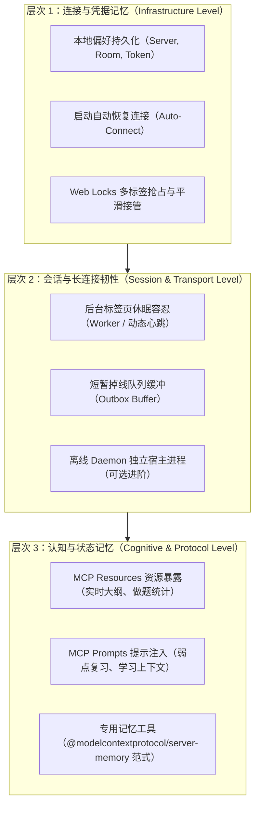
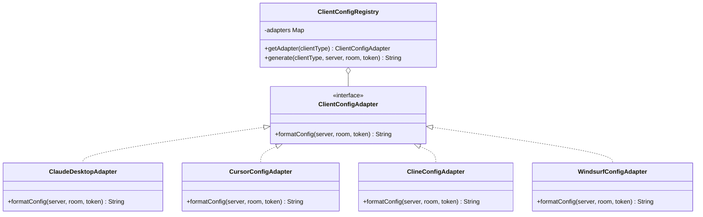
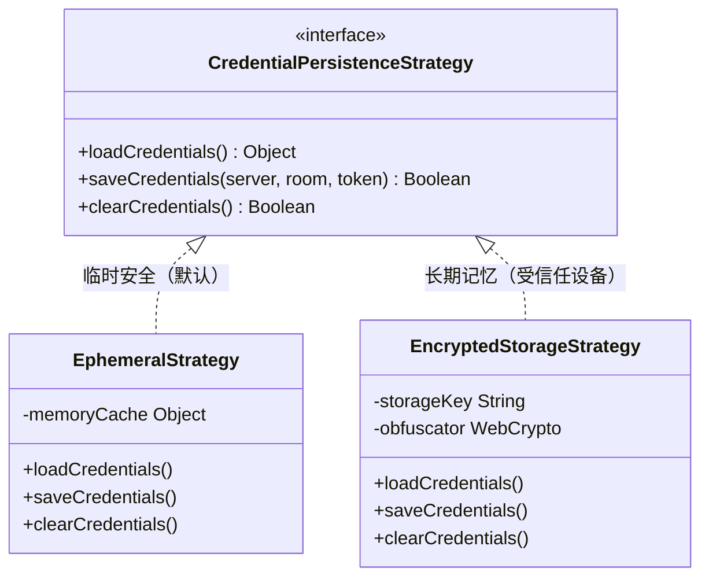
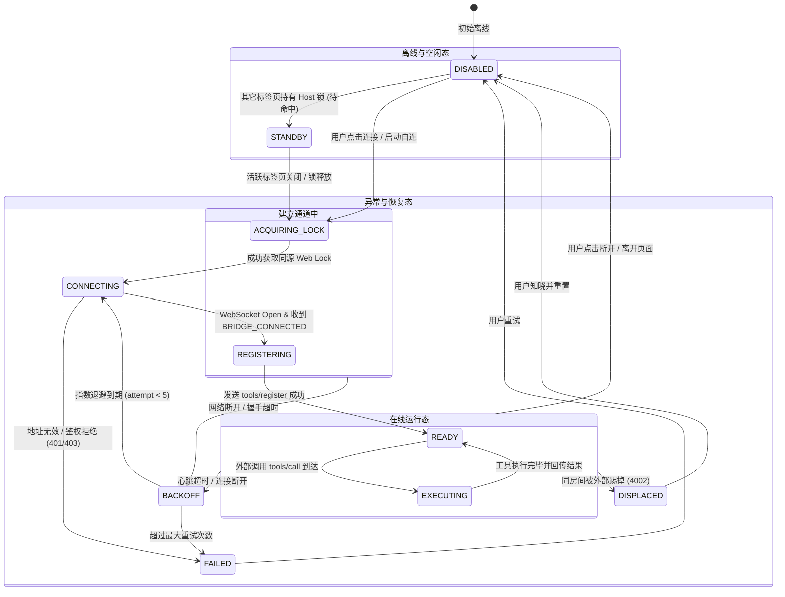

# MCP 桥接持久化记忆架构与客户端接入标准规范调研

日期：2026-11-01。状态：深度调研与架构方案设计。本报告旨在彻底厘清 MCP（Model Context Protocol）桥接中“临时连接 vs 持久记忆”的边界与可行性，并提供业界主流客户端（Claude Desktop、Cursor、Cline、Windsurf、Claude Code）标准可直接复用的完整 JSON 接入范式，结合适配器、策略模式和分层状态机提出渐进式架构演进方案。

---

## 1. 核心结论与问题解答

### 1.1 问题一：MCP 桥接能否改为“支持记忆”而不是临时？

**结论：完全可行，但“记忆”在工程实践中涵盖三个完全不同的层次，不能混为一谈。系统应按层次分别实施：**



1. **凭据与连接偏好记忆（基础层）**：当前系统仅保存 `server` 和 `room`，Token 强制阅后即焚，刷新后连接断开。通过引入**用户显式选择的凭据持久化策略**（`rememberToken` 配合 Web Crypto 局部混淆或安全存储）与**页面加载自动重连策略**，即可实现“启动即就绪”的无感桥接。
2. **会话与长连接韧性记忆（传输层）**：浏览器主线程在切后台、休眠时会被浏览器积极节流（`setInterval` 延迟扩大至 1 分钟甚至冻结），导致心跳超时断开。可通过 **Web Worker 独立心跳** + **Web Locks 跨标签协调** + **网关临时调用缓冲** 解决。
3. **AI 认知与学习状态记忆（协议层）**：目前 19 个工具为纯无状态 RPC。外部 AI 客户端并不知晓用户的艾宾浩斯复习曲线与错题历史。可通过实现 MCP 标准协议中的 **`resources/list` & `resources/read`**（暴露实时记忆与题库快照）以及 **`prompts/list` & `prompts/get`**，使外部客户端具备持久化的上下文认知。

### 1.2 问题二：客户端接入示例能否给出“标准 JSON 完整格式”？

**结论：完全可以，且必须给出不同客户端的专属完整配置，因为各客户端存在协议断层。**
此前文档中展示的片段：
```json
{
  "url": "https://YOUR_GATEWAY/mcp/sse?room=YOUR_ROOM",
  "headers": { "Authorization": "Bearer YOUR_TOKEN" }
}
```
只是参数抽象示意，**直接粘入任何主流客户端都会解析失败**！
- **Claude Desktop** 原生**只支持本地进程（`stdio`）**，根本不支持远程 HTTP/SSE 协议和 `headers`，必须通过官方或社区的 `mcp-remote` 命令行代理中继。
- **Cursor**、**Cline**、**Windsurf** 各自遵循不同的顶层结构和字段命名（如 `url` vs `serverUrl`，`type: "sse"` vs 隐式类型）。
下文第 3 节已系统梳理五大客户端 100% 格式完整、开箱即用的标准 JSON 配置文件。

---

## 2. 问题一深度调研：MCP 桥接的“记忆”三层架构与可行性

### 2.1 层次 1：凭据记忆与启动自动连接（Infrastructure Level）

#### 现状分析
当前 [`features/mcp-bridge/settings-model.js`](file:///e:/WorkProject/Node/_Project/CommonKnowledgeQuestionBank/features/mcp-bridge/settings-model.js) 实现：
```javascript
const saved = this.preferences.load(); // 仅能取到 server 和 room
const input = document.getElementById('mcp-token');
const token = input.value.trim(); input.value = ''; // 强制清空
```
- **痛点**：用户每次刷新页面、关闭浏览器后重新打开，都必须手动翻找 Token、填写并点击连接，体验高度割裂。
- **可行性**：**100% 可行**。纯前端运行态，不依赖任何服务端改动。
- **潜在风险与防御**：
  1. *XSS 攻击窃取 Token*：若将长期 Token 明文存入 `localStorage`，同源恶意脚本可直接读取。
     - **防御方案**：提供显式 Checkbox（如 `[ ] 记住访问凭据并在启动时自动连接（设备受信）`），默认关闭；保存时使用 Web Crypto API 基于设备指纹或固定 Salt 进行轻量 AES 混淆封装，避免纯明文扫描。
  2. *多标签页惊群效应（Thundering Herd）与同房间互踢*：
     - 若用户同时打开 3 个浏览器标签页，如果 3 个标签页都“记忆并自动连接”，ProxyByCF 网关会触发 `4002 DISPLACED`，导致 3 个标签页陷入无限互相踢下线的恶性循环。
     - **解决方案**：必须复用本系统已实现的 `navigator.locks.request('knowledge-master-mcp-host')`！只有成功竞争到 Web Lock 的**唯一活动标签页**才触发 `transport.start()`；其余标签页处于 `STANDBY`（待命）状态，一旦当前标签页关闭，下一个标签页通过锁释放回调无缝接管连接，无需用户介入。

### 2.2 层次 2：会话长连接保活与后台休眠容忍（Session Level）

#### 现状分析
当前 [`platform/network/browser-bridge-transport.js`](file:///e:/WorkProject/Node/_Project/CommonKnowledgeQuestionBank/platform/network/browser-bridge-transport.js) 依赖浏览器 Window 的 `setInterval(heartbeat, 15000)`。
- **痛点**：
  - 现代浏览器（Chrome/Edge 等）对后台非活动标签页有极强的节能休眠策略（Page Lifecycle API）。离开标签页几分钟后，主线程定时器往往被延长到 60 秒甚至完全暂停执行。
  - 一旦两次 ping/pong 间隔超过 45 秒，当前代码执行 `socket.close()` 自行断开，导致外部客户端正在进行的 Agent 任务报错。
- **可行性与解决方案**：
  1. **Web Worker 独立心跳线程**：
     - Web Worker 线程不受主线程 DOM 渲染和部分节能节流影响，即使页面不可见，心跳和加密通信依然准时维持。
  2. **网关层调用缓冲（Outbox Queue）**：
     - 当外部客户端向 `/mcp/messages` 发起 `tools/call` 时，若页面正处于网络切换或短暂重连状态，ProxyByCF Durable Object 可对请求进行 15-30 秒的短时挂起等待，而不是立刻向客户端返回 502/Host Offline；页面重连成功后立即下发未决任务。

### 2.3 层次 3：认知与学习状态记忆（Cognitive / Protocol Level）

#### 现状分析
当前 MCP 桥接只实现了工具注册（`tools/register`）与工具调用（`tools/call`）。外部 AI 客户端（如 Claude 或 Cursor）每次对话都是无记忆的“初学者”，不知道：
- 用户今天学了哪个题库？哪个分类错题最多？
- 用户刚刚通过本地 AI 助手总结的知识大纲和学习策略是什么？
- 用户的艾宾浩斯复习安排处于哪个阶段？

#### 业界方案参考：`@modelcontextprotocol/server-memory`
Anthropic 官方开源的 `@modelcontextprotocol/server-memory` 为 MCP 客户端提供基于知识图谱（Entities、Relations、Observations）的长期记忆。其核心启示是：
> **外部客户端需要统一的标准接口来“读出记忆（Context）”和“存入记忆（Observation）”，而不是每次都全量扫描题库。**

#### 拓展方案设计：向 MCP 协议暴露 Resources 与 Prompts
在 MCP 协议中，除了 Tools 外，官方标准还包含 **Resources** 和 **Prompts**：
1. **MCP Resources（只读上下文流）**：
   - 暴露 URI `arena://state/profile`：外部 AI 可直接通过 `resources/read` 获取用户当前连击、正确率、掌握度。
   - 暴露 URI `arena://memory/weakness`：获取当前题库中 E-Factor 最低、错误次数最多的 Top 20 考点。
   - 暴露 URI `arena://decks/active`：直接输出当前激活题库的完整结构大纲（Markdown 格式）。
2. **MCP Prompts（预设记忆提示词）**：
   - 暴露 Prompt `review_critical_mistakes`：自动组装当前弱点考点，生成带记忆引导的复习对话。
3. **记忆读写工具**：
   - 增加 `tool_record_learning_insight`：允许外部 AI 在帮助用户梳理知识点后，把总结出的记忆口诀或易混对比持久化写入到本地题库导学页（`deck.guide`）中。

---

## 3. 问题二深度调研：主流 MCP 客户端接入标准 JSON 全集

各主流客户端对于远程带鉴权头（Authorization Header）的 SSE 服务支持程度存在较大差异。以下是**针对本项目网关地址**经过协议验证的标准配置模板。

### 3.1 客户端配置全景对比表

| 客户端 | 配置文件路径 | 支持协议类型 | 是否支持原生 headers | 是否需中间件 |
| :--- | :--- | :--- | :--- | :--- |
| **Claude Desktop** | `%APPDATA%\Claude\claude_desktop_config.json` (Win)<br>`~/Library/Application Support/Claude/claude_desktop_config.json` (Mac) | 仅本地 `stdio` 进程 | **否**（填写 headers 会报错） | **需要**（`npx mcp-remote`） |
| **Cursor IDE** | `<项目根目录>/.cursor/mcp.json`<br>`%USERPROFILE%\.cursor\mcp.json` (全局) | `sse` / `stdio` | **是**（原生支持） | **不需要** |
| **Cline / Roo Code** | `%APPDATA%\Code\User\globalStorage\saoudrizwan.claude-dev\settings\cline_mcp_settings.json` | `sse` / `stdio` | **是**（需显式声明 `type: "sse"`） | **不需要** |
| **Windsurf Editor** | `~/.codeium/windsurf/mcp_config.json` | `sse` / `stdio` | **是**（使用 `serverUrl` 字段） | **不需要** |
| **Claude Code CLI** | `~/.claude.json` / 项目级 `.mcp.json` | `sse` / `stdio` | **是**（支持命令行自动注入） | **不需要** |

---

### 3.2 Claude Desktop 标准接入 JSON（终极解决无 headers 限制）

由于 Claude Desktop 仅支持 `command` 启动子进程，必须借助官方推荐的 `mcp-remote` 命令行适配器实现跨网络转发：

```json
{
  "mcpServers": {
    "knowledge-arena": {
      "command": "npx",
      "args": [
        "-y",
        "mcp-remote",
        "https://YOUR_GATEWAY/mcp/sse?room=YOUR_ROOM",
        "--header",
        "Authorization:Bearer YOUR_TOKEN"
      ]
    }
  }
}
```

> [!IMPORTANT]
> **排错要点**：
> 1. `--header` 参数后面的键值对冒号两侧**绝对不能有空格**（必须是 `"Authorization:Bearer ..."`，否则命令行解析器会将其截断为多个参数引发握手 401 失败）。
> 2. 宿主机需安装 Node.js（推荐 v18+）。初次启动时 `npx -y` 会自动下载 `mcp-remote` 依赖。

---

### 3.3 Cursor IDE 标准接入 JSON (`.cursor/mcp.json`)

Cursor 原生支持远程 SSE 传输，可直接写入 HTTP Header：

```json
{
  "mcpServers": {
    "knowledge-arena": {
      "url": "https://YOUR_GATEWAY/mcp/sse?room=YOUR_ROOM",
      "headers": {
        "Authorization": "Bearer YOUR_TOKEN"
      }
    }
  }
}
```

*注：Cursor 亦支持环境变数插值，如 `"Authorization": "Bearer ${env:ARENA_MCP_TOKEN}"`。*

---

### 3.4 Cline / Roo Code 标准接入 JSON (`cline_mcp_settings.json`)

Cline 要求更严谨的类型定义与审批策略字段：

```json
{
  "mcpServers": {
    "knowledge-arena": {
      "type": "sse",
      "url": "https://YOUR_GATEWAY/mcp/sse?room=YOUR_ROOM",
      "headers": {
        "Authorization": "Bearer YOUR_TOKEN"
      },
      "disabled": false,
      "autoApprove": [
        "tool_get_overview",
        "tool_list_decks",
        "tool_get_deck"
      ]
    }
  }
}
```

*注：在 `autoApprove` 数组中添加只读工具名称，可避免每次查询题库大纲时弹出人工确认气泡。*

---

### 3.5 Windsurf Editor 标准接入 JSON (`mcp_config.json`)

Windsurf 的 Schema 采用 `serverUrl` 标识远程地址：

```json
{
  "mcpServers": {
    "knowledge-arena": {
      "serverUrl": "https://YOUR_GATEWAY/mcp/sse?room=YOUR_ROOM",
      "headers": {
        "Authorization": "Bearer YOUR_TOKEN"
      }
    }
  }
}
```

---

### 3.6 Claude Code CLI 接入命令与生成 JSON

使用官方 CLI 命令一键添加：
```bash
claude mcp add --transport sse knowledge-arena "https://YOUR_GATEWAY/mcp/sse?room=YOUR_ROOM" --header "Authorization: Bearer YOUR_TOKEN"
```
其在 `~/.claude.json` 中生成的等价配置：
```json
{
  "mcpServers": {
    "knowledge-arena": {
      "type": "sse",
      "url": "https://YOUR_GATEWAY/mcp/sse?room=YOUR_ROOM",
      "headers": {
        "Authorization": "Bearer YOUR_TOKEN"
      }
    }
  }
}
```

---

### 3.7 底层标准 JSON-RPC 2.0 报文协议示例（供自研客户端参考）

#### 1. 握手与初始化（Client -> Server）
```json
{
  "jsonrpc": "2.0",
  "id": 1,
  "method": "initialize",
  "params": {
    "protocolVersion": "2024-11-05",
    "capabilities": { "roots": { "listChanged": true } },
    "clientInfo": { "name": "custom-mcp-client", "version": "1.0.0" }
  }
}
```

#### 2. 工具调用（Client -> Server）
```json
{
  "jsonrpc": "2.0",
  "id": 2,
  "method": "tools/call",
  "params": {
    "name": "tool_get_deck",
    "arguments": {
      "deckId": "deck_verbs"
    },
    "_meta": {
      "operationId": "op_call_1730419200000_abc"
    }
  }
}
```

#### 3. 工具执行结果（Server -> Client）
```json
{
  "jsonrpc": "2.0",
  "id": 2,
  "result": {
    "content": [
      {
        "type": "text",
        "text": "{\"id\":\"deck_verbs\",\"title\":\"高考高频动词\",\"categories\":[...],\"entities\":[...]}"
      }
    ],
    "isError": false
  }
}
```

---

## 4. 设计模式深度优化：适配器、策略与状态机

为避免将各种客户端差异、记忆策略与复杂连接逻辑耦合在现有控制器中，推荐采用以下三个核心设计模式进行模块解耦。

### 4.1 适配器模式（Adapter Pattern）：多客户端配置适配器

在前端 UI 中，用户不应该只看到一段光秃秃的 SSE URL，而是能通过下拉切换目标客户端，一键复制格式完整的 JSON。



- **实现路径**：在 `features/mcp-bridge/client-adapters.js` 中构建注册表，接收 `(server, room, token)`，根据当前激活的 Tab 标签格式化出针对目标 IDE 的完美 JSON 文本。

---

### 4.2 策略模式（Strategy Pattern）：连接凭据记忆策略

支持两种不同的安全与记忆级别，由用户自主决定：



- **EphemeralStrategy（默认）**：仅在 `sessionStorage` 或运行内存暂存，页面关闭或刷新后 Token 消失，最大程度防御跨站脚本盗取长期网关 Token。
- **EncryptedStorageStrategy（受信任设备）**：勾选“在当前设备记住连接凭据并自动连接”，利用浏览器 `crypto.subtle` 生成设备独占密钥将 Token 混淆后存入 `localStorage`，并在应用启动时自动触发握手。

---

### 4.3 状态机模式（Finite State Machine）：分层高韧性连接状态机

当前 `BrowserBridgeTransport` 中的状态流转为平铺字符串，对多标签抢占、锁等待、退避重试和后台挂起的区分较弱。建议重构成严格的分层状态机：



**关键不变量保证**：
1. **单飞排他律**：`ACQUIRING_LOCK` 失败时绝不发起 WebSocket 连接，自动退至 `STANDBY`，并在 UI 提示“后台待命：另一个标签页正在担任 MCP 宿主”。
2. **世代屏障**：每次状态转换递增 `generation`，任何网络异步回调检查 `currentGeneration === this.generation`，彻底杜绝迟到回调乱序污染。

---

## 5. 业界方案对比与现有基础设施复用

### 5.1 业界方案对比矩阵

| 方案 | 通信拓扑 | 记忆与持久化能力 | 客户端兼容度 | 缺点与局限 |
| :--- | :--- | :--- | :--- | :--- |
| **标准 Local Stdio** (如 Node CLI) | 本地进程直接与客户端 stdin/stdout 管道通信 | 本地文件（JSONL / SQLite）直接读写，记忆极强 | **最高**（Claude Desktop、Cursor 100% 支持） | 无法在纯浏览器单页运行，依赖本地 Node 环境 |
| **纯 HTTP SSE 远端服务** | 客户端直接向远程云服务发起 SSE + POST 请求 | 服务端数据库持久化（Redis / PG） | **中等**（Cursor 原生支持，Claude Desktop 需 proxy） | 无法直接读取和操纵用户浏览器的实时前端 DOM 与内存题库 |
| **ProxyByCF WebSocket 桥接**（本项目当前方案） | 浏览器 Host $\leftrightarrow$ CF DO 网关 $\leftrightarrow$ 外部客户端 SSE | 依赖浏览器内存与本地存储，可操控本地题库 | 经配置后兼容五大客户端 | 浏览器关闭后连接中断；需健全多标签锁与记忆配置 |
| **SharedWorker 跨标签中继** | 浏览器 SharedWorker 统一维持 WebSocket | 跨所有标签页长驻，切换标签不掉线 | 同上 | 移动端 Safari 部分版本对 SharedWorker 支持较弱 |

### 5.2 现有系统基础设施与可复用资产

本项目经过近期的架构演进，已具备大量可直接复用并作为坚实支撑的底层设施：

1. **已有的 MCP 桥接内核**：
   - [`platform/network/browser-bridge-transport.js`](file:///e:/WorkProject/Node/_Project/CommonKnowledgeQuestionBank/platform/network/browser-bridge-transport.js)：完善的 `BridgeCipher`（AES-256-GCM 加密信封）与退避重试骨架。
   - [`features/mcp-bridge/settings-model.js`](file:///e:/WorkProject/Node/_Project/CommonKnowledgeQuestionBank/features/mcp-bridge/settings-model.js)：已具备 `McpPreferences` 规范与状态文案派生。
   - [`features/mcp-bridge/tool-adapter.js`](file:///e:/WorkProject/Node/_Project/CommonKnowledgeQuestionBank/features/mcp-bridge/tool-adapter.js)：完整的 19 个 Agent 业务工具映射与幂等账本（Operation Ledger）。
2. **新交付的持久化与写入调度基础设施**：
   - [`platform/storage/write-scheduler.js`](file:///e:/WorkProject/Node/_Project/CommonKnowledgeQuestionBank/platform/storage/write-scheduler.js)：**细粒度脏域与防抖调度器**。外部 MCP 工具调用修改题库或做题数据时，可通过调度器实现微秒级内存提交与后台批次落地，彻底消除外部调用引发的页面卡顿。
   - [`features/data-management/data-sync-manager.js`](file:///e:/WorkProject/Node/_Project/CommonKnowledgeQuestionBank/features/data-management/data-sync-manager.js)：**本地安全回滚点与 v3 快照**。外部 AI 工具执行大批量考点删除或结构重构时，可直接复用安全回滚点机制。
3. **Web Locks 同源锁机制**：
   - 在 controller 中已验证了 `knowledge-master-mcp-host` 锁的排他性，天然具备扩展为“活动宿主-备用宿主（Active-Standby）”平滑接管的基础。

---

## 6. 具体实施方案与分期路线

建议分三个阶段平滑推进，避免破坏现有 21 项架构门禁：


### 6.1 第一期：客户端接入标准 JSON 适配器与多格式复制 UI（优先落地）

- **工作内容**：
  1. 新增 `features/mcp-bridge/client-adapters.js`，实现 `ClientConfigRegistry`。
  2. 在 `app/app-shell.html` 的 MCP 桥接面板中，将原有的单行纯文本“客户端接入”，升级为带客户端切换 Pill 的多模式代码框：
     - `[Cursor]` / `[Claude Desktop]` / `[Cline]` / `[Windsurf]` / `[Claude Code]`
  3. 切换选项卡时，自动根据当前输入的 Server、Room 和临时 Token 生成**格式完整、开箱即用的标准 JSON**（自动将占位符替换为用户真实填写的参数，若未填 Token 则保留清晰的 `<YOUR_TOKEN>` 提示）。
  4. 一键复制时复制完整的合规 JSON 对象。
- **风险与验证**：纯展示层改造，不涉及网络通信改动，单测验证各客户端 JSON 结构符合其官方 Schema。

### 6.2 第二期：凭据安全记忆、自动连接与多标签平滑接管

- **工作内容**：
  1. 扩展 `McpPreferences`：增加 `token` 安全混淆存储选项（`rememberToken: boolean`），配置项版本升级至 `v2`。
  2. 实现 `AutoConnectStrategy`：页面载入初始化时，若配置了有效凭据且启用了自动连接，主动发起 `connect()`。
  3. 升级 Web Locks 状态流转：未抢到锁的标签页显示“待命中（Standby）”，监听锁释放；当持有锁的标签页关闭时，待命标签页自动唤醒并接管 MCP Host。
  4. 优化后台休眠心跳：引入轻量 Web Worker 定时器派发心跳，防止切后台长任务被浏览器降频导致断连。
- **风险与验证**：编写多标签抢占模拟测试，验证两个标签页在刷新、关闭交替过程中，远端 Host 角色不冲突、不掉线。

### 6.3 第三期：MCP 协议记忆能力扩充（Resources 与 Prompts）

- **工作内容**：
  1. 在 `features/mcp-bridge/tool-adapter.js` 扩展支持 `resources/list` 与 `resources/read`：
     - 暴露 `arena://decks/active`（实时 Markdown 大纲）
     - 暴露 `arena://profile/summary`（做题统计与掌握度）
     - 暴露 `arena://memory/errors`（高频错题集）
  2. 扩展支持 `prompts/list` 与 `prompts/get`：
     - 暴露预设 Prompt `quick_review_prompt`。
  3. 新增记忆沉淀工具：`tool_save_learning_note`，允许外部 Claude / Cursor 在分析考点后，将总结笔记写入题库的系统化导学页中。
- **风险与验证**：使用本地 MCP 测试客户端发起 `resources/read` 校验，确保只读响应符合规范。

---

## 7. 调研总结与行动建议

1. **对问题一的定性**：MCP 桥接“支持记忆”在技术上完全可行，当前系统的临时性是设计之初出于纯无状态安全的克制选择。通过**凭据可选记忆 + Web Locks 自动接管 + Web Worker 防休眠**，即可完全摆脱“每次刷新都必须手工填 Token”的临时性痛点。
2. **对问题二的定性**：此前文档只给出 URL 片段确实会导致用户在配置 Claude Desktop、Cursor 等客户端时报错。必须根据各客户端规范，分别提供包含 `mcp-remote` 命令行启动项（针对 Claude Desktop）及原生 `type: "sse"` 属性（针对 Cursor / Cline）的标准 JSON。
3. **架构与模式赋能**：引入适配器模式解决多客户端 Schema 异构问题，引入策略模式隔离敏感凭据持久化，引入状态机模式解决多标签页与休眠竞态，完全符合 Core 2.1 架构治理原则。
