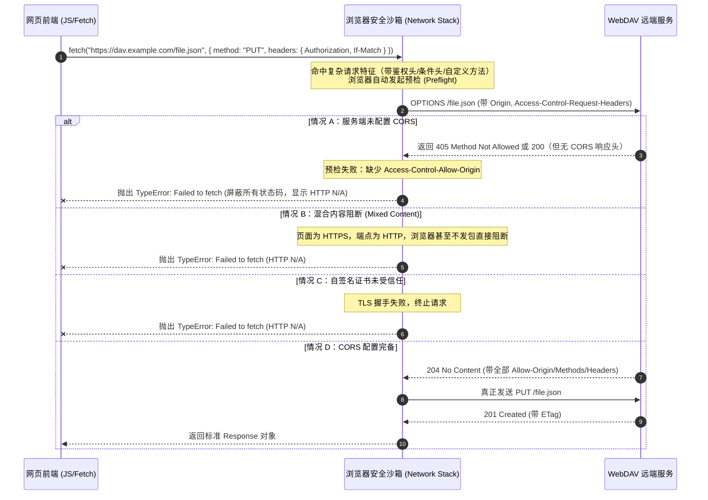

# WebDAV 跨域 (CORS) 与网络连接故障排查及代理中继设计规范

日期：2026-11-01。状态：技术调研与工程化方案设计。针对前端直接调用 WebDAV 探测时出现的 `Network / CORS request failed: Failed to fetch (HTTP N/A)` 典型故障，系统化梳理成因、主流服务兼容性矩阵、服务器端配置及客户端工程化中继代理方案。

---

## 1. 现象定义与底层网络机制

### 1.1 报错特征
当用户在“学习数据与持久化管理”中点击「探测连通性」或「上传云端快照」时，界面提示：
```text
连通失败: Network / CORS request failed: Failed to fetch (HTTP N/A)
```
- **核心特征**：HTTP 状态码为 `N/A`（非 200/401/404/500 等任何标准 HTTP 响应代码）。
- **底层异常**：浏览器原生 `fetch()` 抛出 `TypeError: Failed to fetch`。

### 1.2 为什么状态码是 `HTTP N/A`？
在 W3C Fetch 规范与现代浏览器跨域安全模型中，浏览器 JS 运行环境受到严格沙箱隔离。当发生以下情况时，**浏览器在底层直接熔断了网络连接，禁止任何响应头与状态码暴露给 JavaScript 运行时**：



---

## 2. 故障三大技术成因深度剖析

### 2.1 成因一：跨域资源共享（CORS）限制与预检失败（占 85% 以上）
WebDAV 协议本身（RFC 4918）定义在 HTTP 基础之上，使用了非标的 HTTP 方法（如 `PROPFIND`、`MKCOL`）以及特有的请求头（如 `Depth`、`If-Match`、`If-None-Match`、`Authorization`）。
- **复杂请求与强制预检**：浏览器要求发送非简单请求（包含 Basic Auth、`If-Match`、JSON 载荷、`PUT`/`PROPFIND` 方法）前必须向服务器发送 `OPTIONS` 探测。
- **预检失败表现**：
  1. 服务端未开启 CORS：没有返回 `Access-Control-Allow-Origin: *`（或当前页面域名）。
  2. 预检请求头未放行：服务器未在 `Access-Control-Allow-Headers` 中显式声明放行 `Authorization`、`If-Match`、`If-None-Match`、`Content-Type`、`Depth` 等头。
  3. 响应暴露头未放行：未在 `Access-Control-Expose-Headers` 中声明 `ETag`、`Last-Modified`，导致 JS 读取不到 ETag，条件并发（CAS）无法生效。

### 2.2 成因二：混合内容安全阻断（Mixed Content）
- **现象**：用户在 GitHub Pages（`https://*.github.io`）或自定义 HTTPS 域名打开应用，但在端点 URL 中输入了 `http://192.168.1.100:5005` 或 `http://localhost:5244`。
- **浏览器规则**：现代浏览器（Chromium 85+、Safari、Firefox）实施严格的主动混合内容（Active Mixed Content）拦截。从安全上下文（HTTPS）向非安全上下文（HTTP）发起 `fetch()` 会被底层静默阻断，控制台提示：
  `Mixed Content: The page at 'https://...' was loaded over HTTPS, but requested an insecure resource 'http://...'. This request has been blocked; the content must be served over HTTPS.`

### 2.3 成因三：自签名 SSL 证书不受信任 / 局域网不可达
- **自签名证书**：私有 NAS 或内网部署的 WebDAV 服务未配置有效 CA 机构颁发的 SSL 证书，浏览器在 TLS 握手阶段拒绝连接。
- **局域网/内网穿透超时**：填写的内网 IP、端口或动态域名解析（DDNS）失败或端口未映射，TCP 连接超时（ERR_CONNECTION_TIMED_OUT），浏览器统一封装为 `TypeError: Failed to fetch`。

---

## 3. 主流 WebDAV 生态兼容性矩阵与实测分析

| 服务商 / 软件 | 协议与端口 | 默认浏览器 CORS 支持状态 | 解决方案建议 |
| :--- | :--- | :--- | :--- |
| **坚果云 (Jianguoyun)** | HTTPS 443 | 🔴 **完全不支持**（官方未开放浏览器跨域头，直接直连必挂） | 1. 通过 Alist 挂载坚果云并开 CORS<br>2. 通过轻量 Cloudflare Worker CORS 代理 |
| **Alist (多存储网关)** | HTTP/HTTPS | 🟢 **原生完备支持**（后台一键开关） | **强烈推荐**：设置 -> 全局 -> 勾选「允许跨域访问」 |
| **Nextcloud / ownCloud** | HTTP/HTTPS | 🟡 **默认未开放第三方域** | 1. 修改 `config.php` 的 `cors.allowed_domains`<br>2. 在 Nginx 反向代理层追加 CORS 头 |
| **群晖 Synology NAS** | HTTP(5005) / HTTPS(5006) | 🟡 **默认未开启跨域** | 在群晖「反向代理服务器」或自定义 Nginx 配置文件注入 CORS 响应头 |
| **威联通 QNAP NAS** | HTTP(8080) / HTTPS(443) | 🟡 **默认未开启跨域** | 使用反向代理或在 Container Station 中运行开启 CORS 的 WebDAV 容器 |
| **自建 Nginx / Caddy** | 自定义 | 🟢 **配置后支持** | 补充 `OPTIONS` 处理并放行 WebDAV 特殊头（见下文模版） |
| **InfiniCLOUD (原 TeraCLOUD)** | HTTPS 443 | 🔴 **未开放通用跨域** | 建议配置代理或通过 Alist 桥接 |

---

## 4. 解决方案实操指南

### 4.1 方案 A：自建与私有服务开启 CORS（根治方案）

#### 1. Alist（个人私有云首选）
若你使用 Alist 作为聚合网盘：
1. 登录 Alist 管理后台 -> **设置** -> **全局**。
2. 找到 **「允许跨域访问 (CORS)」**，将其开关置为 **启用（勾选）**。
3. 点击底部「保存」。此时无论 Alist 底层挂载的是坚果云、百度网盘、阿里云盘还是本地硬盘，均能被本项目原生顺畅读写！

#### 2. Nginx 反向代理 WebDAV（标准配置模板）
在 Nginx `server` 块中加入针对 WebDAV 预检请求的处理：
```nginx
location /webdav/ {
    # 针对浏览器预检请求 (OPTIONS)
    if ($request_method = 'OPTIONS') {
        add_header 'Access-Control-Allow-Origin' '*' always;
        add_header 'Access-Control-Allow-Methods' 'GET, POST, PUT, DELETE, OPTIONS, PROPFIND, MKCOL' always;
        add_header 'Access-Control-Allow-Headers' 'Authorization, Content-Type, If-Match, If-None-Match, Depth, X-Requested-With' always;
        add_header 'Access-Control-Max-Age' 86400;
        add_header 'Content-Type' 'text/plain charset=UTF-8';
        add_header 'Content-Length' 0;
        return 204;
    }

    # 针对实际请求追加 CORS 响应头
    add_header 'Access-Control-Allow-Origin' '*' always;
    add_header 'Access-Control-Allow-Credentials' 'true' always;
    add_header 'Access-Control-Expose-Headers' 'ETag, Last-Modified, Content-Length' always;

    # 后端 WebDAV 代理目标
    proxy_pass http://127.0.0.1:8080/;
    proxy_set_header Host $host;
    proxy_set_header X-Real-IP $remote_addr;
}
```

#### 3. Caddy Server 简洁配置
```caddy
dav.example.com {
    @options method OPTIONS
    handle @options {
        header Access-Control-Allow-Origin *
        header Access-Control-Allow-Methods "GET, POST, PUT, DELETE, OPTIONS, PROPFIND, MKCOL"
        header Access-Control-Allow-Headers "Authorization, Content-Type, If-Match, If-None-Match, Depth"
        header Access-Control-Max-Age "86400"
        respond 204
    }

    header Access-Control-Allow-Origin *
    header Access-Control-Expose-Headers "ETag, Last-Modified"

    reverse_proxy localhost:8080
}
```

---

### 4.2 方案 B：商业不可控服务（如坚果云）的代理桥接方案

坚果云官方服务端无法更改配置。要让浏览器访问，必须在中间加入代理：

#### 方案 B1：通过免费 Cloudflare Worker 搭建轻量 CORS 代理
1. 注册/登录 Cloudflare，进入 Workers & Pages，创建一个新 Worker（如 `webdav-cors-proxy`）。
2. 将以下脚本粘贴进 Worker 并部署：
```javascript
export default {
  async fetch(request) {
    const origin = request.headers.get('Origin') || '*';
    
    // 处理预检
    if (request.method === 'OPTIONS') {
      return new Response(null, {
        status: 204,
        headers: {
          'Access-Control-Allow-Origin': origin,
          'Access-Control-Allow-Methods': 'GET, POST, PUT, DELETE, PROPFIND, MKCOL, OPTIONS',
          'Access-Control-Allow-Headers': request.headers.get('Access-Control-Request-Headers') || '*',
          'Access-Control-Max-Age': '86400',
        }
      });
    }

    // 从 Query 获取实际目标 URL，例如: https://worker.example.com/?url=https://dav.example.com/dav/
    const url = new URL(request.url);
    const targetUrl = url.searchParams.get('url');
    if (!targetUrl) return new Response('Missing ?url= parameter', { status: 400 });

    const newHeaders = new Headers(request.headers);
    newHeaders.delete('host');

    const response = await fetch(targetUrl, {
      method: request.method,
      headers: newHeaders,
      body: request.body
    });

    const resHeaders = new Headers(response.headers);
    resHeaders.set('Access-Control-Allow-Origin', origin);
    resHeaders.set('Access-Control-Expose-Headers', 'ETag, Last-Modified, Content-Length');

    return new Response(response.body, {
      status: response.status,
      statusText: response.statusText,
      headers: resHeaders
    });
  }
};
```
3. 部署后，将客户端配置的端点填写为：`https://proxy.example.com/?url=https://dav.example.com/dav/`。

---

### 4.3 方案 C：混合内容与证书快速排查指南

1. **若当前在 GitHub Pages (HTTPS)**：
   - 目标 WebDAV 必须使用 HTTPS。
   - 若只能使用 HTTP（如局域网内网），建议在本地运行 `npm run dev`，在本地 HTTP 地址（`http://localhost:5173`）使用本系统，此时浏览器不会触发混合内容限制。
2. **若使用了自签名证书**：
   - 在当前浏览器中，**新建一个标签页**，直接输入你的 WebDAV 完整地址（例如 `https://192.168.1.50:5005`）。
   - 浏览器会拦截并显示“您的连接不是私密连接”。
   - 点击 **「高级」 -> 「继续访问（不安全）」**。
   - 回到本项目页面再次点击「探测连通性」，即可通过验证。

---

## 5. 前端工程化改进方案（代码架构落地）

为了彻底提升产品的鲁棒性与开发体验，拟在前端代码中实施两项无破坏性增强：

### 5.1 增强 1：智能错误诊断与中文引导提示

在 [`platform/storage/remote/webdav-adapter.js`](file:///e:/WorkProject/Node/_Project/CommonKnowledgeQuestionBank/platform/storage/remote/webdav-adapter.js) 与 [`app/main.js`](file:///e:/WorkProject/Node/_Project/CommonKnowledgeQuestionBank/app/main.js) 中拦截 `NetworkError`，结合上下文环境自动派生中文诊断：

```javascript
export function diagnoseNetworkError(error, endpoint) {
  const currentProto = typeof location !== 'undefined' ? location.protocol : 'https:';
  const targetProto = endpoint?.startsWith('http://') ? 'http:' : 'https:';

  // 1. 混合内容拦截
  if (currentProto === 'https:' && targetProto === 'http:') {
    return '检测到混合内容阻断：当前系统运行在 HTTPS 安全环境，禁止直接跨协议访问 HTTP 端点。请将 WebDAV 服务端升级为 HTTPS，或在本地运行 npm run dev 调试。';
  }

  // 2. 商业服务未开 CORS 提示
  if (endpoint?.includes('jianguoyun.com') || endpoint?.includes('teracloud.jp')) {
    return '检测到未配置 CORS 的商业 WebDAV（如坚果云）。由于浏览器同源限制，请通过 Alist 开启 CORS 后挂载，或使用 CORS 代理中继。';
  }

  // 3. 通用 CORS / SSL 证书未信任提示
  return '连接被浏览器底层拦截 (CORS 或证书未受信任)。若为自建/NAS服务，请在管理后台开启跨域 (CORS)；若使用自签名证书，请在新标签页打开端点并点击信任证书。';
}
```

### 5.2 增强 2：新增可选配置「CORS 代理中继 (CORS Proxy)」

在 WebDAV 配置结构中增加选填项 `corsProxy`：
```javascript
// 示例：用户填写自己的代理前缀，例如 "https://proxy.example.com/?url="
// 或本地代理 "/api/proxy?url="
```
- **请求构建适配器**：
  在 `WebDavAdapter._buildUrl(relPath)` 中：
  ```javascript
  let fullUrl = `${this.endpoint}/${joinedPath}`;
  if (this.corsProxy) {
    fullUrl = `${this.corsProxy}${encodeURIComponent(fullUrl)}`;
  }
  return fullUrl;
  ```
- **用户收益**：无需改动服务端代码，坚果云等不支持 CORS 的公共服务也能通过自选代理顺畅使用。

---

## 6. 总结与推荐行动路线

1. **若您使用的是自建/NAS/Alist 服务**：直接按第 4.1 节配置，在后台勾选「允许跨域访问 (CORS)」或在反向代理补充头，最简单且速度最快。
2. **若您使用的是坚果云等公共商业网盘**：推荐本地或服务器运行 Alist 挂载坚果云并开 CORS，或者使用轻量 Cloudflare Worker 代理。
3. **若您希望系统从界面上直接支持代理输入与智能诊断**：可随时告知，我们将在下一迭代把「CORS 代理前缀」字段与智能诊断提示落地到配置弹窗中。
