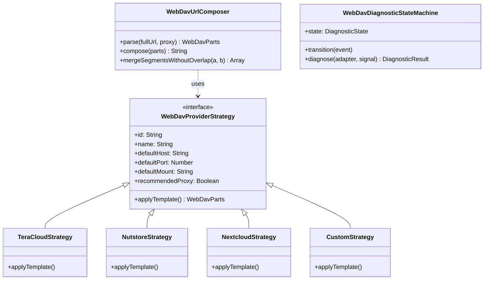
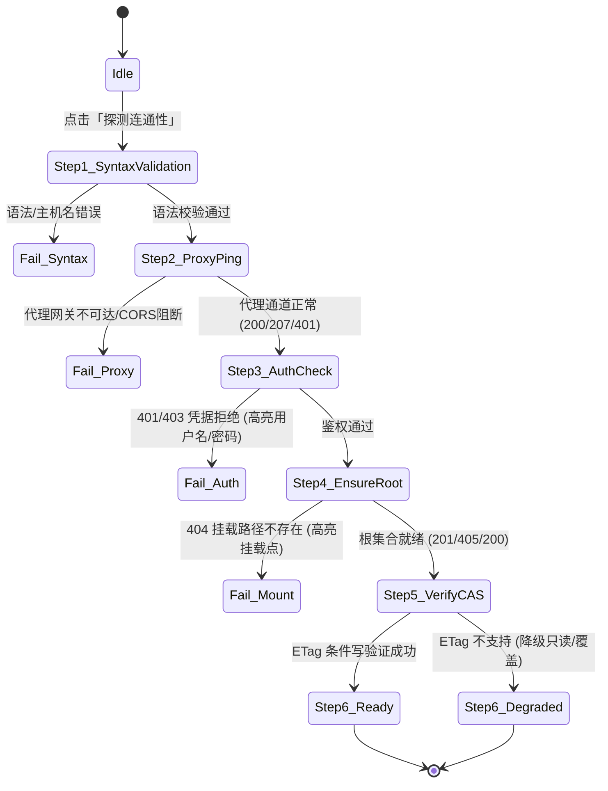

# WebDAV 结构化分段配置（地址/端口/路径/目录）与智能交互架构规范

> 文档编号：43  
> 归属模块：`features/data-management/` & `platform/storage/remote/` & `app/`  
> 关联规范：RFC 3986 (URI Generic Syntax), RFC 4918 (WebDAV), Architecture Gate Suite v2.1

---

## 1. 痛点复盘与头脑风暴 (Brainstorming)

### 1.1 现状痛点
在当前的配置界面中，用户需要填写：
- **WebDAV 端点 URL**（如 `https://proxy.example.com/proxy/dav.example.com/dav/`）
- **存储根目录**（如 `knowledge-arena`）

此设计将多种不同职责的信息揉杂在一个单行输入框中，导致普通用户和开发者频频踩坑：
1. **概念混淆**：用户无法区分“服务器主机（Host）”、“服务挂载点（Mount Path，如 `/dav`、`/remote.php/webdav`）”与“应用存储文件夹（Directory Path）”。
2. **前后斜杠困扰**：用户不确定输入末尾要不要加 `/`，经常在两边都加或者都不加。
3. **CORS 代理多重路径**：在 Web 端必须使用反向代理（如 `https://proxy.example.com/proxy/<target>`）时，复合 URL 更加难以手动拼写。
4. **历史缺陷触发点**：此前用户遭遇的 `/dav/dav/` 重复嵌套以及 `knowledge-arena` 根目录未建等问题，本质上都是因为用户在 `basePath` 中误填了包含挂载点的路径（如 `dav/knowledge-arena`）。

---

### 1.2 能否使用“地址 + 端口 + 挂载路径 + 目录路径”方案？

#### 核心结论：**完全可行，且能大幅降低交互认知负荷，但必须采用“智能双模式 + 实时预览”设计，不能搞成机械式割裂**。

#### 维度评估矩阵：

| 评估维度 | 纯单行 URL 模式（现状） | 纯拆分多字段模式（硬拆） | 智能双模 + 厂商预设（推荐方案） |
| :--- | :--- | :--- | :--- |
| **填写效率** | 粘贴方便，但极易拼错路径段 | 字段繁多（5~6 个框），复制整条 URL 需手动切分 | **支持整行粘贴自动解析分段，也支持按字段微调** |
| **容错率** | 极低（易发生 `/dav/dav/` 重叠） | 较高（各字段职责分明） | **极高（输入时实时数学消除重叠，底栏实时预览最终目标）** |
| **CORS 代理兼容** | 混写在 URL 中，难维护 | 若只给 Host/Port，无法表达代理前缀路径 | **提供独立「CORS 代理网关」辅助开关/输入，结构清晰** |
| **主流习惯匹配** | Joplin、Rclone CLI | FileZilla、Cyberduck 高级连接窗口 | **Obsidian Remotely Save / Postman 级别体验** |
| **性能开销** | 0ms | 0ms | **0ms（纯前端无依赖 URL/Regex 计算与微量响应式渲染）** |

---

## 2. 业界主流方案调研与开源库借鉴

我们调研了业界成熟的云同步与 WebDAV 客户端交互方案：

### 2.1 Obsidian Remotely Save（笔记同步标杆）
* **厂商预设策略 (Vendor Presets)**：提供常用 WebDAV 服务商一键预设（TeraCLOUD、坚果云 Nutstore、Nextcloud、自建 AList / 阿里云盘 WebDAV）。
* **自动补全挂载点**：选择“坚果云”时，自动填充服务地址 `https://dav.example.com` 与挂载路径 `/dav/`，用户只需填写账号、应用密码与自定义文件夹名。
* **CORS 引导提示**：在 Web/移动端明确标识浏览器直连限制，并提供默认可信代理或自定义代理中继。

### 2.2 Cyberduck / FileZilla（专业传输工具）
* **地址与端口解耦**：
  - 协议选择：`HTTPS`（默认端口 443）、`HTTP`（默认端口 80）
  - 主机名：`dav.example.com`
  - 挂载路径：`/dav`
* **双向联动**：修改主机或路径时，下方只读行动态展示当前完整 URI（`https://dav.example.com:443/dav`），杜绝隐蔽拼写错误。

### 2.3 Postman / Insomnia（现代网络工具）
* **单行与多行互通 (Bi-directional Binding)**：在主地址栏粘贴完整 URL，下方 Query / Path Params 会自动拆解成结构化表格；修改表格，主地址栏同步联动更新。

---

## 3. 架构设计与设计模式演进

为实现高内聚、易扩展、健壮无冗余的结构化 WebDAV 配置体系，引入以下经典设计模式：



### 3.1 策略模式：厂商模板策略 (Vendor Template Strategy)
针对主流 WebDAV 服务商的挂载点差异，定义标准化策略集合：

```javascript
export const WEBDAV_PRESETS = {
  teracloud: {
    id: 'teracloud',
    name: 'InfiniCLOUD (原 TeraCLOUD)',
    defaultHost: 'your-account.teracloud.jp',
    defaultPort: 443,
    defaultMount: '/dav',
    defaultBaseDir: 'knowledge-arena',
    recommendedProxy: true,
    helpUrl: 'https://example.com/'
  },
  nutstore: {
    id: 'nutstore',
    name: '坚果云 (Nutstore)',
    defaultHost: 'dav.example.com',
    defaultPort: 443,
    defaultMount: '/dav',
    defaultBaseDir: 'knowledge-arena',
    recommendedProxy: true,
    helpUrl: 'https://example.com/'
  },
  nextcloud: {
    id: 'nextcloud',
    name: 'Nextcloud / ownCloud',
    defaultHost: 'cloud.example.com',
    defaultPort: 443,
    defaultMount: '/remote.php/webdav',
    defaultBaseDir: 'knowledge-arena',
    recommendedProxy: false
  },
  custom: {
    id: 'custom',
    name: '自定义 / 自建 WebDAV (AList, Apache, Nginx)',
    defaultHost: '',
    defaultPort: 443,
    defaultMount: '/',
    defaultBaseDir: 'knowledge-arena',
    recommendedProxy: false
  }
};
```

### 3.2 适配器模式：双向联动编解码器 (URL Decomposer / Composer)
允许用户**既可以直接粘贴复合 URL，也可以分别修改各个分段**：

1. **Decomposer（反向解析）**：
   输入：`https://proxy.example.com/proxy/dav.example.com/dav/`
   自动识别：
   * 代理前缀：`https://proxy.example.com/proxy/`
   * 目标主机：`dav.example.com`
   * 目标端口：`443`
   * 服务挂载点：`/dav`
2. **Composer（正向合成）**：
   根据各分段输入，经由 `mergeSegmentsWithoutOverlap` 运算，实时生成规范化绝对端点 URL：
   `composedUrl = proxyPrefix + protocol + host + (port != 443 ? ':'+port : '') + mountPath`
3. **实时预览响应式徽标**：
   在输入框下方以等宽代码字体显示：
   `🔗 实际写入目标: https://proxy.example.com/proxy/dav.example.com/dav/knowledge-arena/`
   任何重叠（如 `/dav/dav/`）在预览中均已被数学消除，所见即所得。

### 3.3 状态机模式：分级连通性诊断与精准故障定位 (Diagnostic State Machine)
将目前的单次粗粒度 `probe` 改造为确定性分级状态机，帮助用户精准排障：



* **高亮定位错误字段**：
  - 若报 `401 Unauthorized`：自动在 UI 上红色高亮“用户名 / 应用密码”，提示检查 Token；
  - 若报 `404 Not Found`：自动高亮“服务挂载路径”，提示 `/dav` 或 `/remote.php/webdav` 拼写错误；
  - 若报 `Network / CORS Failed`：自动提示开启或更换“CORS 代理”。

---

## 4. UI / UX 落地线框图设计 (Mockup)

```text
┌─────────────────────────────────────────────────────────────┐
│  云端同步与 WebDAV 备份配置                                  │
├─────────────────────────────────────────────────────────────┤
│  服务商预设: [ InfiniCLOUD (TeraCLOUD) ▼ ] [ 一键套用模板 ]  │
│                                                             │
│  [ 快速模式 (完整 URL) ]    [ 专家模式 (结构化分段) ● ]       │
│ ┌─────────────────────────────────────────────────────────┐ │
│ │ 协议: [ HTTPS ▼ ]   服务器主机: [ dav.example.com   ] │ │
│ │ 端口: [ 443   ]     服务挂载点: [ /dav                ] │ │
│ │ 存储目录: [ knowledge-arena  ]  工作区: [ default     ] │ │
│ │ CORS 代理 (可选): [ https://proxy.example.com/proxy/        ] │ │
│ └─────────────────────────────────────────────────────────┘ │
│                                                             │
│  账号: [ your_account             ]  密码: [ ••••••••••••••• ]    │
│                                                             │
│  👀 实际请求目标预览 (动态消除重叠):                         │
│  https://proxy.example.com/proxy/dav.example.com/dav/knowledge-arena/
│                                                             │
│  [ ⚡ 深度诊断连通性 ]              [ 💾 保存配置 ]          │
└─────────────────────────────────────────────────────────────┘
```

---

## 5. 系统现有基础设施复用分析

1. **现有复用资产**：
   * `platform/storage/remote/webdav-adapter.js` 中的 `mergeSegmentsWithoutOverlap(a, b)`：作为 Composer 的核心计算引擎，已经过严格单元测试，零外部依赖。
   * `DataSyncManager` 中的配置持久化与回滚保护机制可以直接无感兼容新结构。
   * `app/app-shell.html` 的 Tailwind Grid 布局系统可直接容纳分段卡片。
2. **向后兼容性 (Backward Compatibility)**：
   * 存储在 LocalStorage 中的配置继续保留 `endpoint`、`basePath` 等核心字段；
   * 新增可选的结构化元数据（`host`, `port`, `mountPath`, `proxyUrl`）；
   * 旧版本已保存的完整 `endpoint` 在新 UI 载入时，由 `Decomposer` 自动拆解还原呈现，无需用户重填。

---

## 6. 质量门禁与实施演进路线

1. **阶段一（本期交付，规格确立）**：
   - 完成理论调研、数学模型推导、架构与模式设计，形成规范文件（本规范 `docs/43_...`）。
   - 保持现有 `mergeSegmentsWithoutOverlap` 核心健壮性。
2. **阶段二（后续交互升级实施）**：
   - 在 `features/data-management/` 增加轻量级辅助类 `webdav-url-helper.js`（`<= 120` 行，受控于 `FE-QUALITY-001`）。
   - 在 UI 接入“快速/分段双模”切换与预设模板，增强用户体验。
   - 补充 URL 编解码器与厂商模板策略的专用单元测试。
