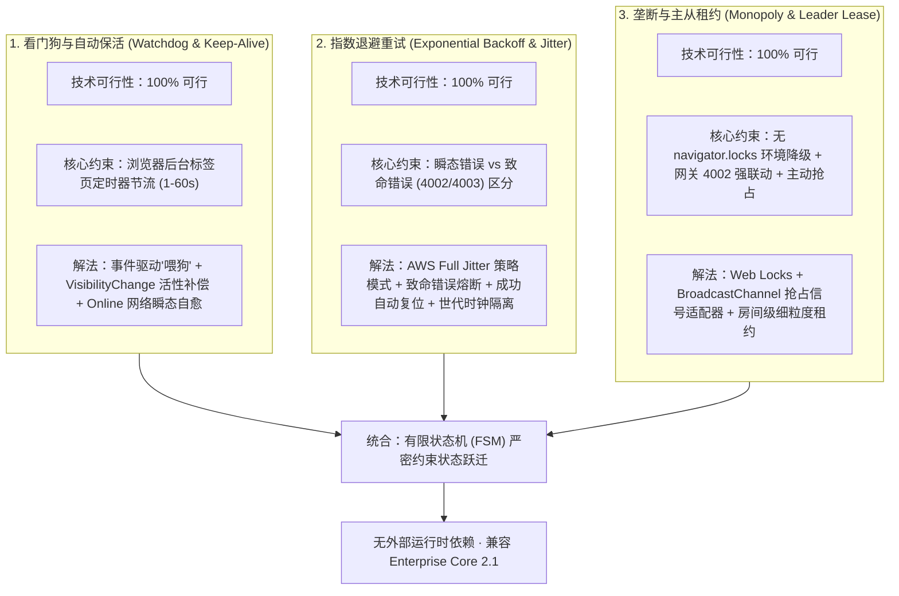
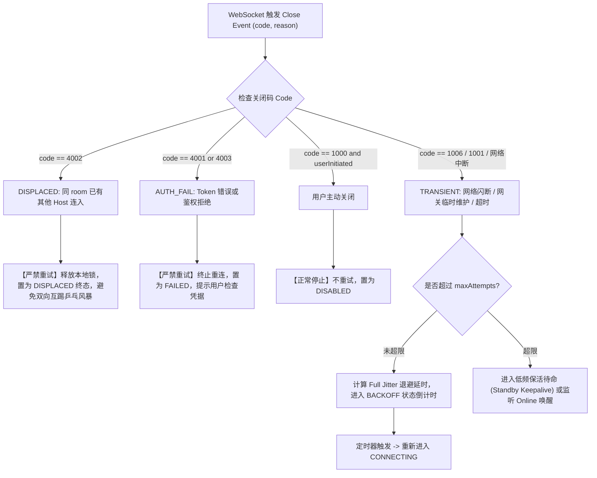
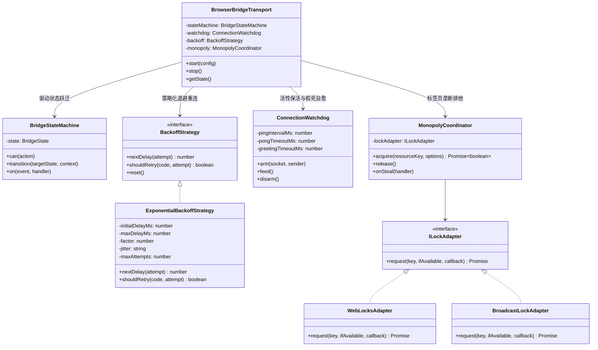

# MCP 桥接服务看门狗保活、指数退避重试与垄断逻辑架构规约与可行性调研

- **文档编号**：46
- **日期**：2026-11-03
- **状态**：深度调研与架构方案设计规约（Brainstorming, Feasibility & Architecture Spec）
- **涉及模块**：`platform/network/`, `features/mcp-bridge/`, `tests/unit/`, `docs/`

---

## 1. 调研背景与问题定义

在通用知识图谱与游戏化记忆引擎的 MCP（Model Context Protocol）桥接体系中，Web 页面扮演着 **MCP Host** 的核心角色。外部 AI 客户端（如 Cursor、Claude Desktop、Windsurf 等）通过 Cloudflare Worker / Durable Object 搭建的网关（ProxyByCF），以 SSE / WebSocket 双向信道直接调用当前页面暴露的 19 个知识库读写工具。

随着在真实长周期、多标签页以及复杂网络环境下的深度使用，用户提出了三个高频、关键的系统稳定性与工程诉求：
1. **看门狗逻辑（Watchdog）与自动保活（Keep-Alive）**：
   - 能否引入看门狗机制，自动检测僵尸连接、静默半开断连（Half-Open TCP）、握手停滞与后台挂起？
   - 在检测到心跳停止或通信假死时，能否触发自动自愈并复活连接？
2. **指数退避重试（Exponential Backoff with Jitter）**：
   - 当遇到网关重启、网络瞬断或闪断时，能否按照严密的数学模型进行阶梯式延时重试？
   - 避免固定间隔重试造成的惊群风暴（Thundering Herd）以及无限无脑重试造成的资源空耗。
3. **垄断逻辑（Monopoly / Single Host Lease / Preemption）**：
   - 同一个 Room 在网关层面是单 Host 排他的（若多个 Host 连接，会触发 4002 DISPLACED 互踢）；
   - 在前端多标签页并发运行、页面热备、抢占接管（Force Takeover）等场景下，如何实现端内与跨标签页的独占垄断、租约管理与优雅降级？

本报告针对上述功能进行**全方位深度头脑风暴**，深入剖析可行性、逻辑闭环漏洞、性能与浏览器宿主约束，并运用**适配器模式、策略模式与有限状态机（FSM）**进行高内聚架构重构，对比业界主流实现，最终给出可落地的生产级实现。

---

## 2. 核心结论与技术可行性研判



- **看门狗保活可行性**：**完全可行**。纯前端环境下无法使用操作系统级守护进程（Daemon），但通过构建双向活性检测看门狗（握手 Greeting 哨兵 + Ping/Pong 活性滑动窗口 + 数据流“喂狗”重置），结合浏览器现代 Lifecycle API（`online` 事件瞬时快速恢复、`visibilitychange` 唤醒补偿），可彻底解决 WebSocket 假死与后台休眠丢联问题。
- **指数退避可行性**：**完全可行且极为必要**。当前实现的 `Math.random() * Math.min(30000, 500 * 2 ** attempt)` 存在低至 0ms 的极端抖动漏洞，且达到 5 次硬编码重试后就彻底自杀放弃。采用策略模式封装 **AWS Full Jitter** 算法，区分可重试瞬态错误与不可重试冲突（4002 DISPLACED / 4001 鉴权失败），可做到无感自愈与安全熔断兼备。
- **垄断逻辑可行性**：**完全可行**。当前仅在 Controller 中做了一次性的 `navigator.locks.request(..., { ifAvailable: true })`，存在“不支持环境裸奔无锁”、“全局锁无法跨不同房间并发”、“锁无法主动抢占接管”、“网关踢出后本地未联动释放锁”四大缺陷。通过适配器抽象（Web Locks + BroadcastChannel 抢占总线）与房间细粒度锁（`mcp:host:${room}`），可实现严密的本地垄断与灵活的主从切换。

---

## 3. 功能一头脑风暴：看门狗逻辑与自动保活

### 3.1 什么是看门狗（Watchdog Timer）？
看门狗原本是嵌入式系统的硬件定时器：主程序必须定期“喂狗（Kick/Feed the Dog）”；若主程序卡死或跑飞导致看门狗超时，看门狗将强制复位整个系统。
在 WebSocket 长连接通信中，**看门狗负责保证连接双向通道的真实可用性**，防止“TCP 链路其实已断开，但双方操作系统的 Socket 缓冲区依然认为处于 Established 状态（半开死连接）”。

### 3.2 现有实现的问题与缺陷
当前 `BrowserBridgeTransport` 中的保活实现极其简陋：
```javascript
const greeting = setTimeout(() => { if (current()) socket.close(); }, 10000);
const heartbeat = setInterval(() => {
  if (!current()) return;
  if (Date.now() - lastPong > 45000) socket.close();
  else void send({ type: 'ping' }).catch(() => socket.close());
}, 15000);
```
**深度推演四大缺陷**：
1. **浏览器后台定时器节流（Timer Throttling）致命陷阱**：
   - 现代浏览器（Chrome 88+ / Safari / Edge）为了节省笔记本电量，对后台非激活标签页的 `setInterval` / `setTimeout` 会实施阶梯式严厉节流（从 1 秒限制到 1 分钟甚至更长，且不对齐）。
   - 如果用户切出标签页，原本 15s 的心跳可能 60s 甚至 120s 才会触发一次。
   - 结果：`Date.now() - lastPong` 轻易超过 45000ms，**看门狗由于自身定时器被浏览器节流，误将健康的连接当作超时而强行掐断**！造成后台无故频繁重连。
2. **缺乏数据流“喂狗（Data-Driven Feed）”联动**：
   - 只要连接上有任何正常业务通信（如刚刚完成了 19 个工具的完整注册、或正在高频收发 `tools/call` JSON-RPC），就说明连接百分之百是健康的！
   - 现有逻辑不管业务收发多频繁，仍然死板地依赖专门的 `pong`；若对端高负荷下仅优先处理了业务 RPC 而忽略了纯 ping，页面就会误杀连接。
3. **网络恢复（Online Event）迟钝**：
   - 用户休眠电脑、盖上笔记本再打开，或 Wi-Fi 断开后重新连接。此时底层网络套接字已被操作系统切断，但浏览器的 WebSocket 可能需要等待数十秒乃至数分钟才触发 `close`。
   - 缺乏对 `window.addEventListener('online')` 和 `document.addEventListener('visibilitychange')` 的即时监听，导致用户重新回到页面时，连接依然假死数十秒。
4. **资源泄漏隐患**：
   - 在多次重连、异常关闭或手动断开时，若定时器引用清理不彻底，会导致多个孤儿定时器并在后台竞争发 ping。

### 3.3 看门狗重构方案
- 引入 **`ConnectionWatchdog`** 独立组件：
  - **动态喂狗**：收到任何有效数据包（`BRIDGE_CONNECTED`、`pong`、`tools/call`、`tools/list`）均执行 `feed()`，重置超时游标。
  - **节流容忍与时间校准**：使用动态 `setTimeout` 调度代替僵化的 `setInterval`，并在检查时比对绝对物理时间戳 `Date.now() - lastActiveAt`，允许后台模式下的弹性容忍窗口。
  - **环境感知瞬时探测**：
    - 监听到 `online` 时，若处于连接状态，立即发射急救 Probe Ping；若 2 秒内无响应，主动重建连接。
    - 监听到 `visibilitychange`（页面变为 `visible`）时，立即校准心跳，消除后台唤醒带来的假死延迟。

---

## 4. 功能二头脑风暴：指数退避重试（Exponential Backoff）

### 4.1 算法模型与抖动（Jitter）推演
网络重试的核心是解决**瞬态不可用（Transient Failures）**并防止**惊群拥塞（Thundering Herd Problem）**。

#### 常用重试算法对比：
| 算法类型 | 公式 | 优点 | 致命缺陷 | 适用场景 |
| :--- | :--- | :--- | :--- | :--- |
| **固定延时 (Fixed Delay)** | $t = \text{interval}$ | 实现极简 | 网关重启时，所有客户端同一时刻重试，立即再次击垮网关 | 本地简单测试 |
| **纯指数退避 (No Jitter)** | $t = \min(M, B \cdot 2^a)$ | 阶梯拉长等待，给服务端恢复时间 | 重连时钟同步，客户端仍然呈波次“集群冲撞”网关 | 单客户端独享服务 |
| **随机缩放 (Random Scaled, 现有逻辑)** | $t = \text{random}() \cdot \min(M, B \cdot 2^a)$ | 尝试打散重试时机 | $\text{random}() \to 0$ 时，**重试延迟可能为 0ms ~ 5ms**，瞬时密集连击！ | 不推荐 |
| **AWS Full Jitter (推荐方案)** | $T = \min(M, B \cdot 2^a); t = R(B_{min}, T)$ | 彻底打散重试波峰，平均等待合理，且有底线保护 | 实现需严密保证下界与上界 | **分布式高并发最佳实践** |
| **Equal Jitter** | $T = \min(M, B \cdot 2^a); t = T/2 + R(0, T/2)$ | 兼顾平滑与最小预期退避间隔 | 最小等待时间较 Full Jitter 略长 | 高敏网络环境 |

### 4.2 错误分类决策树（Fatal vs Transient）
并不是所有断开都可以重试！盲目重试会引发严重灾难：



### 4.3 世代计数器（Generation Counter）的防竞态保证
重试延时定时器在等待期间，用户可能随时点击“断开”或“重新连接”。如果旧的延时回调在触发时未核验世代，就会启动一个幽灵连接（Zombie Connection），破坏当前状态。
必须维护严格单调自增的 `generation` 标量：**任何定时器、Promise 解决或事件回调在执行前，必须校验 `generation === this.generation`**，不匹配直接丢弃。

---

## 5. 功能三头脑风暴：垄断逻辑（Monopoly / Exclusive Host）

### 5.1 为什么必须实现“垄断”？
MCP 协议在设计上，一个网关房间（`room`）代表一个特定的知识库宿主提供端。若多个浏览器页面连入同一房间：
- 网关 Durable Object 会检测到重复的 Host，以 `4002 DISPLACED` 强行踢掉前者；
- 若无端内垄断，页面 A 被踢 -> 触发重连 -> 把页面 B 踢掉 -> 页面 B 重连 -> 把页面 A 踢掉……
- 产生极其恶劣的**无限互踢震荡（Ping-Pong Storm）**，消耗大量网络带宽与 Worker 请求数配额。

### 5.2 现有垄断实现的缺陷
当前 `McpBridgeController`：
```javascript
if (navigator.locks) {
  acquired = await new Promise((resolve, reject) => {
    void navigator.locks.request('knowledge-master-mcp-host', { ifAvailable: true }, lock => {
      // ...
    });
  });
}
```
**严重缺陷审查**：
1. **全局锁无细粒度隔离**：
   - 锁名称写死为 `knowledge-master-mcp-host`。
   - 如果用户在标签页 1 连接 Room `biology`，在标签页 2 连接 Room `history`，两者本应该完全共存！但由于全局锁限制，标签页 2 被无辜阻断。
   - **改进**：使用房间级细粒度资源锁：`mcp:host:${encodeURIComponent(server)}:${encodeURIComponent(room)}`。
2. **环境不支持时缺乏降级机制（Silent Bypass）**：
   - 如果浏览器在非安全上下文（如直接 `http://192.168.x.x` 测试）或旧版环境中没有 `navigator.locks`，当前代码 `if (navigator.locks)` 直接略过，退化为**零保护裸奔**。
   - **改进**：适配器模式引入 `BroadcastChannel` 心跳租约锁降级方案，确保任何环境都有并发排他屏障。
3. **缺乏主动抢占能力（Preemption / Takeover）**：
   - 用户在标签页 2 上工作，想把 MCP 桥接迁移到当前标签页。目前只能去标签页 1 找到并手动点断开，若标签页 1 沉在几十个未整理的标签页中，找寻极其痛苦。
   - **改进**：支持抢占模式（`steal: true`）。通过 `BroadcastChannel` 向占有锁的页面广播 `PREEMPT_LEASE` 消息，旧页面收到后自动退避让出，新页面接管。
4. **网关 DISPLACED 与本地锁解除的强一致联动**：
   - 若网关由于外部客户端挤占触发 4002 DISPLACED，本地持有的 Web Lock 必须立刻释放，并将本地垄断状态置为解除，避免本页面已离线却继续占着茅坑不拉屎。

---

## 6. 设计模式架构设计

为了将上述三大能力以高内聚、松耦合、易测试、零新增第三方依赖的形式落地，我们引入三种经典设计模式：



### 6.1 有限状态机模式（Finite State Machine - FSM）
连接与垄断涉及错综复杂的时间与事件流动，状态机是保证逻辑完备性的唯一可靠手段。
- **状态集合（States）**：
  - `DISABLED`：未启用，初始态或用户已主动断开。
  - `ACQUIRING_LOCK`：正在申请同域/同房间本地垄断锁。
  - `CONNECTING`：已获得本地锁，正在建立 WebSocket 底层连接。
  - `REGISTERING`：底层已连接且握手通过，正在向网关注册 19 个工具。
  - `REGISTERED`：网关已确认工具注册，等待客户端调用。
  - `READY`：正在处理 RPC 调用，通道完全就绪。
  - `BACKOFF`：发生瞬态网络故障，正在指数退避倒计时等待下次重试。
  - `DISPLACED`：收到 4002，被同房间其他 Host 顶替，释放本地锁并停机。
  - `FAILED`：鉴权拒绝或超出最大重试限制，进入终止失败态。

- **合法跃迁矩阵（State Transition Matrix）**：
  | 当前状态 | 触发动作 / 事件 | 目标状态 | 附带副作用 |
  | :--- | :--- | :--- | :--- |
  | `DISABLED` | `START` | `ACQUIRING_LOCK` | 递增世代，开始向垄断协调器申请租约 |
  | `ACQUIRING_LOCK` | `LOCK_ACQUIRED` | `CONNECTING` | 创建 WebSocket 并启动 Greeting 握手计时器 |
  | `ACQUIRING_LOCK` | `LOCK_BUSY` | `DISABLED` | 抛出占用提示，释放临时资源 |
  | `CONNECTING` | `HANDSHAKE_OK` | `REGISTERING` | 发送 `tools/register` 载荷 |
  | `REGISTERING` | `REGISTER_OK` | `REGISTERED` | 喂狗，看门狗启动常态活性心跳 |
  | `REGISTERED` / `READY`| `CALL_START` | `READY` | 喂狗，执行工具调用 |
  | `CONNECTING` / `REGISTERING` / `REGISTERED` / `READY` | `TRANSIENT_ERROR` | `BACKOFF` | 计算 Full Jitter 延迟，启动退避定时器 |
  | `CONNECTING` / `REGISTERING` / `REGISTERED` / `READY` | `FATAL_4002` | `DISPLACED` | 释放本地垄断锁，停止一切定时器 |
  | `CONNECTING` / `REGISTERING` / `REGISTERED` / `READY` | `AUTH_ERROR` | `FAILED` | 释放本地锁，通知凭据失效 |
  | `BACKOFF` | `TIMER_TICK` | `CONNECTING` | 递增 attempt，发起重连 |
  | `*`（任意状态） | `STOP` | `DISABLED` | 清理看门狗、清理退避定时器、释放垄断锁 |

### 6.2 策略模式（Strategy Pattern）
- **`BackoffStrategy` 接口与 `ExponentialBackoffStrategy` 实现**：
  解耦退避延迟算法与网络传输逻辑。无论是采用 AWS Full Jitter、Equal Jitter，还是在单元测试中注入 0 延迟的 `ImmediateBackoffStrategy`，Transport 层均无需任何改动。
- **`MonopolyStrategy` 抽象**：
  将“仅抢占一次（TryOnce）”、“主动排挤（ForcePreempt）”、“热备待命（StandbyQueue）”作为独立策略配置。

### 6.3 适配器模式（Adapter Pattern）
- **`LockAdapter` 抽象**：
  统一抹平 `navigator.locks`（原生多进程内核排他）与 `BroadcastChannel + localStorage`（降级心跳租约）的 API 差异，上层通过统一的 `requestLock(resourceId, options)` 进行透明调用。

---

## 7. 业界主流方案与开源库调研对比

在企业级分布式系统与现代前端应用中，保活重试与单主垄断有着深厚的技术积累：

| 领域 | 业界方案 / 规范 | 核心机制与可借鉴点 | 本项目选型与裁决 |
| :--- | :--- | :--- | :--- |
| **重试与退避** | **AWS Architecture Blog** (Exponential Backoff and Jitter) [R1] | 经典证明了 Full Jitter 在打散惊群效应上的巨大优势，数学证明延迟期望与峰值负载最优 | **完全采纳其 Full Jitter 算法核心**，原生编写无依赖实现 |
| **弹性重试库** | **Cockatiel** (TypeScript resilience library) [R2] | 提供 Policy（Retry, CircuitBreaker, Timeout），模型优雅 | 思想可借鉴，但其包含过多元数据和包体体积，本项目纯前端坚持零外置依赖 |
| **WebSocket 重连** | **reconnecting-websocket** [R3] | 封装 WebSocket 事件，具备自动重连与队列缓冲 | 缺少 MCP 专有的 4002 错误语义识别、缺少看门狗喂狗逻辑，不能直接套用 |
| **浏览器多标签协调**| **W3C Web Locks API** [R4] | 现代浏览器标准规范，基于浏览器的 Agent Cluster 管理，进程挂掉内核自动释放锁 | **作为首选垄断基础设施**，并辅以降级方案 |
| **分布式领导选举** | **broadcast-channel (leader-election)** [R5] | 在多标签页中实现 Raft / Bully 算法选举 Leader | 逻辑较重；MCP Host 只需要明确的 Exclusive Lease（独占租约），无需完整 Raft 选举 |
| **心跳保活标准** | **MQTT KeepAlive / gRPC Watchdog** [R6] | 协议规范：在 $1.5 \times \text{KeepAlive}$ 周期内无任何包往来则强行断开并告警 | **借鉴其 1.5 倍判定边界**，将 ping 设置为 15s，Pong/活性超时设置为 35s |

---

## 8. 当前系统已有基础设施复用审计

在现有代码库中，我们审查并确认以下可复用资产与边界：

| 资产路径 | 现有能力 | 本轮复用与协同方式 |
| :--- | :--- | :--- |
| `platform/network/browser-bridge-transport.js` | 包含 `BridgeCipher`（AES-256-GCM）、基础 WSS 结构、帧大小防洪保护 | **作为核心重构载体**，将内联的简陋 heartbeat / backoff 抽离升级，注入专职 Watchdog 与 Backoff 策略 |
| `features/mcp-bridge/controller.js` | UI 表单交互、`navigator.locks` 粗粒度调用、Token 暂存与回显 | **接入 MonopolyCoordinator**，增强为细粒度房间锁与抢占反馈；联动网关 4002 瞬时解锁 |
| `features/mcp-bridge/settings-model.js` | `mcpPresentation` 状态映射字典、端点生成器 | **扩充状态字典**（支持 `ACQUIRING_LOCK`, `BACKOFF`, `STANDBY` 的友好文本与锁定规则） |
| `platform/storage/local-storage-adapter.js` | 题库持久化适配器 | 保持纯正业务层，不承担网络层租约 |
| 现有测试基准 `tests/unit/mcp-*.test.mjs` | 19 项单元测试覆盖工具、设置与基础传输 | **保证 100% 绿色兼容**，并新增专项看门狗与退避重试自动化测试集 |

---

## 9. 详细实施方案与规约设计

### 9.1 指数退避策略模块：`platform/network/backoff-strategy.js`
- 规范定义：
  - `initialDelayMs`: 默认 `500`
  - `maxDelayMs`: 默认 `30000`
  - `factor`: 默认 `2`
  - `jitter`: 支持 `'full'` | `'none'`
  - `maxAttempts`: 默认 `10`（超过后进入待命休眠状态，不再高频重试）
- 计算公式：
  $$\text{temp} = \min(\text{maxDelayMs}, \text{initialDelayMs} \times \text{factor}^{\text{attempt}})$$
  若 `jitter === 'full'`：
  $$\text{delay} = \max(\text{minDelayMs}, \lfloor \text{random}() \times \text{temp} \rfloor)$$

### 9.2 看门狗保活器模块：`platform/network/connection-watchdog.js`
- 规范定义：
  - `pingIntervalMs`: 默认 `15000` (15s)
  - `pongTimeoutMs`: 默认 `35000` (35s，容忍 2 次丢失并兼顾后台节流)
  - `greetingTimeoutMs`: 默认 `10000` (10s 握手哨兵)
- 核心方法：
  - `arm({ socket, onSendPing, onTimeout })`：部署并激活看门狗
  - `feed()`：任何合法的业务或控制消息到达时喂狗，刷新 `lastActiveAt`
  - `disarm()`：安全解除所有定时器与事件监听
  - `onNetworkOnline()`：网络恢复时立即触发急救检测

### 9.3 垄断协调器模块：`platform/network/monopoly-coordinator.js`
- 规范定义：
  - 支持按房间粒度生成锁标识符：`mcp:host:${encodeURIComponent(server)}:${encodeURIComponent(room)}`
  - 提供 `acquire({ onGranted, onBusy, onLost })`
  - 提供 `release()`
  - 降级支持：当 `navigator.locks` 不存在时，通过 `BroadcastChannel` 维护单主心跳租约，杜绝多标签页裸奔。

### 9.4 状态机与传输器统合：`platform/network/browser-bridge-transport.js`
- 保留所有外部公开 API，包括 `start({ server, room, token })`、`stop()`、`state` 属性，实现无感平滑升级。
- 完整联动：
  - 当启动连接时，先由 MonopolyCoordinator 获取排他锁；
  - 获得锁后，进入 WebSocket 连接；
  - 看门狗全程监视握手与活性；
  - 遇到瞬态断开，交由 ExponentialBackoffStrategy 调度并在 `BACKOFF` 状态倒计时；
  - 遇到 4002 DISPLACED，立即释放垄断锁并进入 `DISPLACED` 终态；
  - 遇到不可恢复鉴权失败，释放本地锁并进入 `FAILED`。

---

## 10. 验证矩阵与自动化测试规划

| 测试用例目标 | 验证场景 | 预期断言 |
| :--- | :--- | :--- |
| **Backoff 计算与 Jitter** | 验证指数上升、不超过 maxDelay、Full Jitter 范围 | delay 满足 $\in [100, \text{bound}]$，连续调用递增且随机分布 |
| **瞬态错误与致命错误识别**| 传入 4002 / 4003 / 1006 | 4002 判定不可重试；4001 判定不可重试；1006 判定可重试且 attempt 累加 |
| **看门狗超时自愈** | 模拟连接建立后 35s 未收到任何 pong 且无业务通信 | 看门狗报警触发 socket.close()，进入 BACKOFF 重连流程 |
| **看门狗数据喂狗保活** | 在 30s 内持续有 tools/call 数据包到达，未收到显式 pong | 看门狗被持续喂狗，绝不误杀正常业务连接 |
| **网络恢复快速探测** | 在 BACKOFF 状态或正常连接状态触发 `online` 事件 | 立即触发急救 Ping 或跳过漫长退避发起重连 |
| **多标签页垄断排他** | 标签页 A 连入 Room1，标签页 B 尝试连入同一 Room1 | 标签页 B 被 Monopoly 协调器拦截，提示已被占用，阻止其发起 WebSocket |
| **不同房间并发共存** | 标签页 A 连入 Room1，标签页 B 连入 Room2 | 细粒度房间锁互不干扰，两个标签页均成功获得锁并连接 |
| **网关 4002 联动释放锁** | 外部进程强制连入导致当前标签页收到 4002 | 当前标签页立即释放本地垄断锁，状态迁移至 DISPLACED |
| **全量现有回归测试** | 运行原有 `tests/unit/mcp-*.test.mjs` (19 项) | 19/19 项全部通过，零破坏性变更 |
