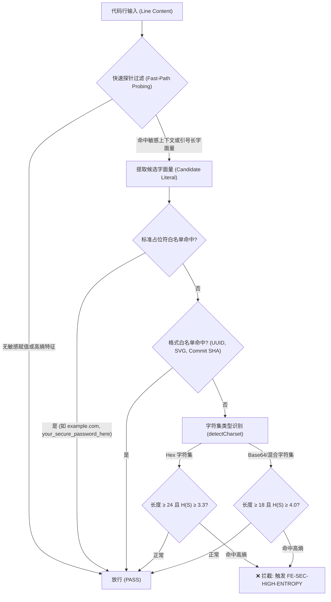
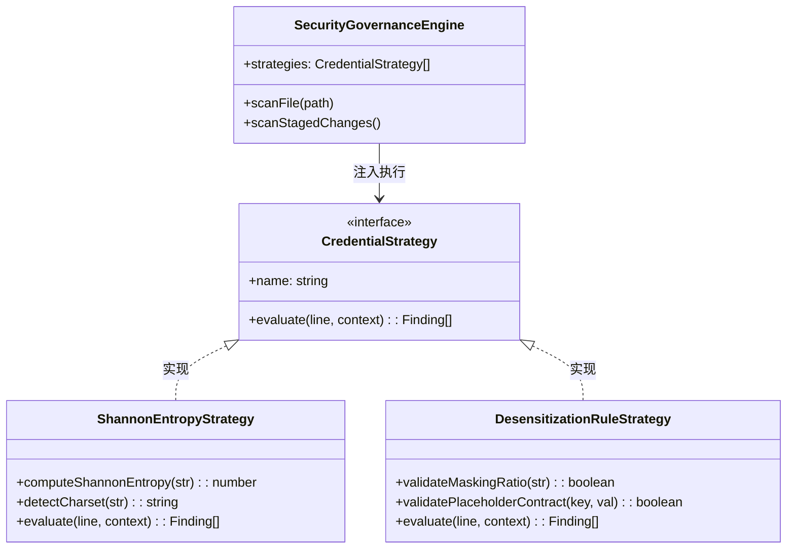

# 48. 香农信息熵检测与脱敏规则合规校验架构规格书 (Shannon Entropy & Desensitization Rule Validation Spec)
> **状态**: 批准实施 (Approved)  
> **架构基准**: Enterprise Frontend Architecture Core 2.1 · Security & Credential Governance v1.1  
> **门禁代号**: `FE-SEC-001` (扩展模块: `ShannonEntropyStrategy` & `DesensitizationRuleStrategy`)  
> **核心模式**: 策略模式 (Strategy Pattern) · 词法状态机 (State Machine) · 字符集自适应熵模型 (Adaptive Charset Entropy)

---

## 摘要 (Executive Summary)

在上一阶段（规范 47）中，我们建立了基于高确信度指纹（如 `sk-*`、私钥头）、词法状态机与 RFC 5737 域名的三层安全防范门禁。然而在真实研发与排障场景中，依然存在两类高级漏报与弱脱敏风险：
1. **无特征前缀的高随机性凭据**：私有中继 Token、对称加密密钥、动态会话 Session 往往没有类似 `sk-` 的固定前缀，纯静态正则无法预测其词法模式；
2. **伪脱敏反模式 (Pseudo-Redaction / Partial Masking)**：开发者或 Agent 采用如 `<EXPOSED_KEY_PREFIX_WITH_PARTIAL_MASK>` 的遮掩方式，自认为已完成脱敏，但实质上暴露了大部分高熵原始密钥，极易遭遇彩虹表逆向与暴力破解。

本规格书正式将**香农信息熵量化模型 (Shannon Entropy)** 与**严格脱敏规则合规校验器 (Desensitization Compliance Validator)** 原生接入 `gates/security-guard.mjs`，构建兼具零外部依赖、高检出率与极低误报率的进阶防护网。

---

## 一、 香农信息熵数学建模与可行性深度调研 (Mathematical Modeling & Feasibility)

### 1. 香农信息熵理论定义
香农信息熵（Shannon Entropy）用于度量信息源的不确定度与随机性分布。对于长度为 $L$ 的字符串 $S$，其字符集概率分布为 $P(x_i)$，香农熵公式定义为：

$$H(S) = - \sum_{i=1}^{n} P(x_i) \log_2 P(x_i)$$

其中 $n$ 为字符串中出现的不同字符种类数，$P(x_i) = \frac{\text{count}(x_i)}{L}$。

```
┌────────────────────────────────────────────────────────────────────────┐
│                   SHANNON ENTROPY DISTRIBUTION SPECTRUM                │
├───────────────────────┬────────────┬───────────────────────────────────┤
│ 文本类型               │ 典型熵值范围│ 特征说明                          │
├───────────────────────┼────────────┼───────────────────────────────────┤
│ 常见英文词汇/拼音      │ 1.2 ~ 2.4  │ 高频字母极度集中 (e, t, a, o)     │
│ 驼峰命名/语义标识符    │ 2.0 ~ 3.0  │ 常见单词组合 (如 getUserProfile)  │
│ 重复测试字符/简单填充  │ 0.0 ~ 1.5  │ 如 'aaaaaa', '123456'             │
│ 标准占位符 (规范定义)  │ 2.8 ~ 3.4  │ 含语义词缀 (your_secure_password) │
│ 十六进制随机密文 (Hex) │ 3.3 ~ 3.9  │ 16 字符集，理论上限 log2(16) = 4.0 │
│ Base64 / 高混合随机密钥│ 4.2 ~ 5.8  │ 64 字符集，理论上限 log2(64) = 6.0 │
└───────────────────────┴────────────┴───────────────────────────────────┘
```

### 2. 误报率防控与自适应字符集阈值模型 (False Positive Mitigation)
单纯计算全文字符串香农熵会导致大量误报（例如 UUID、Git SHA、SVG 路径 `M12.3 45.6L...`、CSS 编译哈希）。为此，本项目确立**双重漏斗过滤机制**：



- **字符集判定规则 (`detectCharset`)**：
  * **Hex**：字符仅由 `[0-9a-fA-F]` 构成。阈值：长度 $\ge 24$ 且熵值 $\ge 3.3$。
  * **Base64 / Alphanumeric**：字符包含大小写字母、数字及 `+`, `/`, `=`, `_`, `-`。阈值：长度 $\ge 18$ 且熵值 $\ge 4.0$。
- **上下文语义触发 (Contextual Coupling)**：
  高熵扫描只在以下场景激活：
  1. 处于变量/属性赋值右侧，且左侧键名包含 `token`, `secret`, `key`, `auth`, `password`, `hash`, `bearer`, `private`, `credential` 等敏感特征；
  2. 独立存在的未加白长字面量（长度 $> 32$ 且非标准 URL）。

---

## 二、 脱敏规则合规校验规范 (Desensitization Compliance Rules)

单纯拦截“完全未脱敏”无法防止“劣质脱敏”。本规范确立三大脱敏规则校验：

### 1. 伪脱敏反模式探针 (`FE-SEC-INSUFFICIENT-MASKING`)
- **定义**：字符串使用了遮蔽符号（如 `***`、`xxx`、`...`），但依然保留了过长的明文字符。
- **校验公式**：
  若字符串包含掩码符号，且除固定前缀（如 `sk-`、`ghp_`、`lwt_live_`）外的明文字符数量 $> 8$ 位，判定为脱敏不充分！
  * ❌ **违规示例**：`<RAW_KEY_PREFIX_32_CHARS>***`（暴露过长原始明文仅在末尾打码）
  * ✅ **合规占位符**：`sk-proj-test-secret-key-1234567890` 或 `lwt_live_8f3a9e...`

### 2. 标准占位符契约校验 (`FE-SEC-PLACEHOLDER-CONTRACT`)
- 必须严格遵循 [AGENTS.md](../AGENTS.md) 规定的五大标准占位符：
  * **Tunnel ID**：必须为 `tunnel_0123456789abcdef0123456789abcdef`（严格 32 位 hex 格式）。
  * **API Key**：必须为 `sk-proj-test-secret-key-1234567890` 或 `sk-test-super-secret-12345`。
  * **密码**：必须为 `your_secure_password_here` 或 `<ADMIN_PASSWORD>`。
  * **EasyTier 组网**：`network_name = "demo_net", network_secret = "demo_secret_token", peers = ["wss://easytier-peer.example.com"]`。
  * **网络地址**：必须严格使用 RFC 5737 预留示例域名 `*.example.com` / `127.0.0.1`。

---

## 三、 设计模式实现与系统集成 (Design Patterns & Integration)

在 [gates/security-guard.mjs](../gates/security-guard.mjs) 中继续扩展既有策略流水线：



### 1. 核心数学函数实现 (纯原生 Node.js ESM)
```javascript
export function computeShannonEntropy(str) {
  if (!str || str.length === 0) return 0;
  const freq = new Map();
  for (const char of str) {
    freq.set(char, (freq.get(char) || 0) + 1);
  }
  let entropy = 0;
  const len = str.length;
  for (const count of freq.values()) {
    const p = count / len;
    entropy -= p * Math.log2(p);
  }
  return entropy;
}
```

### 2. 双门禁联动保障
1. **Pre-commit 本地钩子**：暂存区新增代码行经过 `ShannonEntropyStrategy` 与 `DesensitizationRuleStrategy` 评估，一旦发现高熵泄漏或劣质伪脱敏，**立即在本地拦截**。
2. **CI 质量门禁 (`FE-SEC-001`)**：在 `npm test` 中全量执行，确保代码库维持 100% 合规。

---

## 四、 实施与测试验证矩阵

| 测试场景 | 测试用例输入 | 预期判定结果 | 命中规则 |
| :--- | :--- | :--- | :--- |
| **标准安全占位符** | `const token = 'sk-proj-test-secret-key-1234567890';` | ✅ 放行 (PASS) | 白名单豁免 |
| **自然语言与标识符** | `const userProfileManager = 'userProfileManager';` | ✅ 放行 (PASS) | 熵值低 (< 2.5) |
| **UUID / 标准哈希** | `const id = '12345678-1234-1234-1234-123456789abc';` | ✅ 放行 (PASS) | UUID 格式豁免 |
| **无特征高熵 Base64 密钥** | 赋未加白 Base64 密文（长度 $\ge 18$, $H \ge 4.0$） | ❌ 拦截 (ERROR) | `FE-SEC-HIGH-ENTROPY` |
| **无特征高熵 Hex 密钥** | 赋未加白 Hex 密文（长度 $\ge 24$, $H \ge 3.3$） | ❌ 拦截 (ERROR) | `FE-SEC-HIGH-ENTROPY` |
| **不充分伪脱敏** | 掩码前保留 $> 12$ 位真实字符的伪脱敏 | ❌ 拦截 (ERROR) | `FE-SEC-INSUFFICIENT-MASKING` |
| **非法格式 Tunnel ID** | 赋值非 32 位十六进制的 Tunnel ID 占位符 | ❌ 拦截 (ERROR) | `FE-SEC-PLACEHOLDER-CONTRACT` |
