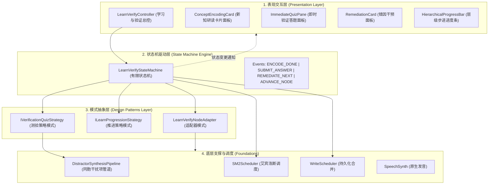
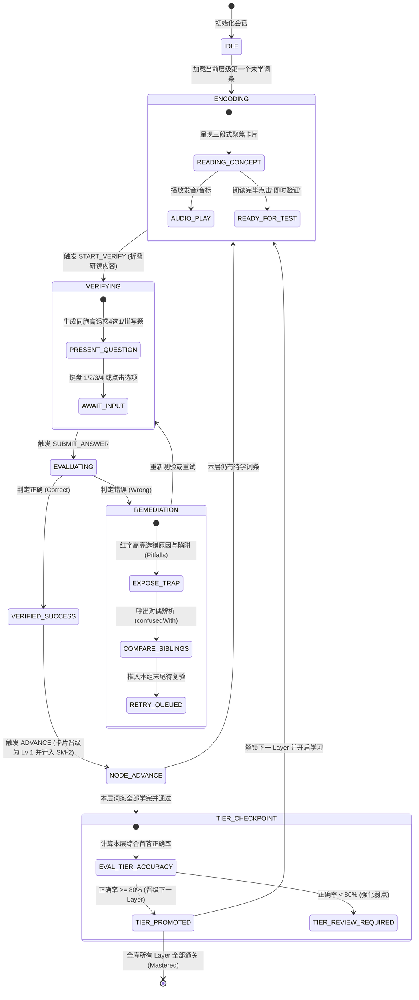
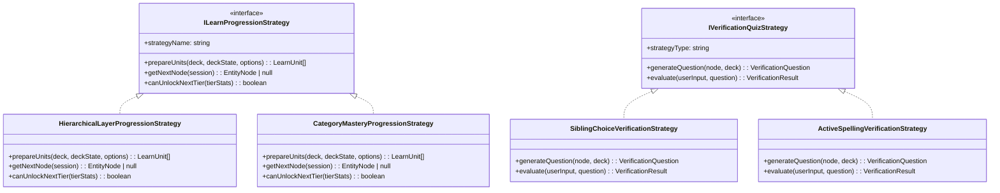
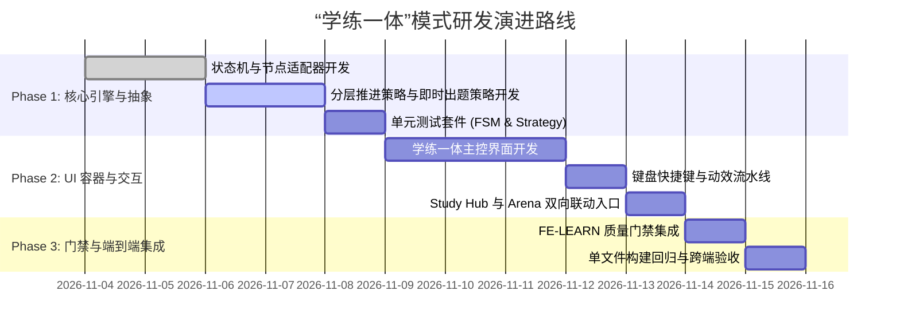

# 49. 题库层级化“学练一体”新知学习与即时验证引擎规约 (Learn & Verify Hierarchical Mastery Spec)

> **对应架构**：Enterprise Frontend Architecture Core 2.1  
> **设计规范参考**：`02_GAME_DESIGN_SPEC.md`、`03_DATA_SCHEMA_AND_KNOWLEDGE_BASE.md`、`08_GROUP_CATEGORY_LAYER_HIERARCHY_SPEC.md`、`27_QUESTION_SOURCE_DESIGN_PATTERNS_SPEC.md`、`32_DECK_SYSTEMIC_KNOWLEDGE_GUIDE_AND_RELATIONAL_LEARNING_SPEC.md`、`AGENTS.md`  
> **状态**：PROPOSED & FEASIBILITY APPROVED  
> **版本**：v2.6-LearnAndVerify  

---

## 摘要与决策全景 (Executive Summary)

当前 Knowledge Arena 题库体系在“新知识初次获取 (Initial Knowledge Acquisition)”与“题库测验 (Retrieval Practice)”之间存在显著的**体验孤岛与认知断层**：
1. **现状割裂**：知识精读中心 (`#/study`) 侧重单向被动浏览，缺乏即时考核反馈；竞技场模式 (`#/arena`) 侧重对既有卡片的快速测试与遗忘曲线复习（SM-2），面对完全未接触的新词条时，容易导致学习者因“未学先测”产生认知超载与猜题挫败。
2. **核心诉求**：构建**“学习并验证 (Learn & Verify)”一体化模式**，支持按**认知层级 (Layer 1 基础认知 ➔ Layer 2 规律运用 ➔ Layer 3 陷阱特例)** 或 **知识单元 (Category)** 进行“先学新知 ➔ 即时微测 ➔ 错因就地干预 ➔ 层级门禁通关”的完整闭环。
3. **架构与模式升级**：引入**有限状态机 (Finite State Machine)** 严格管理学练流转，运用**策略模式 (Strategy Pattern)** 解耦分层推进与题目生成，运用**适配器模式 (Adapter Pattern)** 抹平不同学科知识条目的呈现与测验形态，并在纯前端单文件零依赖（Zero-Backend Pure Client ~700KB）架构下实现高性能毫秒级响应。

---

## 一、 现存痛点与认知断层剖析 (Background & Problem Statement)

```
【当前孤岛体验】
   知识精读中心 (#/study)                           竞技场对战 (#/arena)
┌─────────────────────────┐                     ┌─────────────────────────┐
│ • 单向被动浏览与折叠遮挡   │   【认知鸿沟】       │ • 随机/沙盒/艾宾浩斯复习 │
│ • 易产生“已看即已会”假象  │ <===============> │ • 遇到新词条直接出题    │
│ • 缺乏即时主动提取练习   │   缺乏一体化脚手架  │ • 无概念铺垫，盲目猜选项│
└─────────────────────────┘                     └─────────────────────────┘
                                   ▼
【目标一体化闭环：学练一体 (Learn & Verify)】
┌─────────────────────────────────────────────────────────────────────────┐
│  [概念铺垫与图式建构] ──> [即时微测/提取练习] ──> [错因干预] ──> [层级通关门禁]  │
│      (Learn/Encode)         (Verify/Test)      (Remediate)       (Gate) │
└─────────────────────────────────────────────────────────────────────────┘
```

### 1. 痛点一：被动阅读的“胜任力错觉” (Illusion of Competence)
- **现象**：用户在 `#/study`（知识精读）中逐卡翻看，由于答案就在下方或悬停即可见，大脑工作记忆仅执行了**低强度的知觉再认（Perceptual Recognition）**，产生“我已经全掌握了”的认知虚高。
- **后果**：退出精读进入竞技场后，面对高诱惑同胞干扰项时错误率骤增，造成挫败感。

### 2. 痛点二：新知初见的“盲猜焦虑” (Cold-Start Retrieval Anxiety)
- **现象**：对于 Level 0（未学过）的冷启动词条，若直接推入 `#/arena` 每日复习或沙盒，用户在尚未理解动词变位规则（如 `-ic` 动词为何补 `k`）、HTTP 状态码设计语义或 Python 引用模型前，就被迫在 4 个相似度极高的选项中做选择。
- **后果**：选择变成纯粹的排除法猜题，不仅未能建立逻辑图式，反而强化了对错误干扰项的错误印象。

### 3. 认知心理学与教育学理论支撑

| 认知科学理论 | 提出学者 / 领域 | 对“学练一体”模式的指导意义 |
| :--- | :--- | :--- |
| **掌握学习理论 (Mastery Learning)** | 本杰明·布鲁姆 (Benjamin Bloom) | 学习者必须在低阶层级（Layer 1 基础概念）达到预设熟练度（如 80%~100%）后，方可晋级至更高阶层级（Layer 2/3），避免基础夹生导致的复合型认知崩溃。 |
| **提取练习效应 (Testing Effect)** | Roediger & Karpicke (2006) | 提取（检索）本身就是强大的记忆固化过程。阅读后**立即进行微测**，长时记忆保留率比单纯反复阅读提升 50% 以上。 |
| **测验增强学习效应 (Test-Potentiated Learning)** | Arnold & McDermott (2013) | 即时测验即使答错，也激活了大脑对该知识盲区的神经敏感性。此时紧跟**就地错因干预（Remediation）**，大脑对正确解析的编码深度达到峰值。 |
| **先行组织者 (Advance Organizer)** | 戴维·奥苏贝尔 (David Ausubel) | 在学习细节词条前，先以结构化大纲呈现其所属的 Group 渊源与 Category 规律，降低工作记忆负荷。 |

---

## 二、 头脑风暴：可行性、逻辑闭环与性能全景研判 (Brainstorming & Risk Analysis)

### 1. 可行性研判 (Feasibility)

| 评估维度 | 现状与系统储备 | 可行性结论 |
| :--- | :--- | :--- |
| **三维知识本体** | 系统原生具备 `Group（宏观大组）× Category（分类）× Layer 1/2/3（认知层级）` 正交架构 (`shared/builtin-decks.js`, `shared/markdown-ast.js`) | 🟢 **100% 契合**：数据已严格分层，天然支持按 Layer 递进学习。 |
| **干扰项合成能力** | `shared/distractor-sampler.js` 拥有同分类同胞对齐、形态匹配与自适应退火管道 | 🟢 **100% 可复用**：即时验证可毫秒级派生高质量诱惑项。 |
| **记忆调度引擎** | `shared/sm2-scheduler.js` 拥有完整的 SM-2 衰减与到期调度算法 | 🟢 **100% 可闭环**：新卡片一旦通过即时验证，自动初始化为 Level 1，接入后续每日复习。 |
| **单文件零依赖约束** | `index.html` 需维持单文件便携离线特性（当前 ~684KB），打包流水线 `scripts/bundler.mjs` 纯静态扫描 | 🟢 **高度可行**：无需引入臃肿外部库，采用纯原生轻量 ESM 状态机与策略类。 |

---

### 2. 逻辑完整性与潜在欠缺 (Logic Gaps & Edge Cases)

在架构设计与逻辑推演中，必须高度警惕并解决以下 5 大逻辑缺陷：

```
                    ┌────────────────────────────────────────────────────────┐
                    │             学练一体模式 5 大潜在逻辑缺陷研判          │
                    └───────────────────────────┬────────────────────────────┘
                                                │
         ┌───────────────────┬──────────────────┴────────────────────┬───────────────────┐
         ▼                   ▼                                       ▼                   ▼
  【1. 零延迟暂留错觉】  【2. 严苛卡关流失】                    【3. 模式状态污染】   【4. 长文本与代码适配】
  刚看完卡片立即测4选1   某偏门考点连续答错                    学练中的答题对错      非英语类知识（如Python）
  测试沦为视觉瞬时暂留   硬性门禁阻断后续学习                  意外重置或破坏既有    选项过长或代码块高亮
  缺乏实质认知提取加工   缺乏救助与跳过通道                    SM-2 到期复习计划     导致卡片排版撑破容器
```

#### 欠缺 1：零延迟暂留记忆错觉 (Zero-Delay Iconic Memory Illusion)
- **痛点**：若在展示知识卡片后，0 秒无缝在同一位置弹出该卡片的选择题，用户依靠的是**视网膜瞬时暂留与短时工作记忆**，而非长时记忆的实质提取。
- **治理策略**：
  1. **折叠隐藏与感知脱敏**：进入“即时验证”时，完全折叠概念卡片，并施加 300ms 渐变切换，切断直接视线对照；
  2. **逆向/变异提问策略**：学习时展示的是 `原词 -> 过去分词`，验证时可切换提问形式（如给出分词反查原词，或要求在 4 个同胞变位中找出“唯一规则变位者”）；
  3. **微单元交错验证 (Micro-Interleaving)**：支持单元小批次学习（如一次学习 3 个相关考点 A、B、C，然后交错测验 B、A、C），强迫大脑建立检索路径。

#### 欠缺 2：严苛卡关导致的挫败流失 (Hard-Gating Drop-off)
- **痛点**：若设定“Layer 1 必须 100% 全部答对才能解锁 Layer 2”，用户一旦在某个冷门特例反复出错，整个学习流程停滞。
- **治理策略**：
  1. **双轨掌握度门禁**：通过率阈值设定为 80%（与主线天梯 Tier 80% 保持一致）；
  2. **就地错因干预与错题池回环 (Remediation Re-queue)**：答错不直接判死刑，立即展开【陷阱警示 (`pitfalls`)】与【同胞混淆对比 (`confusedWith`)】，并将该词条推入本轮队列末尾再次复验；
  3. **跳级定级测试 (Test-Out Gate)**：对于有基础的用户，提供“直接参加本层通关测验”入口，答对即一键解锁全层。

#### 欠缺 3：跨模式状态污染与调度口径冲突 (State Desynchronization)
- **痛点**：用户在学练一体模式中做错，是否直接判定为艾宾浩斯“遗忘”并将卡片熟练度清零？
- **治理策略**：
  - **新知初学特权 (Encoding Grace Period)**：对于 `level === 0` 的全新词条，即时验证中的错误归因为“初始编码未完成”，记录内部尝试次数，但不产生过高的惩罚衰减；
  - 一旦即时验证通过，卡片状态原子化初始化：`level = 1, attempts = 1, correct = 1, nextReviewAt = now + 1 day`，平滑衔接至主系统的 SM-2 每日复习队列。

#### 欠缺 4：学科类型与呈现形式失配 (Disciplinary Mismatch)
- **痛点**：英语动词是短词条，而 HTTP 协议涉及状态行、报文首部，Python 涉及代码块与内存图。
- **治理策略**：
  - 采用**多模态适配器 (Multi-Modal Entity Adapter)**：英语题库自动激活 Web Speech 发音与音标；协议与编程题库自动激活 Markdown 语法树与等宽代码高亮。

#### 欠缺 5：中断恢复与学习会话韧性 (Session Resumption)
- **痛点**：用户学到 Layer 2 第 5 题突然刷新页面或关闭标签，进度丢失。
- **治理策略**：
  - 本地轻量 Session 暂存：将当前 `activeDeckId`、`activeLayer`、`activeUnitId`、`completedEntityIds` 实时同步至 `localStorage`（通过 `WriteScheduler`），重开页面一键“继续上次学练”。

---

### 3. 性能评估与非功能性约束 (Performance & Constraints)

1. **单文件零后端物理约束**：
   - 禁止为了状态机引入 60KB+ 的 `xstate`，禁止引入重量级富文本编辑器或外部图表库；
   - 纯前端状态机与控制器源码必须符合 `FE-QUALITY-001`（单文件不超过 300 行）；
   - 打包构建产物维持单文件 `index.html` 运行模式。
2. **DOM 渲染效率与 60FPS 流畅度**：
   - 学练卡片切换采用“就地内容替换 (DOM Content Swapping)”而非频繁注销并重建外层容器；
   - 动画采用 CSS Transform / Opacity GPU 加速，避免引起回流 (Reflow)。
3. **存储写入合并 (Storage Coalescing)**：
   - 避免每答完一题直接同步阻塞写入 `localStorage`；统一走 `platform/storage/write-scheduler.js` 的 200ms 防抖合并管道。

---

## 三、 业界主流方案横向对比与深度借鉴 (Industry Benchmarking)

为了确保设计具备业界先进水准，深入调研了 5 大主流在线学习与记忆产品：

```
                    ┌────────────────────────────────────────────────────────┐
                    │               业界 5 大主流学练模式对比矩阵            │
                    └───────────────────────────┬────────────────────────────┘
                                                │
         ┌───────────────────┬──────────────────┴────────────────────┬───────────────────┐
         ▼                   ▼                                       ▼                   ▼
     【多邻国】             【可汗学院】                            【力扣探索】          【Anki / SuperMemo】
   咬合式微课+关卡树      布鲁姆掌握学习理论                      长文精读+嵌入沙盒     纯间隔复习算法(SM-2/FSRS)
   Learn-Test-Crown       Instruction -> Practice -> Gate         Reading -> Sandbox    无新知讲解，缺乏初次建构
```

| 评估维度 | Duolingo (多邻国) | Khan Academy (可汗学院) | LeetCode (力扣探索/LeetBook) | Anki / SuperMemo | **Knowledge Arena (本方案)** |
| :--- | :--- | :--- | :--- | :--- | :--- |
| **核心机制** | **Learn-Test-Crown** 闭环，每个节点内 10~15 个微互动 | **Mastery Learning**，视频/精读后接 4 道微测题 | 章节概念长文 + 嵌入式即时编程/选择题 | 翻转卡片检索练习（SM-2 / FSRS） | **3D 知识层级化学练一体 (Learn & Verify)** |
| **新知呈现方式** | 单词卡片、提示气泡、点词翻译（轻量沉浸） | 讲解视频、图文大纲、知识公式卡 | 长篇理论讲解、动图演示、代码示例 | 无内置新知讲解（完全依赖用户自行外部学习） | **三段聚焦卡片 (核心释义 + 同胞辨析 + 避坑陷阱)** |
| **即时验证形式** | 拼词、选择、听音连线、句子翻译 | 4 道形成性测试题，需达到 80%~100% 正确率 | 单题代码沙盒运行或概念多选题 | 用户自我评估（Again, Hard, Good, Easy） | **同胞高诱惑干扰项单选 + 拼写默写双轨** |
| **错误干预机制** | 扣除爱心，当前关卡末尾自动重推错题 (Re-queue) | 提示步骤解析，推荐回顾对应视频切片 | 查看官方题解与讨论区，重新提交验证 | 强制重置调度间隔至 Step 1 (1分钟后重来) | **测验增强红字干预 + 易混淆对比 (`confusedWith`) + 本单元末尾回环** |
| **晋级推进门禁** | Crown 皇冠关卡树 / 线性 Learning Path，逐步解锁 | 熟练度阶梯 (未开始➔熟悉➔精通➔完全掌握) | 章节按序锁定，必须通过前置测试方可点击下一章 | 无概念层级门禁（完全由算法打散抽查） | **认知层级门禁 (Layer 1 基础 ➔ Layer 2 规律 ➔ Layer 3 陷阱)** |
| **部署与网络依赖** | 强依赖云端 BirdBrain 模型与在线服务器 | 强依赖云端服务器与视频 CDN | 强依赖云端评测判题引擎 | 本地客户端 / 可配置 WebDAV | **Core 2.1 零后端纯前端独立单文件，100% 离线秒开** |

### 核心借鉴启示：
1. **借鉴 Duolingo 的“错题单元内就地回环 (Intra-Session Error Recycling)”**：答错不扣分退场，而是记录为待巩固，并在完成其他考点后压轴再次考核，确保每个节点离开时达到“全通关”心理满足。
2. **借鉴 Khan Academy 的“掌握度状态跃迁 (Mastery Tiers)”**：将节点标记为 `未学习 (Unlearned)` ➔ `学习中 (Learning)` ➔ `已验证 (Verified)` ➔ `牢固掌握 (Mastered)`。
3. **弥补 Anki 的致命短板**：彻底终结“Anki 只能复习旧知识，无法学习新知识”的历史局限，把“新知初次编码”与“长期间隔复习”无缝缝合。

---

## 四、 基础设施复用与第三方库选型评估 (Build vs Buy)

### 1. 现有基础设施 100% 复用清册

本项目历经多个版本迭代，已沉淀出高工业级的基础设施，本模式无需重复造轮子：

```
┌─────────────────────────────────────────────────────────────────────────┐
│                       当前系统可 100% 复用的基础设施                      │
├──────────────────────────┬──────────────────────────────────────────────┤
│ 模块路径                  │ 复用能力与接入接口                            │
├──────────────────────────┼──────────────────────────────────────────────┤
│ shared/builtin-decks.js  │ 3D 知识数据模型 (Group/Category/Layer/Entity) │
│ shared/distractor-sampler│ 同胞干扰项管道 generateDistractors(ent, deck)│
│ shared/sm2-scheduler.js  │ SM-2 算法 calculateNextReview(card, grade)   │
│ shared/question-strategie│ 策略工厂与规约抽象 (strategyFactory, Specs)   │
│ features/arena/stepped-pr│ 认知阶梯定义 (TIERS 1/2/3, 80% Gate)         │
│ features/study-hub/focus-│ 三段式聚焦阅读排版与同胞比对矩阵渲染         │
│ platform/audio/speech-syn│ Web Speech 离线发音 speakWord(word)          │
│ platform/storage/write-sc│ 批量写合并与防抖持久化 WriteScheduler        │
│ design-system/           │ Tailwind 令牌、Surface 0~4、单色 SVG 图标     │
└──────────────────────────┴──────────────────────────────────────────────┘
```

### 2. 开源库调研与选型决策 (Build vs Buy)

| 选型领域 | 候选开源库 | 优缺点对比 | 本方案决策 |
| :--- | :--- | :--- | :--- |
| **状态机 (FSM)** | **XState (v5)** | 强大完备，支持 SCXML、嵌套状态、Actor 模型；**缺点**：体积 >60KB，TypeScript 重构成本高，违背轻量单文件准则。 | ❌ 放弃引入 |
| | **Robot3** | 仅 1KB，函数式状态机；**缺点**：依然需要 npm 打包与外部依赖管理。 | ❌ 放弃引入 |
| | **原生轻量 ESM 状态机** | **自主实现（~90行）**：严格定义 States、Transitions、Guards 与 Lifecycle Hooks，0 运行时体积负荷，100% 契合 Core 2.1 架构。 | ✅ **自主实现 (自研)** |
| **知识追踪算法** | **pyBKT / BKT** | 经典贝叶斯知识追踪，参数估计需大量先验数据；纯前端离线单机难以训练参数。 | 💡 **借鉴模型思想** (用于掌握度权重预估) |
| | **既有 SM-2 + 阶梯判定** | 本地运行毫秒级，已有完备单元测试守护。 | ✅ **复用既有算法** |

---

## 五、 架构方案与设计模式深度应用 (Architecture & Design Patterns)

本方案采用四层正交的面向对象与函数式混合设计模式：



---

### 1. 设计模式一：有限状态机模式 (Finite State Machine Pattern)

管理单次“学练一体”会话中节点生命周期的严密流转，杜绝非法状态跳变（如在概念研读阶段提交答案）：



#### 状态机契约实现代码设计 (`features/learn-verify/state-machine.js`):
```javascript
export const LearnVerifyState = {
  IDLE: 'IDLE',
  ENCODING: 'ENCODING',
  VERIFYING: 'VERIFYING',
  EVALUATING: 'EVALUATING',
  REMEDIATION: 'REMEDIATION',
  NODE_ADVANCE: 'NODE_ADVANCE',
  TIER_CHECKPOINT: 'TIER_CHECKPOINT',
  COMPLETED: 'COMPLETED'
};

export class LearnVerifyStateMachine {
  constructor({ initialNode, strategy, onTransition }) {
    this.state = LearnVerifyState.IDLE;
    this.currentNode = initialNode;
    this.strategy = strategy;
    this.onTransition = onTransition;
    this.history = [];
  }

  transition(event, payload = {}) {
    const prevState = this.state;
    switch (this.state) {
      case LearnVerifyState.IDLE:
        if (event === 'START') this.state = LearnVerifyState.ENCODING;
        break;
      case LearnVerifyState.ENCODING:
        if (event === 'START_VERIFY') this.state = LearnVerifyState.VERIFYING;
        break;
      case LearnVerifyState.VERIFYING:
        if (event === 'SUBMIT') this.state = LearnVerifyState.EVALUATING;
        break;
      case LearnVerifyState.EVALUATING:
        if (event === 'CORRECT') this.state = LearnVerifyState.NODE_ADVANCE;
        else if (event === 'WRONG') this.state = LearnVerifyState.REMEDIATION;
        break;
      case LearnVerifyState.REMEDIATION:
        if (event === 'RETRY') this.state = LearnVerifyState.VERIFYING;
        else if (event === 'NEXT_UNRESOLVED') this.state = LearnVerifyState.ENCODING;
        break;
      case LearnVerifyState.NODE_ADVANCE:
        if (event === 'NEXT_NODE') this.state = LearnVerifyState.ENCODING;
        else if (event === 'TIER_FINISH') this.state = LearnVerifyState.TIER_CHECKPOINT;
        break;
      case LearnVerifyState.TIER_CHECKPOINT:
        if (event === 'UNLOCK_NEXT_TIER') this.state = LearnVerifyState.ENCODING;
        else if (event === 'ALL_COMPLETE') this.state = LearnVerifyState.COMPLETED;
        break;
      default:
        throw new Error(`[FSM] Illegal transition from ${this.state} on event ${event}`);
    }
    this.onTransition({ from: prevState, to: this.state, node: this.currentNode, payload });
  }
}
```

---

### 2. 设计模式二：策略模式 (Strategy Pattern)

将**“如何排布学习顺序”**与**“如何出题验证”**解耦，保证系统具备开闭原则 (OCP)，支持未来扩充更多学科或题型：



#### 策略一览：
1. **`HierarchicalLayerProgressionStrategy` (层级阶梯策略)**：
   - 严格遵循 `Layer 1 ➔ Layer 2 ➔ Layer 3`；
   - 过滤当前 Deck 中未掌握的词条，按层级升序编排；
   - 每层达到 80% 首答正确率并完成全量错题回环时，解锁下一层。
2. **`CategoryMasteryProgressionStrategy` (知识模块突破策略)**：
   - 围绕指定 Category 进行全层级垂直打透；
   - 适合针对特定专题（如“规则动词变位”或“HTTP 4xx 客户端错误”）的专项突击。
3. **`SiblingChoiceVerificationStrategy` (同胞甄别测验策略)**：
   - 依托 `generateDistractors` 动态获取 3 个同胞干扰项，打乱顺序呈现 4 选 1。
4. **`ActiveSpellingVerificationStrategy` (拼写主动构建策略)**：
   - 针对语言类词库，遮挡目标答案，要求键盘键入完整单词，彻底验证主动生成能力。

---

### 3. 设计模式三：适配器模式 (Adapter Pattern)

不同学科的卡片数据字段各异（动词有变位 prompt、HTTP 有状态描述、Python 有代码片段）。通过 `LearnVerifyNodeAdapter` 统一转换为学练视图模型：

```javascript
export class LearnVerifyNodeAdapter {
  static adapt(entity, deck, deckState) {
    const category = (deck.categories || []).find(c => c.id === entity.categoryId) || { name: '核心体系', group: '默认大组' };
    const cardState = (deckState.cards || {})[entity.id] || { level: 0, attempts: 0, correct: 0, wrong: 0 };
    const isNew = cardState.attempts === 0 || cardState.level === 0;

    // 寻找配对混淆项
    const confusedTarget = entity.confusedWith
      ? (deck.entities || []).find(e => e.id === entity.confusedWith)
      : null;

    return {
      id: entity.id,
      title: entity.title,
      subtitle: entity.subtitle || '',
      layer: entity.layer || 1,
      categoryName: category.name,
      groupName: category.group || '通用板块',
      isNew,
      currentLevel: cardState.level,
      
      // 1. 认知输入研读载荷 (Encoding View)
      encoding: {
        prompt: entity.prompt || '掌握要点：',
        answer: entity.answer,
        explanation: entity.explanation || '暂无详尽解析',
        pitfalls: entity.pitfalls || null,
        confusedSibling: confusedTarget ? {
          title: confusedTarget.title,
          answer: confusedTarget.answer,
          explanation: confusedTarget.explanation
        } : null
      },

      // 2. 原始实体与题库句柄
      rawEntity: entity,
      rawDeck: deck
    };
  }
}
```

---

## 六、 详细流程与交互设计 (User Experience & Interaction Flow)

### 1. 界面视图布局（双区一体化架构）

在 `app/app-shell.html` 中引入专用或复用容器。采用**“极简聚焦工作台”**设计，消除一切无关导航干扰：

```
+-------------------------------------------------------------------------+
| [← 退出学练]   ⚡ 英语动词形态 · Layer 1 基础认知    进度: [====>     ] 3/10 |
+-------------------------------------------------------------------------+
|                                                                         |
|  [ 阶段 1：认知输入态 (Encoding Phase) ]                                  |
|  ┌───────────────────────────────────────────────────────────────────┐  |
|  │  🏷️ 规则变形与读音规律 · Layer 1                🌟 未学新知 (New)  │  |
|  │                                                                   │  |
|  │  picnic  /ˈpɪknɪk/   [🔊 朗读]                                     │  |
|  │  考核转化：转化为过去式 (-ed)                                       │  |
|  │  ---------------------------------------------------------------  │  |
|  │  📖 核心规则：动词以 -ic 结尾，追加后缀前必须先补 k 锁定 /k/ 音！    │  |
|  │  🎯 正确形态：picnicked                                            │  |
|  │  ⚠️ 避坑警示：漏加 k 拼成 picniced 是高频死穴！                     │  |
|  │                                                                   │  |
|  │                  [ 🚀 记住了，立即验证 (Enter) ]                  │  |
|  └───────────────────────────────────────────────────────────────────┘  |
|                                                                         |
+-------------------------------------------------------------------------+
                                    ▼ 点击立即验证 (平滑无缝折叠)
+-------------------------------------------------------------------------+
|  [ 阶段 2：即时微测态 (Verification Phase) ]                             |
|  ┌───────────────────────────────────────────────────────────────────┐  |
|  │  🎯 即时验证 · 请凭记忆选出正确形态                                │  |
|  │                                                                   │  |
|  │  picnic                                                           │  |
|  │  请问其过去式 (-ed) 的正确拼写是？                                  │  |
|  │                                                                   │  |
|  │  [ 1 ] picniced       [ 2 ] picnicked                             │  |
|  │  [ 3 ] picnicking     [ 4 ] picnick                               │  |
|  └───────────────────────────────────────────────────────────────────┘  |
+-------------------------------------------------------------------------+
                                    ▼ 判定与就地干预
+-------------------------------------------------------------------------+
|  [ 阶段 3：反馈与干预态 (Remediation Phase) ]                            |
|  ┌───────────────────────────────────────────────────────────────────┐  |
|  │  ❌ 哎呀，掉入陷阱了！(你选了 1. picniced)                          │  |
|  │  ---------------------------------------------------------------  │  |
|  │  💡 关键警示：漏加了保护字母 k！字母 c 遇上 e 会软化发 /s/ 音。     │  |
|  │  🔄 已经将此考点推入本单元末尾，稍后再次检验！                     │  |
|  │                                                                   │  |
|  │                     [ 知道了，继续下一词条 ➔ ]                    │  |
|  └───────────────────────────────────────────────────────────────────┘  |
+-------------------------------------------------------------------------+
```

### 2. 交互细则与操作体验 (UX Polish)
1. **全键盘无缝流转**：
   - 研读态：按 `Enter` 或 `Space` 立即开启验证，按 `P` 键朗读发音；
   - 验证态：按 `1` / `2` / `3` / `4` 选定答案；
   - 反馈态：按 `Enter` 前进至下一词条；
2. **动效引导**：
   - 从研读态切换至验证态时，研读内容以 `translate-y-2 opacity-0` 向上收起，答题选项卡自底部滑入（时长 200ms），给大脑明确的“考考你”信号。
3. **单元总结与层级晋级勋章**：
   - 当前 Layer 词条全部验证通过后，弹出**层级通关结算看板**，呈现“掌握率 100%”、“首答正确率”及“解锁下一阶梯”动效。

---

## 七、 质量门禁与工程规范 (Quality Gates & Governance)

遵循项目自动化门禁体系 (`gates/run-gates.mjs`)，新增或适配以下质量规范：

```
┌─────────────────────────────────────────────────────────────────────────┐
│                 “学练一体”模式架构与代码质量硬门禁                      │
├────────────────────┬────────────────────────────────────────────────────┤
│ 门禁编号           │ 校验规则与守卫指标                                 │
├────────────────────┼────────────────────────────────────────────────────┤
│ FE-LEARN-001       │ 状态机无死锁门禁：覆盖全状态路径，验证无死循环与阻断 │
│ FE-LEARN-002       │ 干扰项同胞对齐门禁：即时验证选项必须同属同分类同形态│
│ FE-LEARN-003       │ 模块体积硬门禁：所有新建 JS 模块严格 <= 300 行     │
│ FE-LEARN-004       │ SM-2 契约幂等门禁：学练模式完成必须原子化更新 Card │
│ FE-SEC-001         │ 凭据安全红线：文档与测试代码零真实密钥，严格脱敏   │
└────────────────────┴────────────────────────────────────────────────────┘
```

### 🔒 凭据与敏感信息治理说明
- 本规约及后续代码开发严格遵守 `AGENTS.md`：
- 不在任何文档中出现真实密钥、域名或内网 IP；统一采用 RFC 5737 占位符 `example.com`、`127.0.0.1`，测试 Token 使用 `sk-proj-test-secret-key-1234567890`。

---

## 八、 实施阶段与演进路线 (Implementation Roadmap)



---

## 九、 结论与建议

“学练一体 (Learn & Verify)”模式是对 Knowledge Arena 知识闭环的**关键性奠基与补全**：
1. **解决核心症结**：彻底根除“新知识无处系统学、只在题库盲目猜”的体验断层；
2. **坚守核心特色**：无需依赖后端服务器，在 100% 离线、纯前端单文件的优雅架构下，运用**状态机、策略与适配器**三大经典设计模式，提供了媲美 Duolingo 与 Khan Academy 的现代化互动教学体验；
3. **低风险演进**：100% 兼容既有 3D 知识本体模型与 SM-2 记忆算法，无破坏性变更，具备极高的工程落地可行性。
