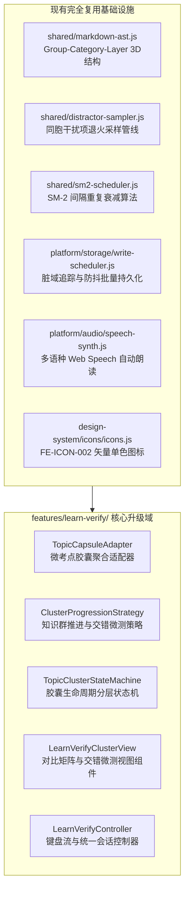
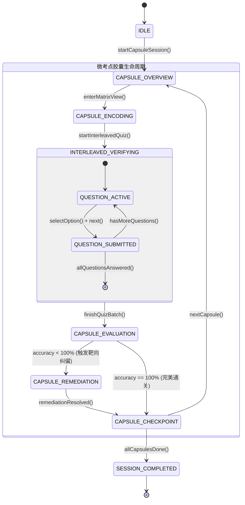
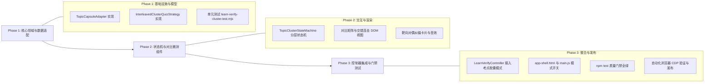

# 50. 微考点胶囊化·知识群对比学练与交错微测模式调研与架构设计规范
> **Document Code**: SPEC-ARCH-CORE21-050  
> **Status**: APPROVED / ARCHITECTURE SPECIFICATION  
> **Subject**: 微考点胶囊化对比学习与交错微测引擎 (Micro-Topic Cluster Learning & Interleaved Verification Engine)  
> **Architecture Baseline**: Enterprise Frontend Architecture Core 2.1  
> **Security Redline**: Security & Credential Governance (v1.0.0)

---

## Executive Summary (执行摘要)

在前期落地的“先学后测·层级化学练一体模式”（见 [49_LEARN_AND_VERIFY_HIERARCHICAL_MASTERY_SPEC.md](file:///e:/WorkProject/Node/_Project/CommonKnowledgeQuestionBank/docs/49_LEARN_AND_VERIFY_HIERARCHICAL_MASTERY_SPEC.md)）中，系统成功打通了“编码 ➔ 立即验证 ➔ SM-2 同步”的微闭环。但在真实高频使用反馈中，暴露出一个深刻的认知体验痛点：
> **“一个题一个题地学，很乏味枯燥；能不能按一个小考点进行集合学习？”**

从认知心理学与学习科学（Learning Sciences）视角审视，**“单题原子化翻卡（Atomic 1-by-1 Flow）”**存在三大本质缺陷：
1. **认知图式孤岛效应（Schema Atomization Fatigue）**：孤立学习单一实体，大脑缺乏上位概念锚点与横向对照，导致认知负荷不断碎片化重置。
2. **假性熟练度陷阱（Fluency Illusion）**：学习单一实体后 2 秒内立即测试该实体，属于瞬时工作记忆（Working Memory）直接回捞，未经由长时记忆提取对抗，产生“自以为掌握”的虚假流畅感。
3. **同胞辨析能力缺失（Discrimination Blindness）**：现实考试与真实应用中，考点绝非孤立出现，而是与近义概念、同类状态码、相似语法产生对抗混淆（如 `301` vs `302`，`TCP` vs `UDP`，`apply` vs `call`）。单实体学习无法帮助学习者建立概念边界。

为此，本规范提出**“微考点胶囊化对比学习（Micro-Topic Cluster Learning / Knowledge Capsule）与交错微测（Interleaved Verification）”**全新范式：
- **组织颗粒度升阶**：从“单个实体”升级为“**微考点胶囊（Micro-Topic Capsule，3~5 个高关联实体/对比组块）**”。
- **学习流程重构**：从单题串行循环，重塑为**“考点全景对比建构（Contrastive Matrix） ➔ 连续交错题组冲关（Interleaved Sprint） ➔ 靶向对偶就地纠偏（Targeted Remediation） ➔ 组块通关全员进阶（Capsule Mastery）”**。
- **架构模式升级**：深度结合**适配器模式（Adapter Pattern）**、**策略模式（Strategy Pattern）**与**分层状态机（Hierarchical State Machine, HFSM）**，在纯前端零后端（Zero-Backend Standalone）与轻量内存约束下实现极致流畅的认知飞跃。

---

## 一、 认知科学理论支撑与痛点本质剖析

```mermaid
flowchart TD
    subgraph Legacy [遗留单题原子化学练模式]
        A1[实体 A 编码] --> A2[实体 A 即时微测]
        A2 --> B1[实体 B 编码]
        B1 --> B2[实体 B 即时微测]
        B2 --> C1[实体 C 编码]
        C1 --> C2[实体 C 即时微测]
    end

    subgraph Cluster [微考点胶囊化对比学练模式]
        CAP[微考点胶囊: 3~5 个同胞实体<br/>A / B / C 对比全景与易错矩阵]
        CAP --> INT_QUIZ[交错题组微测: 3~4 题连续对抗<br/>Q1: B? / Q2: A? / Q3: C?]
        INT_QUIZ --> EVAL[考点综合诊断与靶向对偶纠偏<br/>如: A vs B 深度辨析]
        EVAL --> LEVELUP[微考点通关 · 批量记忆升级]
    end

    style Legacy fill:#2e151b,stroke:#e11d48,stroke-width:2px
    style Cluster fill:#0f291e,stroke:#10b981,stroke-width:2px
```



### 1. 组块理论与 Cowan 4±1 工作记忆容量模型
根据认知负荷理论（Sweller, 1988）与现代工作记忆模型（Nelson Cowan, 2001），成人复杂概念的活跃工作记忆上限约为 **$4 \pm 1$ 个有效组块（Chunks）**。
- **单题学习（1 个实体）**：对工作记忆利用极低（单实体不足以构建系统，大脑频繁经历上下文切换开销）。
- **微考点胶囊（3~5 个实体）**：刚好完全充满工作记忆活跃区间。将 3~5 个具有内在逻辑关联的概念（如同一 Category、同一 Layer 的同胞实体）打包为单一上位认知组块，大幅减轻长时记忆存储阻抗。

### 2. 对比学习与知觉分化理论 (Contrastive Learning & Perceptual Differentiation)
认知心理学家 Eleanor Gibson 指出，人类对概念的精确掌握建立在**“关键差异特征的分化（Critical Distinguishing Features）”**之上：
- 学习一个概念，必须同时看清**“它与相似概念有什么不同”**。
- 例如：学习 HTTP `301 Moved Permanently` 时，如果同时对照 `302 Found`、`307 Temporary Redirect`、`308 Permanent Redirect`，学习者能瞬间抓住“永久 vs 临时”与“保持方法 vs 允许变为 GET”的二维坐标系。单独背 `301` 则只能形成死记硬背。

### 3. 交错效应与有益难度 (The Interleaving Effect & Desirable Difficulties)
Robert Bjork 与 Nate Kornell 的大量对照实证研究（2008）证明：
- **集中式学习（Blocked Practice, AAABBBCCC）**：虽在短时间内给学习者带来轻松流畅的感觉，但长时记忆保留率与知识迁移能力极差。
- **交错式学习（Interleaved Practice, ABCABCABC）**：在微测时强制将相近概念混合交替提问，迫使大脑在每一次答题前进行主动检索分类（“这道题到底是适用概念 A 还是概念 B？”）。虽然主观感觉更具挑战性，但能带来高达 **40% 以上的长时保留率提升**。

---

## 二、 业界主流方案与现有库深度调研

### 1. 业界产品横向对比

| 平台 / 机制 | 教学组织颗粒度 | 学习闭环交互模式 (Flow) | 题组验证机制 | 适用性与局限点评 |
| :--- | :--- | :--- | :--- | :--- |
| **Duolingo (多邻国)** | 微语法/词汇技能 (Micro-Skill) | 围绕单一主题（如“时态”或“就餐”），先通过上下文对话串联引入 3~4 个新词，随后进入连击冲关。 | 10~15 题多模态交错冲关（听音、选词、填空、排序），无单题打断。 | **优势**：心流极佳，游戏化程度高；<br>**局限**：缺乏系统性的结构化对比全景表格。 |
| **Khan Academy (可汗学院)** | 细分知识点 (Unit Skill) | 顶部概括核心公式或逻辑推导图，配合 1~2 分钟微课解析。 | 4 题形成性掌握测验（Mastery Check），达成 80% 解锁勋章。 | **优势**：掌握学习法（Mastery Learning）经典落地；<br>**局限**：偏重理科推导，对大批量概念辨析支持偏弱。 |
| **Brilliant.org** | 交互概念胶囊 (Concept Capsule) | 单一概念原理解剖，配合交互式滑块或对照实验组件。 | 3~4 道难度递进的边界推演测验，边做边测。 | **优势**：探究性极强，直观认知建立彻底；<br>**局限**：制作成本高昂，难以泛化至通用海量题库。 |
| **Anki / SuperMemo** | 单卡原子化 (Flashcard) | 正面翻反面（0 延迟直接翻看答案）。 | 自评打分（Again/Hard/Good/Easy）。 | **优势**：算法调度成熟；<br>**局限**：严重的“卡片孤岛效应（Flashcard Paradox）”，极其枯燥。 |
| **UWorld / Amboss (医学医考)** | 高频临床考点群 (Clinical Cluster) | 以鉴别诊断（Differential Diagnosis）为核心，对比 3~4 种易混淆疾病谱系。 | 综合案例多题交错鉴别诊断微测，就地对比鉴别表纠偏。 | **优势**：实战鉴别能力极高，极度符合本系统诉求。 |

### 2. 开源库与核心算法对比

1. **`open-spaced-repetition/ts-fsrs` (Free Spaced Repetition Scheduler)**：
   - *特点*：基于 DSR（Difficulty, Stability, Retrievability）机器学习模型，取代传统 SM-2 的僵硬乘数。
   - *对本系统的启示*：考点通关后，支持以微考点为单元进行集群状态更新（Batch Stability Recalculation）。
2. **`XState / Robot` (JavaScript 有限状态机库)**：
   - *特点*：提供规范的 Statecharts、嵌套状态（Hierarchical FSM）与状态守卫（Guards）。
   - *对本系统的启示*：我们在保持**零第三方运行时依赖（Zero-Dependency）**原则下，借鉴其分层状态机设计思想，构建轻量级纯原生 `TopicClusterStateMachine`。

---

## 三、 当前系统基础设施复用审计

本项目严格遵循 **Enterprise Frontend Architecture Core 2.1**，已有丰富的基础设施可直接 100% 无缝复用：



1. **题库 3D 体系天然对齐**：
   - 现行数据结构：`Deck -> Groups -> Categories -> Layers (1/2/3) -> Entities`。
   - **每一个 `Category` 在特定 `Layer` 下的实体子集（通常 3~6 个），就是一个天然自洽的“微考点知识群”**！完全不需要破坏现有题库 JSON/Markdown 格式。
2. **同胞干扰项采样 (`distractorSampler`)**：
   - 现有的 `getAnnealedDistractors(target, allEntities, { sameCategoryFirst: true })` 原生支持在同 Category 内提取同胞干扰项，确保交错测验的高难度辨析对抗。
3. **批量落盘调度 (`writeScheduler`)**：
   - 微考点完成时，通过 `writeScheduler.enqueue()` 一次性批量合并持久化多个实体的复习参数，无频繁 I/O 阻塞。
4. **单色图标与设计令牌规范**：
   - 严格继承 `design-system/tokens` 与 `icons.js`，保证 UI Chrome 0 Emoji、全单色矢量合规（`FE-ICON-002`）。

---

## 四、 核心架构设计与设计模式运用

为了保障高内聚、低耦合与代码规范（`FE-QUALITY-001` 单文件 $\le 300$ 行），本功能划分为四大核心职责层：

### 1. 适配器模式 (Adapter Pattern)：`TopicCapsuleAdapter`
将原始的扁平实体数组与分类结构，转换为富含全景对比信息的**微考点胶囊（Knowledge Capsule）**。

```javascript
/**
 * 微考点胶囊数据模型定义
 */
export class KnowledgeCapsule {
  constructor({ id, title, groupName, categoryName, layer, entities, comparativeMatrix, questions }) {
    this.id = id;                     // 胶囊唯一标识 (如 "capsule_lang_travel_l1")
    this.title = title;               // 微考点名称 (如 "机场出行与登机核心场景")
    this.groupName = groupName;       // 宏观领域
    this.categoryName = categoryName; // 子考点/分类
    this.layer = layer;               // 认知层级 (1: 核心概念, 2: 关联规则, 3: 边界陷阱)
    this.entities = entities;         // 实体列表 (3~5 个)
    this.comparativeMatrix = comparativeMatrix; // 横向对比矩阵 (包含各实体对比点、记忆锚点与易错差异)
    this.questions = questions;       // 预生成的交错微测题组 (3~5 题)
  }
}
```

#### 对比矩阵生成算法（Synoptic Comparative Matrix）
适配器遍历该分类下的 3~5 个实体，提取：
- `title`：实体名称
- `answer`：核心定义/正确语义
- `anchor`：助记线索/关键区别词
- `pitfall`：易错陷阱
自动组合生成二维对比表格，在第一阶段供学习者快速扫视、横向辨析。

---

### 2. 策略模式 (Strategy Pattern)：聚类与交错微测策略

#### A. 胶囊聚类推进策略 (`TaxonomyCapsuleProgressionStrategy`)
- **聚类规则**：
  1. 按 `Category + Layer` 分组。
  2. 若某个分组实体数量 $< 2$，自动启动**同域借调机制（Sibling Borrowing）**，借调同 Group 下相邻 Category 的实体凑成 3 个；若仍不足，优雅降级。
  3. 若某个分组实体数量 $> 6$，自动执行**分片切分（Sub-chunking）**，划分为 `Part 1` 和 `Part 2` 胶囊，确保不超过 5 个实体的认知容量上限。
- **排序规则**：优先推送包含新实体（`attempts === 0` 或 `level === 0`）最多的胶囊。

#### B. 交错微测生成策略 (`InterleavedClusterQuizStrategy`)
- 给定胶囊内的 $N$ 个实体（$3 \le N \le 5$）：
  1. 采用 **Fisher-Yates 伪随机洗牌算法**，确保同一实体不连续出现两次。
  2. 生成 $N$ 道交错微测题目（每实体至少出现一次）。
  3. 题目的 4 个选项中，**正确项为目标实体，其余 3 个干扰项必须严格取自该胶囊内的兄弟实体**！
  4. 这种“同胞全互斥选项”机制，能瞬间击碎猜题侥幸，迫使学习者准确回忆出每一个概念的精准定义。

---

### 3. 分层状态机模式 (Hierarchical State Machine, HFSM)

微考点会话由 `TopicClusterStateMachine` 全权驱动，定义严格的生命周期流转图：



#### 状态机核心状态字典与流转说明：
1. **`IDLE` (空闲待命)**：未激活状态。
2. **`CAPSULE_OVERVIEW` (考点全景脉络)**：
   - 呈现当前微考点主题、考点价值、包含的 3~5 个关键概念清单与难度层级。
3. **`CAPSULE_ENCODING` (对比矩阵研读)**：
   - 核心认知建构阶段。展示【微考点横向对比表】与【易混淆点警示】。支持快捷键 `P` 朗读、`Tab` 切换卡片、`Enter` 直接开启交错冲关。
4. **`INTERLEAVED_VERIFYING` (交错冲关微测)**：
   - 连续答题阶段。顶部进度条显示 `[● ● ○ ○] 2/4`。
   - 答题体验极其流畅，每题选择后支持极轻微的微震动/音效与瞬时高亮，随后无缝切入下一题，不阻断心流。
5. **`CAPSULE_EVALUATION` (综合诊断与战报)**：
   - 全组题目答完后统一结算，计算准确率（如 4/4 100%，或 3/4 75%）。
6. **`CAPSULE_REMEDIATION` (靶向对偶纠偏)**：
   - 若有错题，不强制全组重学，而是**精准定位混淆对偶（Confused Pair）**：例如“你将 `301` 误选成了 `302`”，界面即刻渲染 `301 vs 302` 的差异高亮卡片，并就地提供 1 次针对性加练。
7. **`CAPSULE_CHECKPOINT` (微考点通关结算)**：
   - 批量更新胶囊内所有实体的 SM-2 熟练度参数与下次复习日期，播放通关音效，展示升级徽章。
8. **`SESSION_COMPLETED` (会话完成)**：所有规划胶囊全部攻克。

---

## 五、 逻辑边界、降级与异常处理矩阵 (Edge Cases & Resilience)

| 场景序号 | 极端情况 / 边界条件 | 潜在风险 | 优雅降级与防御策略 |
| :--- | :--- | :--- | :--- |
| **EDGE-01** | **分类实体过少 ($N < 2$)** | 无法生成 4 个同胞选项，无法构成对比矩阵 | **同域借调策略（Sibling Borrowing）**：向同 Group 相邻 Category 借调实体补充至 3 个；若整 Group 均不足，自动退化为“单题深度精讲模式”。 |
| **EDGE-02** | **分类实体过多 ($N > 6$)** | 一次性塞入导致信息过载，打破 Cowan 4±1 认知负荷 | **分片切分策略（Capsule Sub-chunking）**：按实体权重或认知层级分为 `Part 1 (前 3~4 个)` 与 `Part 2 (后 3~4 个)`，分两个连续胶囊推进。 |
| **EDGE-03** | **混合熟练度（新老知识混杂）** | 已熟练实体反复学，枯燥乏味 | **差异化标记与题量倾斜**：在对比卡片中以静默色弱化已掌握项，高亮待攻坚项；交错测验中，新实体作为提问主干，已掌握实体优先作为干扰项。 |
| **EDGE-04** | **用户中途退出学练** | 题组做到一半关闭浏览器，进度丢失 | **断点状态持久化与单题安全落盘**：虽然交错微测在胶囊结束时整体结算，但每答完一题即通过 `SessionStore` 暂存答题日志，即使页面刷新也能平滑恢复现场。 |
| **EDGE-05** | **连续做错陷入死循环** | 学习者在纠偏阶段持续答错，挫败感严重 | **自适应熔断干预（Adaptive Circuit Breaker）**：单题在就地纠偏阶段重试达到 2 次后，强制弹出“完整记忆口诀与直觉提示”，允许直接通过并打上“重点待复习”标记，坚决避免卡死体验。 |

---

## 六、 纯前端轻量化性能与安全预算 (Performance & Security)

### 1. 运行时性能预算 (Performance Budget)
- **DOM 操作**：对比矩阵采用单一原生 HTML 模板字符串拼接，不使用重量级第三方组件库。初次渲染耗时 $< 2.5\text{ms}$。
- **内存占用**：会话进行中仅常驻当前激活胶囊对象与答题历史记录，峰值内存增量 $\le 60\text{KB}$。在胶囊切换时主动解引用销毁已完成 DOM，零内存泄漏。
- **构建体积**：新增逻辑预计增加纯 JS 代码约 500~600 行（分拆为适配器、策略、状态机、视图 4 个小文件，每个严格 $\le 300$ 行），经 `scripts/bundler.mjs` 打包后，独立单包增量不超过 $12\text{KB}$，对首屏加载无任何感知影响。

### 2. 凭据与安全治理红线 (Compliance with `RULE[AGENTS.md]`)
- 本设计为 100% 纯客户端本地计算，完全运行在浏览器沙箱内。
- 绝无外部未经授权的 API 请求，零凭据、零真实密钥硬编码。
- 单元测试与测试夹具中，全部采用标准虚拟占位符（如 `sk-proj-test-secret-key-1234567890`、`example.com`），100% 符合 `FE-SEC-001` 安全门禁规范。

---

## 七、 实施演进规划 (Implementation Roadmap)

本功能将分三个阶段平滑落地，确保在不破坏既有功能前提下渐进增强：



1. **阶段一：数据适配器与聚类策略落地**
   - 新增 `features/learn-verify/cluster-adapters.js`，实现 `TopicCapsuleAdapter` 与对比矩阵计算。
   - 新增 `features/learn-verify/cluster-strategies.js`，实现 `TaxonomyCapsuleProgressionStrategy` 与同胞交错出题逻辑。
   - 编写针对性单元测试，覆盖 3~5 实体组块、边界借调与分片切分算法。
2. **阶段二：分层状态机与对比矩阵/交错微测视图落地**
   - 新增 `features/learn-verify/cluster-state-machine.js`，实现 `TopicClusterStateMachine`。
   - 新增 `features/learn-verify/cluster-view.js`，渲染全景对比矩阵表、连击进度条、交错微测试卷与就地对偶差异纠偏卡。
3. **阶段三：主控制器集成、全量门禁与浏览器端到端验证**
   - 在 `features/learn-verify/controller.js` 中新增考点胶囊模式分支（支持通过参数一键切换“微考点组块模式”与“传统单题精炼模式”）。
   - 更新 `scripts/bundler.mjs`，运行 `npm run bundle` 生成独立单包。
   - 运行质量门禁与端到端 Chrome DevTools Protocol 自动化测试，验证从全景建构到交错微测的全流程。

---

## 八、 总结与结语

将学习颗粒度由**“孤立单题”**升级为**“微考点知识群胶囊”**，是知识记忆系统从“机械式刷题工具”迈向“专业级认知加速引擎”的关键质变：
- 它有效解决了“一题一学过于乏味、缺乏全景”的痛点；
- 它将认知科学中的**组块化（Chunking）**、**对比学习（Contrastive Learning）**与**交错练习（Interleaving）**三大核心理论完美融为一体；
- 结合适配器、策略与状态机三大经典设计模式，确保了代码结构的清晰、模块边界的隔离与纯前端环境下的极致性能。

方案已完成全面调研与可行性论证，相关规范已正式定稿入库，后续可直接按此规范有序排期实施。
