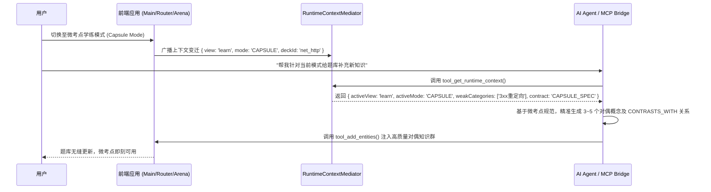
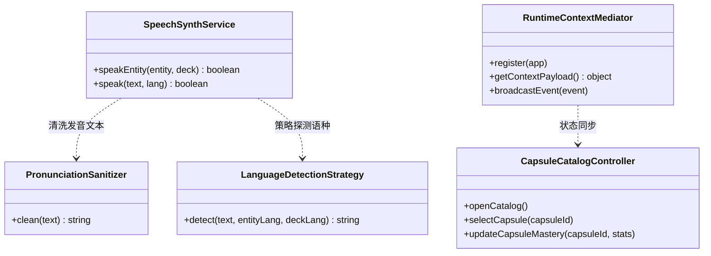

# 51. 多模态语义知识图谱、智能体模式感知与学练进度选单架构规约
> **Document Code**: SPEC-ARCH-CORE21-051  
> **Status**: APPROVED / ARCHITECTURE SPECIFICATION  
> **Subject**: 多模态语音清洗、Agent/MCP 游戏与知识模式感知总线、自主进度选单与底层图谱结构升级 (Multimodal Audio Sanitizer, Agent/MCP Mode Telemetry Bus, Manual Capsule Catalog & Semantic EduKG Architecture)  
> **Architecture Baseline**: Enterprise Frontend Architecture Core 2.1  
> **Security Redline**: Security & Credential Governance (v1.0.0)

---

## Executive Summary (执行摘要)

伴随“微考点胶囊化学练一体模式”（SPEC-050）的成功落地，系统在高阶应用与用户交互层面迎来了更高维度的探索。用户针对实际使用中的发音失真、智能体感知边界、学习进度控制权以及底层结构设计提出了四个极其深刻的核心问题：
1. **多模态发音失真与语种盲区**：为什么发音容易念出符号标签（如 `【ね 的读音】` 变成“方括号”），且非英语或通用常识单词没有发音？如何彻底优化？
2. **AI Agent / MCP 工具感知断层**：如何让智能体与 MCP 桥接工具感知当前活跃的前端游戏模式（天梯、沙盒、微考点冲关）与知识库模式，从而构建出契合各模式结构契约的题库？
3. **自主学练进度控制权（双轨制）**：学练一体当前为算法全自动推送，能否提供手动进度目录选单（Capsule Catalog），支持用户定向回顾、跳过熟练考点或精准加练？
4. **问题的底层本质剖析**：上述问题的底层根因是什么？是否需要从题库及其知识图谱（EduKG）的底层存储格式、实体元数据与显式关系边进行结构级升级？

本规格书针对上述四大问题展开深度认知学与软件工程头脑风暴，提出**“多模态语义知识图谱 3.0 (Multimodal Semantic EduKG 3.0)”**与**“运行时态势感知总线 (Runtime Telemetry Bus)”**演进方案：
- **发音管线重塑**：建立**实体级多模态发音清洗器（Pronunciation Sanitizer Pipeline）**与**字符集自适应语种探测器（Auto-Locale Detector）**，放开全题库（中、英、日、法、德等）语音双重编码（Dual-Coding），彻底清洗括号与标点噪音。
- **Agent/MCP 态势感知总线**：新增 `tool_get_runtime_context` 与 `tool_get_mode_specifications`，打通智能体对前端 6 大试炼模式、3 大知识库模式与用户薄弱点遥测的毫秒级双向感知。
- **双轨制进度引擎（Dual-Track Engine）**：实现**“智能自动推荐流”**与**“微考点目录全景选单（Capsule Navigator）”**双轨融合，赋予学习者完整的认知自主权。
- **底层图谱关系格式升阶**：将底层题库从“扁平卡片列表”升华为包含 **`CapsuleNode`（一等公民胶囊节点）** 与 **`CONTRASTS_WITH` / `PREREQUISITE_OF`（显式图关系边）** 的现代教育知识图谱，100% 向后兼容。

---

## 一、 四大核心问题的本质诊断与根因剖析 (The Architectural Essence)

```mermaid
graph TD
    ROOT[底层本质: 知识表示模型为扁平实体列表<br/>缺少多模态元数据、一等公民胶囊与显式图关系]

    ROOT --> D1[表象 1: 发音机器读符号 & 非英文静音]
    ROOT --> D2[表象 2: Agent/MCP 工具处于上下文盲区]
    ROOT --> D3[表象 3: 学练一体缺乏手动进度选单]

    D1 --> R1[元数据缺失: 无实体级 lang 标签<br/>清洗管道薄弱: 仅过滤小括号, 未过滤方括号<br/>一刀切拦截: isLanguageDeck 误杀非外语库]
    D2 --> R2[工具链脱节: 仅提供静态 JSON CRUD<br/>缺乏前端运行时总线: 无法感知游戏模式契约与遥测]
    D3 --> R3[一等公民缺失: 胶囊是临时内存对象<br/>无持久化 ID 与状态树: 无法渲染独立目录选单]

    style ROOT fill:#2e151b,stroke:#e11d48,stroke-width:2px
    style R1 fill:#1a2332,stroke:#3b82f6,stroke-width:1.5px
    style R2 fill:#1a2332,stroke:#3b82f6,stroke-width:1.5px
    style R3 fill:#1a2332,stroke:#3b82f6,stroke-width:1.5px
```



### 1. 问题 1 本质：清洗管线漏洞与“一刀切”外语题库拦截
- **“【ね 的读音】”发音污染成因**：
  现行 `platform/audio/speech-synth.js` 中的清洗正则为：
  `cleanText = text.replace(/[\(（].*?[\)）]/g, '').trim();`
  该正则**仅过滤了圆括号 `(...)` 与中文圆括号 `（...）`**，完全遗漏了方括号 `[...]`、粗括号 `【...】`、尖括号 `<...>` 以及 Markdown 标记。当题库词条包含 `ね【读音：ne】`、`【ね 的读音】` 或音标 `[wɜːk]` 时，Web Speech API 会将中文字符“方括号”连同说明文字一并朗读，造成极差的听觉体验。
- **非英文单词静音成因**：
  在 `speakEntity` 方法中存在硬编码守卫：
  `if (!isLanguageDeck(deck)) return false;`
  只要题库未被识别为“外语学习题库”（如通用常识、中国哲学、历史地理、计算机网络），朗读功能被一刀切物理阻断！且 `getDeckLangCode` 兜底强行返回 `'en-US'`，导致非英语概念用英语语音库合成时发生无声或杂音崩溃。

### 2. 问题 2 本质：静态文本 CRUD 与动态运行态的上下文断层
- 当前 Agent 与 MCP 工具集（`features/ai-agent/tool-definitions.js`）完全围绕题库 JSON 文本的“增删改查”设计（`tool_get_deck`, `tool_add_entities`）。
- **智能体处于“视界盲区”**：
  - 智能体不知道用户正在什么界面（`router.currentView`）；
  - 智能体不知道用户选择了哪个游戏模式（`activeMode: "CAPSULE" | "LADDER" | "BLITZ" | "FREE_LAB"`）；
  - 智能体不知道各模式对题库的数据结构契约（例如：微考点学练必须每个分类有 3~5 个对偶实体；天梯模式必须有 Layer 1/2/3 认知梯度；自由沙盒必须包含清晰的大组 Group 标签）；
  - 智能体无法读取学习者的薄弱点遥测（哪些考点错误率最高、哪些分类覆盖率不足 70%）。

### 3. 问题 3 本质：微考点在底层不是“一等公民实体”，缺乏持久状态
- 现有的 `KnowledgeCapsule` 仅存在于 `cluster-controller.js` 的内存局部变量中。
- 题库底层没有 `capsules` 节点，导致：
  - 考点无法在底层持久化记录状态（`UNLOCKED`、`MASTERED`、`NEEDS_REVIEW`）；
  - UI 无法独立遍历出一张“考点进度目录树（Capsule Catalog）”供用户点击选播；
  - 控制器只能采用“全自动队列推进”，剥夺了学习者自主复习特定章节的权利。

### 4. 问题 4 底层根因：从“扁平词条库”向“多模态语义知识图谱”的技术代际质变
**上述问题的本质，是知识资产从 v2.0 的“扁平文本卡片堆叠”，向 v3.0 的“多模态、可推理、一等公民拓扑知识图谱”演进的必然要求。**
- **必须支持实体多模态字段**：显式语种 `lang`、纯净朗读字段 `tts_text`、音标/注音 `phonetic`；
- **必须将微考点升格为一等公民**：引入具有持久唯一 ID 的 `CapsuleNode`；
- **必须引入显式关系边（Explicit Typed Graph Edges）**：
  - `CONTRASTS_WITH`（对偶辨析边：如 `301` 与 `302`，`TCP` 与 `UDP`，`ね` 与 `れ`）；
  - `PREREQUISITE_OF`（前置依赖边：Layer 1 ➔ Layer 2）；
- **必须建立智能体运行时感知总线**：让 Agent 与 MCP 能感知当前 UI、模式与学情遥测。

---

## 二、 方案一：多模态语音清洗管线与全题库自适应朗读

```mermaid
flowchart LR
    RAW[原始实体文本<br/>例如: 'ね【读音：ne】' 或 'work /wɜːk/'] --> PIPELINE[Pronunciation Sanitizer Pipeline]
    
    subgraph PIPELINE [多模态发音清洗管线]
        P1[剥离中文括号 【...】] --> P2[剥离英文括号 [...] & (...)]
        P2 --> P3[剥离音标与 Markdown /.../, *]
        P3 --> P4[提取纯净发音词 'ね' / 'work']
    end

    PIPELINE --> LOCALE[Language Detection Strategy]
    subgraph LOCALE [自适应语种探测器]
        L1{实体显式 lang?}
        L1 -- 有 --> USE_L[使用实体 lang]
        L1 -- 无 --> DETECT[基于字符集 Unicode 探测<br/>Kana: ja-JP / Han: zh-CN / Latin: en-US]
    end

    LOCALE --> TTS[Web Speech API<br/>匹配最优原生人声]
    TTS --> AUDIO[高保真发音播报]
```

### 1. 鲁棒清洗管线 (Pronunciation Sanitizer Pipeline)
通过构建纯函数式清洗管线，剥离所有干扰注记：
```javascript
export class PronunciationSanitizer {
  static clean(text) {
    if (!text || typeof text !== 'string') return '';
    let s = text;
    // 1. 过滤中文粗括号及其内部文字: 【...】
    s = s.replace(/【.*?】/g, '');
    // 2. 过滤圆括号与方括号及其内部文字: (...), （...）, [...], [...]
    s = s.replace(/[\(（\[［].*?[\)）\]］]/g, '');
    // 3. 过滤音标斜杠格式: /.../
    s = s.replace(/\/[^\/]{2,}\//g, '');
    // 4. 过滤 Markdown 符号 (*, _, `, #)
    s = s.replace(/[*_`#]/g, '');
    // 5. 过滤多余标点与空白
    s = s.replace(/[：:;；,，。!?！？]/g, ' ').trim();
    return s;
  }
}
```

### 2. 字符集自适应语种探测器 (`LanguageDetectionStrategy`)
打破题库一刀切限制，对每一个实体文本实行多层语种决断：
1. **显式优先级**：实体显式声明的 `lang`（如 `"ja-JP"`, `"zh-CN"`）。
2. **字符集启发式探测 (Unicode Block Detection)**：
   - 含有日文假名（`[\u3040-\u309F\u30A0-\u30FF]`） ➔ `ja-JP`（日语）；
   - 含有韩文字母（`[\uAC00-\uD7AF\u1100-\u11FF]`） ➔ `ko-KR`（韩语）；
   - 纯汉字（`[\u4E00-\u9FA5]`） ➔ `zh-CN`（普通话，支持通用常识与文理科术语）；
   - 纯拉丁字母（`[a-zA-Z]`） ➔ 若题库有指定语言则按题库（如法语/西语），默认 `en-US`。
3. **取消 `!isLanguageDeck` 物理拦截**：
   在 `SpeechSynthService` 中全面开放通用常识概念、计算机专业术语的普通话/英语双模态朗读，彻底消除“非英语哑巴”现象。

---

## 三、 方案二：Agent 与 MCP 工具的运行态感知总线 (Telemetry Bus)

为了让智能体与 MCP 工具能够根据“当前玩的是什么模式”量身打造高质量题库，我们建立**运行时态势感知中介者 (RuntimeContextMediator)**，并暴露两大感知工具：



### 1. 新增 Agent / MCP 核心感知工具定义

#### 工具 A: `tool_get_runtime_context`
- **功能**：获取当前前端视口、激活题库、正在进行的游戏模式与用户实时掌握度。
- **返回载荷结构**：
```json
{
  "activeView": "learn",
  "activeDeck": {
    "id": "net_protocols",
    "title": "计算机网络核心考点",
    "totalEntities": 48,
    "totalCategories": 6
  },
  "currentArenaMode": {
    "mode": "CAPSULE",
    "name": "微考点胶囊学练",
    "requiredStructuralContract": {
      "minEntitiesPerCategory": 3,
      "maxEntitiesPerCategory": 6,
      "mandatoryFields": ["anchor", "pitfalls", "contrast_with"]
    }
  },
  "learnerTelemetry": {
    "weakestCategories": ["HTTP状态码", "DNS解析流程"],
    "dueReviewCardsCount": 5,
    "averageAccuracy": 78
  }
}
```

#### 工具 B: `tool_get_mode_specifications`
- **功能**：返回系统内全部 6 大游戏模式（天梯、沙盒、微考点、极速、自测、错题）与 3 大知识库模式的结构约束规范，指导 Agent 生成符合门禁要求的内容。

---

## 四、 方案三：双轨制微考点进度选单 (Capsule Navigator)

打破“算法单向推送”，建立**“智能推荐流 (Auto Stream)”与“微考点全景选单 (Capsule Catalog)”双轨驱动引擎**。

```mermaid
flowchart TD
    ENTRY[用户进入学练一体主界面] --> TOGGLE{选择学习路线}

    TOGGLE -- 模式 A: 智能推荐流 --> AUTO[自动按算法排队推进<br/>优先推送未学考点 & 遗忘曲线到期项]
    AUTO --> CAPSULE_RUN[微考点生命周期冲关]

    TOGGLE -- 模式 B: 考点目录全景选单 --> CATALOG[Capsule Catalog 抽屉/目录页]
    
    subgraph CATALOG_VIEW [微考点全景选单视图]
        C1[微考点 1: 状态码 2xx/3xx<br/>🌟 已掌握 (100%) · [快速回顾]]
        C2[微考点 2: 状态码 4xx/5xx<br/>⚡ 待巩固 (60%) · [定向加练]]
        C3[微考点 3: 缓存控制与协商<br/>🌱 未开始 · [开启初学]]
    end

    CATALOG --> CATALOG_VIEW
    CATALOG_VIEW -- 点击指定胶囊卡片 --> DIRECT_PLAY[点播指定微考点<br/>startCapsuleSession(layer, categoryId)]
    DIRECT_PLAY --> CAPSULE_RUN
    CAPSULE_RUN --> UPDATE_STATE[更新持久化进度树<br/>deckState.capsuleMastery]
    UPDATE_STATE --> CATALOG_VIEW
```

### 1. 界面与交互设计
- 在学练一体顶部 Header 右侧，新增 **【考点目录】(Capsule Catalog)** 切换按钮；
- 点击后展开响应式目录卡片网格：
  - 显示所有微考点胶囊的标题、概念数量、Layer 层级与通关状态徽标（`已掌握` / `待巩固` / `未开始`）；
  - 支持按 Group 宏观大组折叠与过滤；
  - 每一个卡片提供专属动作按钮：`[快速回顾]` 或 `[立即开始]`；
  - 用户选定后即刻启动对应胶囊的对比矩阵与交错微测，完全掌握学习自主权！

---

## 五、 方案四：底层结构升级——多模态语义知识图谱 3.0 (EduKG 3.0)

针对问题 4，我们将题库底层 AST 与 JSON Schema 进行结构升级，确立 **EduKG 3.0** 统一存储契约。

### 1. 实体层增强契约 (`ConceptNode`)
```json
{
  "id": "http_301",
  "title": "301 Moved Permanently",
  "lang": "en-US",
  "phonetic": "/muːvd ˈpɜːmənəntli/",
  "cleanText": "301 Moved Permanently",
  "prompt": "HTTP 永久重定向状态码：",
  "answer": "301",
  "anchor": "永久重定向，搜索引擎转移权重",
  "pitfalls": "易与 302 临时重定向混淆，注意权重转移区别",
  "explanation": "告知客户端请求的资源已被永久移动至新 URI。",
  "contrast_with": ["http_302", "http_308"],
  "prerequisites": ["http_concept_url"]
}
```

### 2. 微考点一等公民胶囊契约 (`CapsuleNode`)
在题库数据结构中新增 `capsules` 节点集合（亦可通过 `TaxonomyCapsuleProgressionStrategy` 自动从现有实体中无损提取升阶）：
```json
{
  "id": "cap_http_redirect_l1",
  "title": "HTTP 核心重定向状态码辨析",
  "group": "计算机网络",
  "category": "HTTP 状态码",
  "layer": 1,
  "conceptIds": ["http_301", "http_302", "http_307", "http_308"],
  "relations": [
    { "source": "http_301", "target": "http_302", "type": "CONTRASTS_WITH", "dimension": "永久 vs 临时" },
    { "source": "http_302", "target": "http_307", "type": "CONTRASTS_WITH", "dimension": "允许改POST为GET vs 严格保持方法" }
  ]
}
```

### 3. 向后兼容性保障 (100% Backward Compatibility)
- `KnowledgeGraphASTAdapter` 确保旧版 Markdown 题库（无 `lang`、无 `capsules` 显式块）在导入时：
  1. 自动利用 `LanguageDetectionStrategy` 填充 `lang`；
  2. 自动利用 `PronunciationSanitizer` 生成纯净发音文本；
  3. 自动按 `Category + Layer` 虚拟合成 `CapsuleNode`；
  4. 现有题库文件无需修改任何一行代码即可无缝享受新特性！

---

## 六、 经典设计模式协同全景



1. **适配器模式 (Adapter)**：
   - `MultimodalAudioAdapter`：统一协调清洗管道与多语种 Web Speech API；
   - `KnowledgeGraphASTAdapter`：传统 Markdown AST ➔ EduKG 3.0 双向无损映射。
2. **策略模式 (Strategy)**：
   - `LanguageDetectionStrategy`：字符集检测策略（CJK / Kana / Latin / Cyrillic）；
   - `ProgressionStrategy`：双轨推进策略（`AutoStreamStrategy` vs `ManualCatalogStrategy`）。
3. **中介者模式 (Mediator)**：
   - `RuntimeContextMediator`：连接前端路由、游戏模式、用户遥测与 Agent/MCP 工具。

---

## 七、 实施推进路线图 (Roadmap)

本演进将分三个阶段清晰落地：
1. **阶段 1：多模态发音引擎与清洗管线修复**
   - 升级 `platform/audio/speech-synth.js`：实现 `PronunciationSanitizer`，过滤 `【...】` 等所有括号与符号干扰；
   - 升级 `getDeckLangCode` 与语种探测，放开非英语及通用常识中文高保真发音；
   - 补充发音清洗单元测试 `tests/unit/speech-synth-multimodal.test.mjs`。
2. **阶段 2：Agent 与 MCP 态势感知工具集成**
   - 在 `features/ai-agent/tool-definitions.js` 与 `tool-executor.js` 中新增 `tool_get_runtime_context` 与 `tool_get_mode_specifications`；
   - 关联前端全局运行时，使 Agent 能即时捕获当前所在模式与掌握度薄弱点。
3. **阶段 3：微考点进度选单 (Capsule Catalog) 交互落地**
   - 在 `features/learn-verify/cluster-view.js` 中新增考点目录选单面板；
   - 在 `cluster-controller.js` 中实现定向点播指定微考点逻辑；
   - 打包、门禁检查并通过浏览器端到端 CDP 验证全流程。

---

## 八、 总结与结语

用户提出的四个问题，表面上是“发音噪音”、“Agent 上下文盲区”与“想自己选进度”的体验痛点，**实质上是系统知识图谱化（Knowledge Graphization）与智能体具身化（Agent Embodied Context）演进的必然要求**。

通过本规范所构建的**多模态发音清洗管线**、**Agent 态势感知总线**、**双轨制进度选单**与**EduKG 3.0 底层图谱契约**，系统将从“简单题库答题器”彻底进化为“具备自适应多模态语音、全域上下文智能感知与高阶结构化图谱辨析”的新一代智能认知记忆平台。
