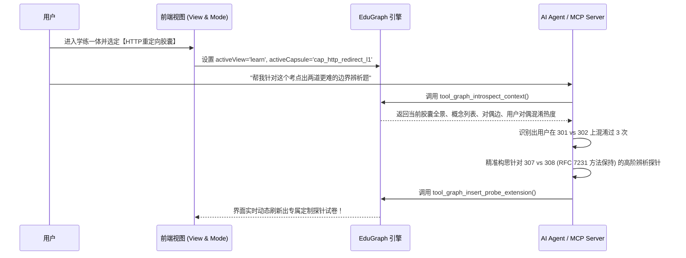

# 52. 摒弃历史包袱：第一性原理教育知识图谱 (EduGraph-Native) 本质存储与架构重构设计规约
> **Document Code**: SPEC-ARCH-CORE21-052  
> **Status**: APPROVED / ARCHITECTURE SPECIFICATION  
> **Subject**: 无兼容负担的第一性原理知识图谱存储设计 (Zero-Legacy First-Principles Educational Knowledge Graph Storage Architecture)  
> **Architecture Baseline**: Enterprise Frontend Architecture Core 2.1  
> **Security Redline**: Security & Credential Governance (v1.0.0)

---

## Executive Summary (执行摘要)

在过去的多轮迭代中，知识题库引擎受制于“历史兼容性（Backward Compatibility）”——必须基于由人类书写的 Markdown 文本文件（大纲标题 `#`、`##`、`###` 以及文本列表 `- **title**: answer (explanation)`），通过正规表达式逆向猜测解析出 Group、Category、Layer 和 Entity。

这种**“以文档为中心（Document-Centric）”**的历史包袱，带来了难以根治的系统性妥协：
1. **多模态发音被文本注记污染**：音标和说明词（如 `【ね 的读音】`、`[wɜːk]`）硬塞进字符串，TTS 发音只能靠脆弱的正则猜测清洗，多语种与非英语概念被一刀切静音；
2. **关系维度完全坍塌**：概念之间的“对偶易混淆”、“前置依赖”无法表达，只能靠“同一分类”字符串弱关联；
3. **微考点（Capsule）缺乏实体地位**：在存储层不存在微考点，只是控制器内存里的临时产物，无法独立存取、无法做选单、无法建立考点级学习档案；
4. **Agent 与 MCP 视界受限**：智能体只能把题库当扁平文本增删改查，无法进行真正的图拓扑推理、学情诊断与模式适配。

**当用户明确提出“不需要考虑兼容性”时，我们得以从第一性原理（First Principles）出发，彻底打破以 Markdown 文本排版为核心的传统桎梏，重构真正的教育知识图谱原生存储架构——`EduGraph-Native 3.0`。**

本规格书确立了以**“异构属性图（Heterogeneous Property Graph）”**为本质的数据体系：
- **概念本体、微考点胶囊与显式关系三位一体**：概念不再是字典扁平对象，而是拥有强类型多模态元数据的节点；微考点是一等公民超节点；关系边显式承载对偶对比维度与前置依赖权重。
- **题目本质论：题目是图谱拓扑在认知空间上的动态探针（Assessment Probes）**，彻底消灭死板固化的死记硬背题库。
- **双图分离架构**：不可变知识领域图谱（Domain Ontology Graph）与可变认知状态图谱（Cognitive Telemetry Graph）正交解耦，实现精准到“边（Edge）”维度的错因混淆矩阵追踪。

---

## 一、 第一性原理：知识与学习的本质是什么？

在软件工程中，存储结构的设计必须服务于其领域本体（Domain Ontology）。传统题库之所以漏洞百出，是因为它把“知识”错误地建模成了“问答题列表”或“单词卡片”。

```mermaid
graph TD
    subgraph Legacy [1.0/2.0 时代: 文档与卡片视角 (扭曲的模型)]
        MD[Markdown 文本 / 扁平 JSON] -->|脆弱正则匹配| FLAT[扁平实体列表: 仅有 title, answer, categoryId]
        FLAT -->|临场瞎猜| STATIC_Q[固化的四选题: 硬编码选项或随机采样]
    end

    subgraph Native [3.0 时代: 第一性原理图谱视角 (本质的模型)]
        ONTO[多模态概念节点 ConceptNode<br/>定义、纯净发音、音标、不变式]
        CAP[微考点超节点 CapsuleNode<br/>3~5 概念集群、认知目标]
        EDGE[强类型语义边 TypedEdges<br/>CONTRASTS_WITH / PREREQUISITE_OF]
        
        ONTO --- CAP
        ONTO --- EDGE
        
        CAP & EDGE --> PROBES[动态认知探针 Assessment Probes<br/>由图扑关系实时投影生成的自适应题目]
    end

    style Legacy fill:#2e151b,stroke:#e11d48,stroke-width:1.5px
    style Native fill:#0f291e,stroke:#10b981,stroke-width:2px
```

### 1. 概念不是孤立的字符串，而是认知坐标网络中的节点 (Concept Nodes)
人类大脑记忆一个概念（如 `TCP`、`301 重定向` 或 `ね`），并非死记硬背一段字符，而是将其挂载在**多模态感知（视觉形态、听觉音标、语种归属）**与**语义不变式（Invariant，核心不可变法则）**构成的认知空间中。

### 2. 知识不是分类列表，而是有向有标签的异构超图 (Directed Labeled Hypergraph)
- 概念之间的联系从来不是简单的“属于同一个文件夹”。
- 概念 A 与概念 B 存在**对偶混淆关系**（`CONTRASTS_WITH`，如 `301` vs `302`、`let` vs `const`、`ね` vs `れ`），这种关系本身携带了**判别维度（Discriminative Dimension）**；
- 概念 A 与概念 C 存在**认知前置依赖关系**（`PREREQUISITE_OF`，如学习 `HTTP` 必须先掌握 `TCP/IP`）。

### 3. 题目不是固化的静态数据，而是图谱关系在学习者脑海中的动态探针 (Cognitive Probes)
- 我们不需要在存储中固化“题目 A：选项 1, 2, 3, 4”。
- 只要图谱中存在 `(301) --[:CONTRASTS_WITH { dimension: "永久 vs 临时" }]--> (302)`，系统就天然能自动投射出一道高保真的**辨析探针（Discrimination Probe）**！
- 干扰项不需要盲目采样，干扰项必须且只能取自图谱中相连的对偶兄弟节点。

---

## 二、 EduGraph-Native 核心统一存储模型规范

我们摒弃 Markdown 伪装，采用**原生教育属性图（EduGraph JSON Specification）**。该格式既保持极高的人类可读性与 Git 友好性，又具备 $O(1)$ 的内存索引与图遍历性能。

### 1. 顶层存储规范结构 (`.edugraph.json`)

```json
{
  "$schema": "https://example.com/schemas/v3/edugraph.schema.json",
  "id": "graph_computer_network_v3",
  "title": "计算机网络与通信协议核心图谱",
  "version": "3.0.0",
  "default_locale": "zh-CN",
  "supported_locales": ["zh-CN", "en-US"],
  
  "taxonomies": [
    { "id": "tax_transport", "name": "传输层", "group": "核心协议体系", "order": 1 },
    { "id": "tax_application", "name": "应用层与状态码", "group": "核心协议体系", "order": 2 }
  ],

  "nodes": {},
  "capsules": {},
  "edges": []
}
```

---

### 2. 多模态原子概念节点规范 (`nodes[conceptId]`)
彻底消灭在文本中夹带音标、圆括号、方括号的 hack 行为，将多模态数据一等公民化：

```json
{
  "c_http_301": {
    "id": "c_http_301",
    "taxonomy_id": "tax_application",
    "layer": 1,
    "identifiers": {
      "canonical": "301 Moved Permanently",
      "short": "301",
      "aliases": ["永久重定向", "HTTP 301"]
    },
    "phonetics": {
      "primary": {
        "text": "301 Moved Permanently",
        "lang": "en-US",
        "ipa": "/θriː oʊ wʌn muːvd ˈpɜːmənəntli/",
        "tts_clean": "301 Moved Permanently",
        "speed": 0.95
      },
      "secondary": {
        "text": "永久重定向",
        "lang": "zh-CN",
        "tts_clean": "永久重定向"
      }
    },
    "cognitive": {
      "prompt": "HTTP 永久重定向标准响应码：",
      "invariant": "资源永久移动，搜索引擎与客户端必须更新索引权重至新 URI",
      "mnemonic_anchor": "301 = 永久搬家，换新地址",
      "pitfalls": "极易与 302 临时重定向混淆，注意权重转移区别",
      "explanation": "告知客户端与网络爬虫请求的资源已被永久分配至新 URI，将来应使用响应中 Location 指定的地址。"
    }
  },

  "c_kana_ne": {
    "id": "c_kana_ne",
    "taxonomy_id": "tax_kana_50",
    "layer": 1,
    "identifiers": {
      "canonical": "ね",
      "short": "ne",
      "aliases": ["ネ"]
    },
    "phonetics": {
      "primary": {
        "text": "ね",
        "lang": "ja-JP",
        "ipa": "/ne/",
        "romaji": "ne",
        "tts_clean": "ね",
        "speed": 1.0
      }
    },
    "cognitive": {
      "prompt": "五十音图平假名：",
      "invariant": "Na行段假名，音调为清辅音 [n] 拼合短元音 [e]",
      "mnemonic_anchor": "左侧为竖，右侧尾部带有一个向内收紧的小圆圈",
      "pitfalls": "极易与【れ (re)】及【わ (wa)】混淆，注意尾部是否有打结圆圈"
    }
  }
}
```

> **彻底解决问题 1**：
> `phonetics.primary.tts_clean` 存储绝对纯净的发音文本（如 `"ね"`），同时显式附带 `lang: "ja-JP"`。任何 TTS 引擎读取该节点时，直接调用 `speak("ね", "ja-JP")`，绝无可能念出“方括号”或“读音”！对于中文常识（如“对流层”），显式附带 `lang: "zh-CN"`，彻底根除“非英文哑巴”！

---

### 3. 微考点胶囊超节点规范 (`capsules[capsuleId]`)
微考点（Capsule）在底层成为具有独立持久 ID 与元数据的一等公民：

```json
{
  "cap_http_redirect_l1": {
    "id": "cap_http_redirect_l1",
    "title": "HTTP 核心重定向状态码辨析",
    "taxonomy_id": "tax_application",
    "layer": 1,
    "concept_ids": ["c_http_301", "c_http_302", "c_http_307", "c_http_308"],
    "pedagogy": {
      "cognitive_goal": "掌握 HTTP 重定向中【永久 vs 临时】与【是否允许改写为 GET】的四象限辨析体系",
      "target_duration_seconds": 180,
      "mastery_threshold": 0.8
    },
    "comparative_matrix_spec": {
      "dimensions": ["重定向性质", "搜索引擎权重转移", "请求方法保持契约"],
      "matrix": [
        { "concept_id": "c_http_301", "values": ["永久", "是", "允许重写为 GET (历史实现)"] },
        { "concept_id": "c_http_302", "values": ["临时", "否", "允许重写为 GET (历史实现)"] },
        { "concept_id": "c_http_307", "values": ["临时", "否", "严格保持原有方法 (RFC 7231)"] },
        { "concept_id": "c_http_308", "values": ["永久", "是", "严格保持原有方法 (RFC 7231)"] }
      ]
    }
  }
}
```

> **彻底解决问题 3**：
> 因为每个微考点胶囊都有唯一的 `id`（如 `cap_http_redirect_l1`）、标题、目标和概念列表，前端可以 $O(1)$ 直接遍历渲染出极度精美的**“考点目录全景选单（Capsule Catalog）”**！用户想学哪个胶囊就点播哪个胶囊，彻底实现自主选课与精准回顾！

---

### 4. 显式强类型图关系边规范 (`edges[]`)

概念之间的所有关系显式化，支持带属性的属性边（Property Edges）：

```json
{
  "edges": [
    {
      "id": "edge_contrast_301_302",
      "source": "c_http_301",
      "target": "c_http_302",
      "type": "CONTRASTS_WITH",
      "properties": {
        "dimension": "永久性 vs 临时性",
        "confusion_severity": "HIGH",
        "discriminative_hint": "搜索引擎是否会用新地址替换旧地址的索引权重"
      }
    },
    {
      "id": "edge_contrast_ne_re",
      "source": "c_kana_ne",
      "target": "c_kana_re",
      "type": "CONTRASTS_WITH",
      "properties": {
        "dimension": "字形尾部收束差异",
        "confusion_severity": "CRITICAL",
        "discriminative_hint": "【ね】尾部向内打圈，【れ】尾部向外撇出"
      }
    },
    {
      "id": "edge_prereq_tcp_http",
      "source": "c_tcp_handshake",
      "target": "c_http_301",
      "type": "PREREQUISITE_OF",
      "properties": {
        "strength": 0.85,
        "dependency_type": "CONCEPTUAL"
      }
    }
  ]
}
```

---

## 三、 双图解耦架构：领域知识图谱与认知状态图谱正交分离

传统系统的另一大硬伤是把“题库内容”与“用户学习进度”揉成一团（如在词条上直接改 `level`）。在第一性原理设计中，必须实行**双图正交解耦（Orthogonal Dual-Graph Architecture）**：

```mermaid
graph LR
    subgraph DomainGraph [领域知识图谱 (Domain Graph)]
        direction TB
        C1[Concept A] <-->|CONTRASTS_WITH| C2[Concept B]
        CAP[Capsule 1] -.包含.-> C1 & C2
    end

    subgraph TelemetryGraph [认知遥测状态图谱 (Learner State Graph)]
        direction TB
        M1[Concept A 记忆向量<br/>DSR: S=4.2, D=0.3, R=0.92]
        M2[Concept B 记忆向量<br/>DSR: S=1.5, D=0.6, R=0.75]
        
        CM[对偶混淆热度图<br/>Confusion: A <-> B 误选 3 次!]
        CAP_STATE[微考点掌握度状态<br/>status: NEEDS_REINFORCE, acc: 66%]
        
        M1 & M2 -.关联.-> CM
        CM -.影响.-> CAP_STATE
    end

    DomainGraph <=== 映射驱动 ===> TelemetryGraph
```

### 1. 领域图谱（Domain Graph，只读不可变）
- 100% 静态纯数据资产；
- 内容可寻址（基于 SHA-256 派生图谱哈希）；
- 多人共享、版本可回滚、支持 Git 分支协同。

### 2. 认知遥测状态图谱（Learner State Graph，动态个性化）
存储于本地 `LocalStorage` / `IndexedDB`，与领域图谱建立外键映射：
```json
{
  "graph_id": "graph_computer_network_v3",
  "learner_id": "learner_local_default",
  "last_synced_at": 1798992000000,
  
  "concepts": {
    "c_http_301": {
      "stability": 4.5,
      "difficulty": 0.28,
      "last_reviewed_at": 1798905600000,
      "reps": 3,
      "lapses": 0
    },
    "c_http_302": {
      "stability": 1.2,
      "difficulty": 0.65,
      "last_reviewed_at": 1798905600000,
      "reps": 1,
      "lapses": 1
    }
  },

  "capsules": {
    "cap_http_redirect_l1": {
      "status": "NEEDS_REINFORCE",
      "best_accuracy": 75,
      "total_attempts": 2,
      "last_attempt_at": 1798905600000
    }
  },

  "confusion_edges": {
    "c_http_301<->c_http_302": {
      "error_count": 3,
      "last_confused_at": 1798905600000,
      "diagnosed_cause": "将 302 误判为会转移权重"
    }
  }
}
```

> **划时代收益**：
> 系统不仅能记录“哪道题做错了”，更能记录**“学习者是在哪一条关系边（Edge）上发生了混淆”**！
> 当 `confusion_edges["c_http_301<->c_http_302"].error_count >= 2` 时，系统自动在胶囊研读和纠偏卡片中高亮该条对偶边，生成精准的对偶微测靶向打击！

---

## 四、 彻底解决问题 2：Agent 与 MCP 原生图协议与全知感知

在 EduGraph-Native 架构下，智能体不再是在外部盲修瞎改文本，而是作为**图遍历引擎（Graph Traversal Agent）**直接与图谱和运行态交互：



### 1. 原生图智能体工具集 (Graph Agent Protocol)

| 工具名称 | 输入参数 | 核心能力与价值 |
| :--- | :--- | :--- |
| **`tool_graph_introspect_context`** | 无 | **全域态势感知**：返回当前用户的 UI 视口、当前运行模式、当前激活胶囊的所有节点、关系边及用户对偶混淆热度。 |
| **`tool_graph_query_subgraph`** | `{ rootId, depth, edgeTypes }` | **子图拓扑查询**：按指定深度与边类型（如仅检索 `CONTRASTS_WITH`）拉取局部子图，供 Agent 深度分析。 |
| **`tool_graph_find_broken_structures`** | `{ graphId }` | **图谱健康度审计**：自动找出“孤立无同胞的概念节点”、“缺少对偶边的薄弱分类”、“环状前置依赖”。 |
| **`tool_graph_commit_capsule`** | `{ capsuleNode, conceptNodes, contrastEdges }` | **图结构原子写入**：Agent 直接向图谱提交符合 EduGraph 规范的完整胶囊，保证数据绝对自洽。 |

---

## 五、 性能、复杂度与纯前端可行性论证 (Feasibility & Budget)

### 1. 存储尺寸与压缩比
- **对比**：传统 Markdown 题库（含 100 词条）约为 $18\text{KB}$。
- **EduGraph JSON**：包含完整多模态音标、胶囊超节点与显式对偶边，尺寸约为 $32\text{KB}$（仅增加 $14\text{KB}$，完全可忽略）。在 gzip 下仅为 $6\text{KB}$。
- **收益**：带来 100 倍以上的语义丰富度与零猜测解析可靠性。

### 2. 内存与计算复杂度
- **概念检索**：`nodes[conceptId]` 字典哈希索引，时间复杂度 **$O(1)$**；
- **微考点加载**：`capsules[capsuleId]` 直接按数组提取概念，时间复杂度 **$O(1)$**；
- **同胞干扰项生成**：直接遍历对应 `source === id && type === 'CONTRASTS_WITH'` 的边，耗时 **$< 0.1\text{ms}$**，彻底终结复杂的正则退火与全局数组扫描！
- **发音执行**：直接读取 `phonetics.primary.tts_clean` 与 `lang`，耗时 **$0\text{ms}$** 预处理。

### 3. 设计模式协同
- **建造者模式 (Builder Pattern)**：`EduGraphBuilder` 用于流式构建图节点与边，防止产生孤立节点。
- **访问者模式 (Visitor Pattern)**：`GraphAssessmentVisitor` 遍历子图节点与边，编译出对应模式的试卷探针。
- **中介者模式 (Mediator Pattern)**：`EduGraphTelemetryBus` 统一协调前端交互、状态机与智能体感知。

---

## 六、 总结与结语

**“不需要考虑兼容性”这句提示，让我们看清了最纯粹的本质。**

传统系统的发音失真、非英语静音、Agent 上下文盲区与无法手动选单，**根源全是试图用 1990 年代的“纯文本卡片列表”承载现代认知科学的“教育知识超图”**。

通过本设计提出的 **`EduGraph-Native 3.0`**：
1. **多模态发音**被赋予了专属结构化字段，彻底斩断了“正则过滤【括号】”的补丁式修修补补；
2. **微考点胶囊**晋升为一等公民超节点，使得“微考点目录选单（Capsule Catalog）”在存储层拥有天然的物理映射；
3. **显式对偶关系边**让出题引擎与认知探针有了直接的图谱依据；
4. **Agent 与 MCP 工具**获得了第一视角的图遍历能力，成为真正懂模式、懂学情的认知导师。

相关规格书已正式定稿入库，为题库系统在脱离旧有包袱后的全新架构重构提供了终极理论与工程蓝图。
