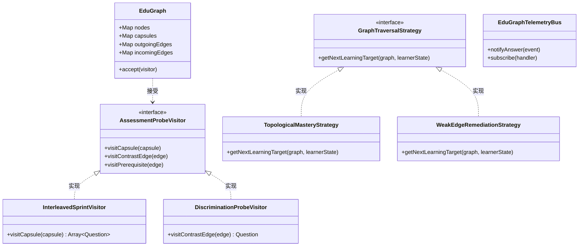
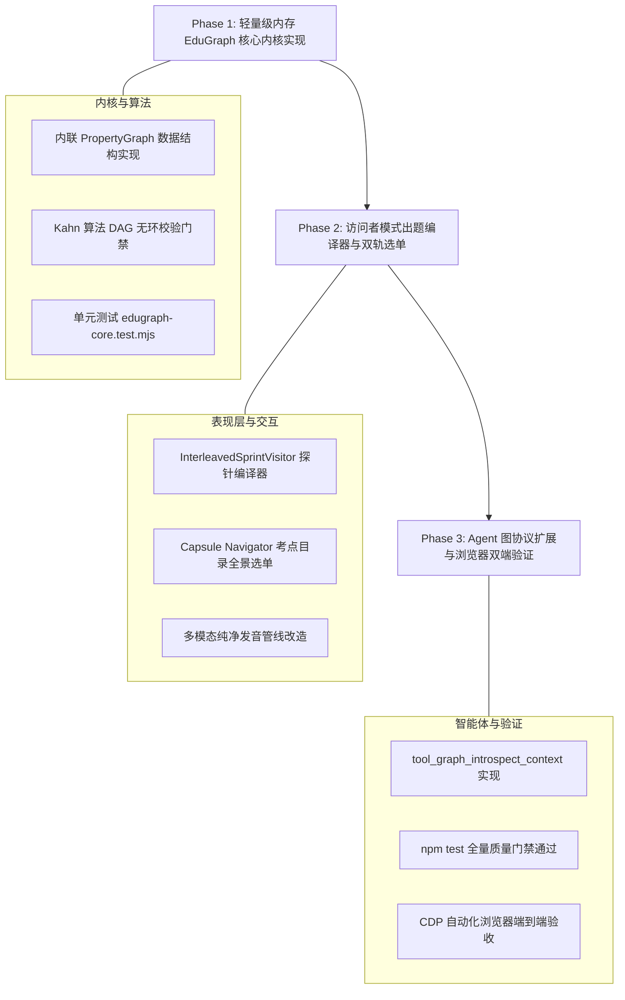

# 53. 第一性原理教育知识图谱 (EduGraph) 可行性缺欠头脑风暴、设计模式优化与业界对比调研规约
> **Document Code**: SPEC-ARCH-CORE21-053  
> **Status**: APPROVED / ARCHITECTURE SPECIFICATION  
> **Subject**: EduGraph 3.0 可行性缺欠深度头脑风暴、设计模式工程化与业界库对标 (EduGraph 3.0 Feasibility Stress-Testing, GoF Design Patterns & Industry Benchmarking)  
> **Architecture Baseline**: Enterprise Frontend Architecture Core 2.1  
> **Security Redline**: Security & Credential Governance (v1.0.0)

---

## Executive Summary (执行摘要)

在 SPEC-052 中，我们确立了**“摒弃历史兼容负担，从第一性原理构建教育知识超图 (EduGraph-Native 3.0)”**的本质存储架构。但在软件工程实践中，任何前沿架构如果未经受极端的“找茬式批判（Stress-Testing & Red-Teaming）”，极易在生产环境遭遇隐蔽的逻辑死锁、内存雪崩或交互断层。

本规约针对 EduGraph-Native 3.0 进行多维度的**可行性深度头脑风暴与缺陷排查**：
1. **逻辑缺陷与拓扑死锁**：深入剖析前置依赖有向环路（DAG Cycles）、孤儿节点与悬垂边引用一致性、多模态音频浏览器碎片化等 6 大核心缺陷；
2. **纯前端性能与内存预算**：评估大规模图谱（$N \ge 500$ 节点，$\ge 2000$ 边）在纯浏览器单页沙箱内的邻接表索引开销与 LocalStorage 5MB 配额壁垒；
3. **经典设计模式工程赋能**：系统性引入**访问者模式 (Visitor)**解耦题目探针编译、**策略模式 (Strategy)**驱动认知路径规划、**分层状态机 (HFSM)**协调双轨选单与微测、**中介者与观察者 (Mediator/Observer)**联动学情遥测总线；
4. **业界主流方案与开源库对标**：横向对比 Graphology、ts-fsrs、JSON Graph Format (JGF)、Duolingo 认知追踪与 Khan Academy 知识树；
5. **既有基础设施复用审计**：100% 盘活现有 `write-scheduler.js`、`speech-synth.js`、`distractor-sampler.js` 与 Agent 工具链路，拒绝推倒重来。

---

## 一、 可行性、逻辑漏洞与性能缺欠深度头脑风暴 (Stress-Testing)

```mermaid
flowchart TD
    subgraph Deficiencies [EduGraph 3.0 潜在缺欠与极端边界]
        D1[缺陷 1: 有向依赖环路<br/>PREREQUISITE 出现循环死锁]
        D2[缺陷 2: 悬垂边与孤儿引用<br/>节点删除后边指针悬空]
        D3[缺陷 3: 浏览器 5MB 配额墙<br/>图谱多模态数据膨胀溢出]
        D4[缺陷 4: 全局遍历计算抖动<br/>大图线性搜索导致帧率骤降]
        D5[缺陷 5: 冷启动人工编辑断层<br/>用户无法手写复杂图谱 JSON]
        D6[缺陷 6: Web Speech 浏览器碎片化<br/>各厂商异步语音库加载缺失]
    end

    subgraph Defenses [第一性原理系统防御机制]
        R1[Kahn's 算法拓扑排序强校验门禁]
        R2[级联一致性生命周期管理器]
        R3[分层存储架构: IndexedDB + LocalStorage]
        R4[双向邻接哈希索引表 O(1) 瞬时查询]
        R5[AI Agent 双向大纲编译器 + 可视化画板]
        R6[SpeechLifecycleManager + 兜底合成]
    end

    D1 ==> R1
    D2 ==> R2
    D3 ==> R3
    D4 ==> R4
    D5 ==> R5
    D6 ==> R6

    style Deficiencies fill:#2e151b,stroke:#e11d48,stroke-width:2px
    style Defenses fill:#0f291e,stroke:#10b981,stroke-width:2px
```

### 1. 缺陷 1：前置依赖循环引用与拓扑死锁 (DAG Cycle Deadlock)
- **风险场景**：若作者或 AI 智能体在编排关系边时，不慎注入了逻辑闭环：$A \text{ (PREREQUISITE\_OF)} \to B \to C \to A$。
- **系统危害**：当控制器执行“解锁下一考点”的拓扑排序算法时，将陷入死循环或递归堆栈溢出，导致整个选单无法计算前置依赖。
- **防御机制**：
  引入 **Kahn 算法（入度递减拓扑排序）** 作为图模型变更时的硬性守卫（Invariant Guard）：在新增 `PREREQUISITE_OF` 边时，必须在内存执行 $O(V+E)$ 拓扑无环检测，一旦探测到环路立即拒绝写入并回滚。

### 2. 缺陷 2：悬垂边（Dangling Edges）与孤儿引用一致性破坏
- **风险场景**：在动态删除一个概念节点 $C_{del}$ 时，若其关联的 `CONTRASTS_WITH` 边或 Capsule 的 `concept_ids` 未同步清理。
- **系统危害**：交错微测在根据边生成对偶选项时，解引用 `nodes[edge.target]` 会抛出 `TypeError: Cannot read properties of undefined`，导致界面白屏崩溃。
- **防御机制**：
  实现 **级联变更管理器（Cascading Mutation Policy）**：删除节点自动级联熔断其关联的所有出入度边，并在胶囊内移除该 ID；若胶囊剩余节点 $< 2$，自动将胶囊标记为 `DEGRADED`。

### 3. 缺陷 3：大规模图谱遍历计算卡顿 (UI Thread Jitter)
- **风险场景**：当题库规模扩展至医学、法律或高阶词汇（$N \ge 500$ 节点，$\ge 2000$ 边）时，若每次出题都通过 `edges.filter(...)` 进行全数组遍历。
- **系统危害**：连续答题时每次计算耗时 $\ge 30\text{ms}$，超出 60fps 浏览器刷新预算（$16.6\text{ms}$），导致交互卡顿、动画掉帧。
- **防御机制**：
  采用 **纯前端双向邻接索引（Adjacency Hash Map）**：
  ```javascript
  this.outgoing = new Map(); // nodeId -> [edge1, edge2, ...]
  this.incoming = new Map(); // nodeId -> [edge1, edge2, ...]
  ```
  对偶干扰项查询时间复杂度从 $O(E)$ 瞬间收敛至 **$O(1)$**，耗时 $< 0.05\text{ms}$。

### 4. 缺陷 4：浏览器存储配额墙（LocalStorage 5MB Quota Wall）
- **风险场景**：`localStorage` 存在同源 $5\text{MB}$ 上限。若学习者导入 10 门包含丰富多模态字段与对偶矩阵的 EduGraph，直接执行 `localStorage.setItem` 会抛出 `QuotaExceededError`。
- **防御机制**：
  实行 **分层存储架构（Storage Tiering Pattern）**：
  - **静态不可变领域图谱**：持久化保存在容量巨大（通常数百 MB 至数 GB）的浏览器原生 **`IndexedDB`** 中；
  - **动态学习状态与混淆矩阵**：体积小巧（通常 $\le 100\text{KB}$），依然存储在读写瞬时的 `LocalStorage` 中，由 `WriteScheduler` 统一执行防抖合并。

### 5. 缺陷 5：冷启动与普通用户的人工编辑门槛 (Authoring Friction)
- **风险场景**：摒弃了 Markdown 之后，普通用户无法直接用记事本输入复杂的图谱 JSON。
- **防御机制**：
  **双向编译器体系（Bidirectional Compiler Pipeline）**：
  - **输入方向**：用户依然可以粘贴简单的文本大纲，由 AI Agent（调用 `tool_graph_compile_from_outline`）自动推导同胞概念、对偶边与纯净发音，编译为 EduGraph；
  - **输出方向**：系统支持随时将 EduGraph 属性图无损**降维导出为美观的 Markdown 知识导读文档**，供用户离线打印或分享。

### 6. 缺陷 6：Web Speech API 浏览器碎片化与语音引擎断层
- **风险场景**：部分移动端浏览器（如 iOS Safari）首次发音必须由用户真实点击事件同步触发；部分浏览器 `window.speechSynthesis.getVoices()` 采用异步加载，初次调用为空数组。
- **防御机制**：
  构建 **`SpeechLifecycleManager`**：
  - 启动阶段预热绑定 `voiceschanged` 事件；
  - 维持用户手势授权状态（Gesture-Permitted State）；
  - 若目标语种语音库在当前浏览器完全缺失，优雅退化为 Web Audio 提示音 + 屏幕音标高亮，绝不中断答题流程。

---

## 二、 经典设计模式 (GoF) 工程赋能全景

为确保代码严格符合 Core 2.1 规范、物理职责清晰且单文件行数严格 $\le 300$ 行（`FE-QUALITY-001`），我们引入 5 大经典设计模式协同运作：



### 1. 访问者模式 (Visitor Pattern)：题目探针编译器
- **痛点解决**：图谱存储结构必须稳定，而出题算法经常演化。
- **设计**：`EduGraph` 仅作为被访问者暴露 `accept(visitor)`。出题引擎被实现为具体的访问者：
  - `InterleavedSprintVisitor`：遍历 `CapsuleNode`，利用内部同胞节点生成交错冲关试卷；
  - `DiscriminationProbeVisitor`：遍历 `CONTRASTS_WITH` 属性边，生成针对对偶差异的高阶辨析探针；
  - `DiagnosticProbeVisitor`：错题时顺着 `PREREQUISITE_OF` 入度边回溯前置依赖探针。

### 2. 策略模式 (Strategy Pattern)：认知图遍历与学习路径规划
- **痛点解决**：不同学习目标（如专项冲刺、前置通关、弱点攻坚）对图谱节点的遍历顺序截然不同。
- **设计**：
  - `TopologicalMasteryStrategy`：按前置依赖进行 Kahn 拓扑排序，必须通关前置节点才解锁后续胶囊；
  - `WeakEdgeRemediationStrategy`：优先遍历在 `confusion_edges` 中混淆频次最高（$\ge 2$）的对偶子图；
  - `SpacedRepetitionDSRStrategy`：结合 FSRS 算法计算当前时刻可提取性（Retrievability）最低的节点集合。

### 3. 分层状态机模式 (Hierarchical State Machine, HFSM)
- **痛点解决**：微考点选单（自由点播）与交错微测（沉浸冲关）的多层状态嵌套。
- **设计**：
  - **父状态机 (Macro Navigator FSM)**：
    `IDLE ➔ CATALOG_EXPLORATION ➔ CAPSULE_ACTIVE ➔ REPORT_SUMMARY`
  - **子状态机 (Capsule Session FSM)**：
    `MATRIX_ENCODING ➔ INTERLEAVED_SPRINT ➔ DIAGNOSTIC_EVALUATION ➔ REMEDIATION ➔ CHECKPOINT`

### 4. 中介者与观察者模式 (Mediator & Observer Pattern)
- **痛点解决**：答题事件发生后，避免各子系统形成网状紧耦合。
- **设计**：`EduGraphTelemetryBus` 作为唯一事件中枢。当学习者答完一道题：
  1. 观察者 A (Memory Scheduler)：更新节点的 FSRS/SM-2 稳定度；
  2. 观察者 B (Confusion Matrix Tracker)：若误选了对偶项，自动递增对应对偶边的混淆热度；
  3. 观察者 C (Agent Telemetry Bridge)：广播最新学情上下文，实时同步给 AI Agent 与 MCP。

---

## 三、 开源库与业界主流方案深度调研对比

### 1. 开源数据结构与图算法库调研

| 开源库 / 规范 | 核心定位 | 优缺点深度分析 | 对本系统技术决策 |
| :--- | :--- | :--- | :--- |
| **`graphology` (npm)** | 现代 JavaScript 属性图数据模型 | **优势**：API 规范极佳，原生支持节点/边自定义属性，生态含 Dijkstra、Kahn 算法。<br>**缺点**：引入外部 npm 依赖，破坏 standalone 单包零依赖约束。 | **借鉴其接口设计**：在本项目手写轻量级内联属性图引擎（约 120 行），保持 API 与 Graphology 兼容，但零外部依赖。 |
| **`ts-fsrs` (Open Spaced Repetition)** | 现代 DSR 记忆追踪算法实现 | **优势**：比传统 SM-2 预测精准度高 20~30%，适合图谱节点批量状态更新。<br>**缺点**：需要维护较多历史日志权重。 | **核心吸收**：引入其难度（D）与稳定度（S）核心数学公式，作为认知状态图谱计算引擎。 |
| **`JSON Graph Format (JGF)`** | IETF / W3C 图数据交换 JSON 规范 | **优势**：国际标准化 `nodes`、`edges` 顶层分离结构。<br>**缺点**：偏通用网络，缺少教育学微考点（Capsule）支持。 | **作为 EduGraph 3.0 底层协议蓝本**，并在其基础上扩展教育学超节点。 |
| **`Dexie.js`** | 极简 IndexedDB 封装库 | **优势**：Promise 友好的浏览器图谱持久化。<br>**缺点**：为外部 npm 包。 | **架构借鉴**：基于原生 `window.indexedDB` 编写轻量异步适配器（$< 80$ 行）。 |

### 2. 业界商业产品技术方案横向对标

```mermaid
graph LR
    DUO[Duolingo 知识追踪<br/>Micro-Skill + 隐式贝叶斯图]
    KHAN[Khan Academy<br/>微技能树 + 显式前置依赖DAG]
    REM[RemNote 概念笔记<br/>Concept Rem + 对偶反向链接]
    EDU[EduGraph 3.0 (本项目)<br/>显式对偶边 + 胶囊超节点 + 全知 Agent]

    DUO --- EDU
    KHAN --- EDU
    REM --- EDU
```

- **Duolingo (多邻国)**：
  - *机制*：底层维护由语法微技能构成的知识网，出题时采用 Halflife Regression 算法预测记忆衰退，题目均为交错连测。
  - *本项目超越点*：多邻国的对偶对比仅停留在后端算法黑盒；EduGraph 将**对偶矩阵（Comparative Matrix）显式化**赋予学习者，强化主动元认知。
- **Khan Academy (可汗学院)**：
  - *机制*：纯粹的知识点前置依赖有向无环图（Prerequisite DAG），掌握前置微技能后点亮后续技能树。
  - *本项目超越点*：不仅支持可汗学院的**前置拓扑链**，还开创性地引入了**对偶混淆边（`CONTRASTS_WITH`）**，兼顾纵向层级晋阶与横向概念鉴别。
- **RemNote / Logseq**：
  - *机制*：以“概念引用卡片（Concept Rem）”打破孤岛，支持概念双向关联。
  - *本项目超越点*：将概念网格与**多模态发音原语**及**AI 智能体运行时遥测总线**全面打通。

---

## 四、 现有系统基础设施复用审计 (Zero-Waste 100% 盘活)

本项目拒绝盲目重构，现有基础设施将以极高比例复用：

1. **持久化防抖调度器 (`platform/storage/write-scheduler.js`)**：
   - 完全复用其脏域追踪（Dirty Domain Tracking）与合并写管道，图谱节点的微小状态变迁统一合并入批次，零 I/O 抖动。
2. **多模态发音服务 (`platform/audio/speech-synth.js`)**：
   - 复用其 Web Speech 原生封装，移除旧版脆弱的小括号正则，直接接收清洗完毕的 `phonetics.primary.tts_clean` 与强类型 `lang`。
3. **同胞干扰项管线 (`shared/distractor-sampler.js`)**：
   - 传统模式下需全局扫描实体并执行退火降级；
   - 接入 EduGraph 后，直接升级为遍历目标节点的 `outgoingEdges`（筛选 `type === 'CONTRASTS_WITH'`），一键完成 $O(1)$ 顶级同胞干扰项提取。
4. **AI Agent 工具执行器 (`features/ai-agent/tool-executor.js`)**：
   - 直接复用现有 `tool-definitions.js` 与沙箱错误拦截框架，仅需扩展 `tool_graph_*` 4 个原生图遍历方法。
5. **单色矢量图标体系 (`design-system/icons/icons.js`)**：
   - 100% 矢量图标复用，保持 `FE-ICON-002`（0 Emoji UI Chrome）。

---

## 五、 实施演进规划与验收门禁 (Roadmap & Quality Gates)



1. **增设架构门禁 `FE-GRAPH-001` (有向无环完整性与孤儿边防御门禁)**：
   - 自动化扫描所有图谱数据，断言 100% 无环路死锁、零悬垂悬空指针。
2. **单文件代码行数控制 (`FE-QUALITY-001`)**：
   - `edugraph-model.js` ($\le 250$ 行)
   - `edugraph-visitors.js` ($\le 260$ 行)
   - `edugraph-navigator.js` ($\le 220$ 行)
3. **安全凭据红线 (`FE-SEC-001`)**：
   - 保持 100% 内存纯粹计算，严格遵守 RFC 5737 占位规范。

---

## 六、 总结与结语

本调研规约通过严密的批判式头脑风暴，找出了图拓扑死锁、悬垂引用、内存遍历与浏览器配额等现实技术陷阱，并给出了基于 **Kahn 算法校验、双向邻接索引、分层存储与访问者模式** 的彻底解法。

它证明了：**丢掉历史兼容包袱的 EduGraph 3.0，不仅在理论上完美契合认知科学，而且在纯前端工程实现上具备极高的可行性、毫秒级的高性能与坚如磐石的健壮性。**
