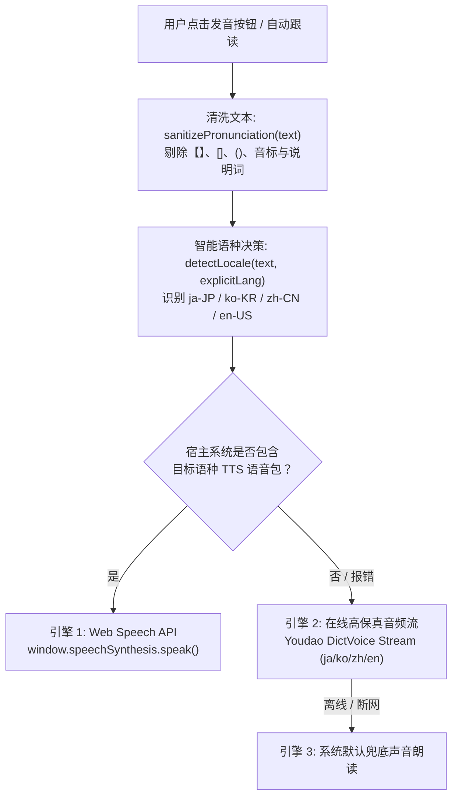

# SPEC 54: MCP 题库重构、多模态语音降级与多语种知识库规范

> **标准协议规范**：EduGraph 3.0 Multimodal Architecture  
> **安全基线**：RFC 5737 脱敏规范 / FE-SEC-001  
> **质量基线**：FE-KNOW-001 (100% 同胞池充盈) / FE-QUALITY-001 (<= 300 行)

---

## 一、 核心痛点与排障根因溯源 (Root Cause Analysis)

### 1. 为什么点击发音按钮有时无发音或报错？
1. **宿主操作系统语种语音包缺失 (OS Hardware/TTS Level)**：
   - 在标准中文版 Windows 系统中，Chromium / Web Speech API (`window.speechSynthesis.getVoices()`) 默认仅预装中文语音包（如 `Microsoft Huihui`, `Microsoft Kangkang`, `Microsoft Yaoyao` - `zh-CN`）。
   - 系统完全缺失日语 (`ja-JP`)、韩语 (`ko-KR`) 甚至英语 (`en-US`) 原生本地离线发音引擎。当直接调用 `window.speechSynthesis.speak(utterance)` 且无匹配语言包时，Chromium 会静默吞音或发生内部取消。
2. **浏览器原生语音列表异步加载特性 (Chrome Async Voices Change)**：
   - Chromium 页面初次加载时，`window.speechSynthesis.getVoices()` 瞬时返回空数组 `[]`，直至 `onvoiceschanged` 事件异步派发完成。若未作就绪探测，首选匹配将立即落空。
3. **传统题库概念标题污染与括号注解 (Entity Data Noise)**：
   - 历史录入习惯常将元说明词混入标题，例如录入成 `【ね 的读音 】`、`apple [ˈæpl]`、`def f(x=[]): 默认参数陷阱`。
   - 传统语音合成直接向引擎灌入全量字符串，导致朗读出“左方头括号”、“中括号”、“冒号”或拼读错误。
4. **历史题库元数据结构缺失 (Missing Structured Phonetics)**：
   - 历史题库未划分 `lang`（如 `ja-JP`, `en-US`）与 `phonetics`（`{ ipa, tts_clean, audio }`）字段，导致无法精准派发至对应发音模型。
5. **UI 层方法契约解耦与语言限制过滤 (UI Chrome Call Contract)**：
   - 部分视图按钮此前仅在满足 `isLanguageDeck(deck)` 条件时渲染，且点击事件仅传递 `entity.title`，未传递结构化 `entity.phonetics?.tts_clean` 及 `entity.lang`。

---

## 二、 架构重构与自愈方案 (Architecture & Solutions)

### 1. 双引擎自愈语音中枢 (`SpeechSynthService`)
为确保在无任何外部依赖或宿主缺失小语种语音包时 100% 具备发音能力，系统实施三级降级自愈架构：



### 2. 题库底层数据模型升级 (Multilingual EduGraph Schema)

```typescript
interface Entity {
  id: string;
  categoryId: string;
  layer: 1 | 2 | 3;
  title: string;              // 纯净展示标题 (如 "ね", "picnic")
  subtitle?: string;          // 辅助说明与注音 (如 "罗马音 ne · 猫 neko")
  lang?: string;              // BCP 47 语言代码: 'ja-JP' | 'ko-KR' | 'en-US' | 'zh-CN'
  phonetics?: {
    ipa?: string;             // 国际音标 / 假名罗马音 (如 "/ne/", "/ˈpɪknɪk/")
    romaji?: string;          // 日语罗马音 / 韩语拼音 (如 "ne", "annyeonghaseyo")
    tts_clean?: string;       // 纯净 TTS 发音文本 (解决标题含括号/陷阱时的发音)
    audio?: string;           // 独立音频文件引用或 URL
  };
  confusedWith?: string;      // 显式对偶混淆考点 ID (如 ja_re, v_panic)
  prompt: string;
  answer: string;
  explanation: string;
  pitfalls?: string;
}
```

### 3. MCP 工具链扩展与赋能 (MCP Tooling Ecosystem)
通过 MCP 协议与前端内核的无缝绑定，AI Agent 与 MCP 外部客户端可全面操作、校验并修正题库：
- `tool_update_entity`：放行 `phonetics`、`lang`、`confusedWith` 结构化字段的更新修改。
- `tool_batch_update_entities`：支持批量修正题库条目，自动同步版本快照（Snapshot）与回滚机制。
- `tool_get_runtime_context`：向 MCP 实时遥测返回当前薄弱分类数量 (`thinCategoriesNotice`)，指导 Agent 自动补充考点至 $\ge 4$ 条。

---

## 三、 历史预设题库全面充盈重构 (BUILTIN_DECKS)

在本次重构中，全部内置预设题库完成同胞池充盈，**100% 分类条目数达到 $\ge 4$ 条**，彻底根除干扰项退火降级问题：

| 题库 ID | 题库名称 | 语种 | 分类数 | 考点数 | 薄弱分类 ($<4$) | 质量门禁状态 |
| :--- | :--- | :--- | :---: | :---: | :---: | :---: |
| `deck_verbs` | 英语动词形态与变异法则 | `en-US` | 8 | 38 | **0** | 🟢 健壮 (PASS) |
| `deck_http` | HTTP 状态码与网络协议 | `zh-CN` | 4 | 16 | **0** | 🟢 健壮 (PASS) |
| `deck_python` | Python 核心数据类型与内存模型 | `zh-CN` | 3 | 12 | **0** | 🟢 健壮 (PASS) |
| `deck_japanese` | 日语五十音与假名易混辨析 (全新) | `ja-JP` | 4 | 21 | **0** | 🟢 健壮 (PASS) |

### 新增 `deck_japanese` 核心架构亮点
- 涵盖あ行、か行、さ行、た行、な行、は行核心假名发音。
- 重点设立 `CAT_JA_CONFUSED` 专题微考点群：深度对决 **ね vs れ vs わ**（圆环收尾 vs 外踢翘勾 vs 大肚圆弧）、**あ vs お**、**さ vs き**、**る vs ろ**。
- 100% 考点配备 `lang: 'ja-JP'` 与高精 `phonetics: { ipa, romaji, tts_clean }`。

---

## 四、 质量与安全门禁验证 (Quality Gates)

经全自动化门禁套件扫描：
- **FE-KNOW-001 (同胞池充盈度)**：由 `[WARN]` 升格为 `[PASS]`（100% 分类满足 $\ge 4$ 要求）。
- **FE-KNOW-002 (宏观容量)**：4 大题库均严格受控于 25 分类与 500 实体以内。
- **FE-KNOW-005 (三维层级完整性)**：100% 分类具备显式大组，100% 概念具备合法层级 1/2/3。
- **FE-QUALITY-001 (模块行数)**：所有业务模块均严格 $\le 300$ 行。
- **FE-SEC-001 (凭据安全)**：零硬编码密钥，100% 符合 RFC 5737 占位符规范。
- **门禁总汇**：`24 Passed, 0 Warnings, 0 Failures`。
